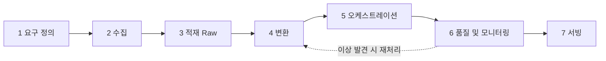

# 데이터 파이프라인 구축 과정

외부·내부 소스에서 데이터를 모아 분석이나 서비스가 쓸 수 있는 형태로 꾸준히 공급하는 파이프라인을 만들 때, 보통 거치는 순서다.

## 전체 흐름 { #overview }

순서대로 한 번에 끝나는 일은 드물다. 서빙 단계에서 쓰는 사람이 생기면 요구가 다시 바뀌고, 품질 검사에서 걸린 문제는 변환이나 수집으로 되돌아간다. 처음에는 작은 소스 하나로 1~7단계를 끝까지 한 바퀴 돌려 보고 넓히는 편이 안전하다.

## 1단계. 요구 정의 { #step-1-requirements }

**목적**: 누가 어떤 데이터를 얼마나 자주, 어떤 형태로 받아야 하는지 정한다. 이게 흐리면 이후 모든 단계의 선택 기준이 사라진다.

**하는 일**

- 소비자(분석가, 대시보드, 서비스 API, 모델 학습)와 그들이 던질 질문을 적는다
- 소스 목록과 접근 방식(API, DB, 파일, 웹 페이지)을 조사한다
- 신선도(freshness) 요구와 데이터 양·증가 속도를 정한다
- 보존 기간, 개인정보 포함 여부, 재처리 가능 범위를 정한다

**흔한 선택지**

| 선택 | 언제 고르나 |
|------|-------------|
| 배치 (일·시간 단위) | 대부분의 분석, 리포트. 운영이 단순하다 |
| 마이크로 배치 | 수 분 단위 신선도가 필요하지만 스트리밍 운영 부담은 피하고 싶을 때 |
| 스트리밍 | 이벤트가 끊임없이 들어오고 초 단위 반응이 필요할 때 |

**흔한 실수**

- "일단 다 모으자"로 시작해 쓰지 않는 데이터만 쌓인다
- 신선도를 과하게 잡아 필요 없는 스트리밍 인프라를 운영한다
- 소스의 변경 주기와 이용 약관(수집 허용 범위)을 확인하지 않는다

**관련 기술 노트**: [ETL · ELT · 계층](../stack/modeling/etl-elt-layers.md)

**관련 내 프로젝트**

- 데이터 수집 API · ETL 파이프라인 <!-- PROJECT-LINK: [데이터 수집 API · ETL 파이프라인](../projects/douzone-scraping-etl.md) -->
- 외부 소스 수집 워크플로우 (서브 프로젝트) <!-- PROJECT-LINK: [외부 소스 수집 워크플로우 (서브 프로젝트)](../projects/douzone-external-sources.md) -->

## 2단계. 수집 { #step-2-ingestion }

**목적**: 소스에서 데이터를 빠짐없이, 중복 없이, 소스에 부담을 주지 않고 가져온다.

**하는 일**

- 전체(full) 수집과 증분(incremental) 수집 기준을 정한다: 수정 시각, 증가하는 ID, 변경 로그
- 웹 페이지는 정적 HTML이면 requests + 파서, 동적 렌더링이면 브라우저 자동화로 가져온다
- 요청 속도 제한, 재시도, 타임아웃을 넣고 수집 시각·소스 식별자를 남긴다

**흔한 선택지**

| 선택 | 언제 고르나 |
|------|-------------|
| 공식 API | 제공되면 우선. 구조가 안정적이다 |
| Scrapy | 페이지가 많고 정적인 사이트를 대량 크롤링할 때 |
| Selenium·Playwright | JavaScript로 그려지는 페이지 |
| Kafka | 이벤트 로그처럼 계속 흘러오는 데이터, 여러 소비자가 같은 흐름을 읽을 때 |
| RabbitMQ + Redis | 수집 작업 요청을 큐로 나누고 중복 요청은 캐시로 걸러낼 때 |

**흔한 실수**

- 증분 기준 없이 매번 전체를 다시 긁어 소스와 저장소 모두에 부담을 준다
- 실패한 요청을 조용히 건너뛰어 누락을 모른다
- 페이지 구조 변경에 대비한 알림이 없다

**관련 기술 노트**: [스크래핑](../stack/ingestion/scraping.md), [Kafka](../stack/processing/kafka.md), [RabbitMQ · Redis](../stack/messaging/rabbitmq-redis.md)

**관련 내 프로젝트**

- 데이터 수집 API · ETL 파이프라인 <!-- PROJECT-LINK: [데이터 수집 API · ETL 파이프라인](../projects/douzone-scraping-etl.md) -->
- Scrapy 기반 데이터 수집 Pipeline <!-- PROJECT-LINK: [Scrapy 기반 데이터 수집 Pipeline](../projects/personal-scrapy-books.md) -->

## 3단계. 적재 (Raw) { #step-3-raw }

**목적**: 가져온 데이터를 원본 그대로 먼저 저장해, 변환 로직이 바뀌어도 다시 수집하지 않고 재처리할 수 있게 한다.

**하는 일**

- 원본 형태(JSON, HTML, CSV)를 손대지 않고 저장한다
- 날짜·소스 기준으로 경로나 파티션을 나눈다
- 같은 배치를 두 번 넣어도 결과가 같도록(멱등) 덮어쓰기 단위를 정한다

**흔한 선택지**

| 선택 | 언제 고르나 |
|------|-------------|
| S3 등 오브젝트 스토리지 + Parquet | 양이 많고 Spark·Hive로 다시 읽을 때 |
| PostgreSQL raw 스키마 | 양이 적당하고 이후 변환을 SQL로 할 때 |
| MongoDB | 소스마다 필드가 제각각인 문서형 데이터 |

**흔한 실수**

- 수집하면서 바로 정제해 원본이 남지 않는다
- append만 해서 재실행할 때마다 중복이 생긴다

**관련 기술 노트**: [S3 · Hive · Parquet](../stack/storage/s3-hive-parquet.md), [PostgreSQL](../stack/storage/postgresql.md), [MongoDB](../stack/storage/mongodb.md)

**관련 내 프로젝트**

- DW 기반 이벤트 로그 ELT Pipeline <!-- PROJECT-LINK: [DW 기반 이벤트 로그 ELT Pipeline](../projects/personal-dw-elt.md) -->
- Backpacker Spark 배치 <!-- PROJECT-LINK: [Backpacker Spark 배치](../projects/personal-backpacker-spark.md) -->

## 4단계. 변환 { #step-4-transform }

**목적**: 원본을 정제·통합·집계해 소비자가 바로 쓸 수 있는 테이블로 만든다.

**하는 일**

- 타입 변환, 결측·이상값 처리, 중복 제거
- 소스 간 코드·이름을 매핑해 하나의 기준으로 맞춘다
- Staging(정제) → Marts(분석용) 순서로 계층을 나눈다
- 텍스트 데이터면 정규화, 형태소 분석 같은 전처리를 이 단계에 둔다

**흔한 선택지**

| 선택 | 언제 고르나 |
|------|-------------|
| SQL (DB 안에서 변환, ELT) | 데이터가 DB에 이미 있고 양이 DB로 감당될 때 |
| Pandas | 한 대 메모리에 들어가는 크기, 빠른 개발 |
| Spark | 한 대로 감당이 안 되는 양, 분산 처리 필요 |

**흔한 실수**

- 변환 로직이 여러 스크립트에 흩어져 같은 지표가 다르게 계산된다
- 중간 결과를 남기지 않아 어디서 값이 틀어졌는지 추적하지 못한다
- 작은 데이터에 Spark를 써서 오히려 느리고 복잡해진다

**관련 기술 노트**: [Spark](../stack/processing/spark.md), [ETL · ELT · 계층](../stack/modeling/etl-elt-layers.md)

**관련 내 프로젝트**

- DW 기반 이벤트 로그 ELT Pipeline <!-- PROJECT-LINK: [DW 기반 이벤트 로그 ELT Pipeline](../projects/personal-dw-elt.md) -->
- NLP 기반 한국어 텍스트 처리 Pipeline <!-- PROJECT-LINK: [NLP 기반 한국어 텍스트 처리 Pipeline](../projects/personal-nlp-korean.md) -->
- Backpacker Spark 배치 <!-- PROJECT-LINK: [Backpacker Spark 배치](../projects/personal-backpacker-spark.md) -->

## 5단계. 오케스트레이션 { #step-5-orchestration }

**목적**: 수집·적재·변환을 정해진 순서와 주기로 자동 실행하고, 실패를 다시 돌릴 수 있게 한다.

**하는 일**

- 작업 간 의존성을 DAG로 표현한다
- 스케줄과 처리 구간(data interval)을 정해 증분 범위를 자동으로 넘긴다
- 재시도 횟수, 타임아웃, 실패 알림을 설정한다
- 과거 구간 재처리(backfill)가 되도록 작업을 멱등하게 만든다
- 실행 환경을 Docker 이미지로 고정하고, 규모가 크면 Kubernetes에서 작업별 Pod로 띄운다

**흔한 선택지**

| 선택 | 언제 고르나 |
|------|-------------|
| cron | 작업 한두 개, 의존성 없음 |
| Airflow | 의존성 있는 작업 여러 개, 재시도·backfill·실행 이력이 필요할 때 |
| Airflow + KubernetesExecutor | 작업마다 필요한 자원이 다르고 클러스터가 이미 있을 때 |

**흔한 실수**

- 실행 시각(`now()`)을 기준으로 데이터를 골라 재실행 결과가 달라진다
- 실패 알림이 없어 며칠 뒤에야 누락을 안다

**관련 기술 노트**: [Airflow](../stack/orchestration/airflow.md), [Docker](../stack/infra/docker.md), [Kubernetes](../stack/infra/kubernetes.md)

**관련 내 프로젝트**

- 데이터 수집 API · ETL 파이프라인 <!-- PROJECT-LINK: [데이터 수집 API · ETL 파이프라인](../projects/douzone-scraping-etl.md) -->
- 외부 소스 수집 워크플로우 (서브 프로젝트) <!-- PROJECT-LINK: [외부 소스 수집 워크플로우 (서브 프로젝트)](../projects/douzone-external-sources.md) -->

## 6단계. 품질 · 모니터링 { #step-6-quality }

**목적**: 파이프라인이 "돌았다"가 아니라 "맞는 데이터를 냈다"를 확인하고, 이상을 사람보다 먼저 알아챈다.

**하는 일**

- 건수, null 비율, 키 중복, 값 범위 같은 기본 검사를 적재 직후 실행한다
- 전일 대비 건수 급감·급증을 감지한다
- 실행 시간, 실패율, 지연을 대시보드로 본다
- 검사 실패 시 다음 단계를 멈추고 알림을 보낸다

**흔한 선택지**

| 선택 | 언제 고르나 |
|------|-------------|
| SQL 검사 태스크 | 검사 항목이 적고 DAG 안에 바로 넣고 싶을 때 |
| Kibana 대시보드 | 로그·지표가 Elasticsearch에 쌓일 때 |

**흔한 실수**

- 실패만 감시하고 "성공했지만 0건"은 놓친다
- 검사가 실패해도 다음 단계가 그대로 진행된다

**관련 기술 노트**: [Kibana](../stack/infra/kibana.md), [Airflow](../stack/orchestration/airflow.md)

**관련 내 프로젝트**: 데이터 수집 · 감성 분석 대시보드 운영 <!-- PROJECT-LINK: [데이터 수집 · 감성 분석 대시보드 운영](../projects/douzone-sentiment-dashboard.md) -->

## 7단계. 서빙 { #step-7-serving }

**목적**: 만든 데이터를 소비자가 쓰는 방식(API, 대시보드, 서비스 DB)으로 내보낸다.

**하는 일**

- 소비 방식에 맞춰 조회 API, 대시보드, 서비스 DB 적재 중 하나를 고른다
- 자주 쓰는 조회는 인덱스나 캐시를 두고, 데이터 기준 시각을 함께 보여준다
- 응답 스키마를 문서화하고 버전을 관리한다

**흔한 선택지**

| 선택 | 언제 고르나 |
|------|-------------|
| FastAPI 조회 API | 다른 서비스가 프로그램으로 가져갈 때 |
| Kibana·BI 대시보드 | 사람이 지표를 눈으로 볼 때 |
| 서비스 DB에 직접 적재 | 기존 서비스 화면이 그 DB를 읽을 때 |

**흔한 실수**

- 분석용 테이블을 서비스가 직접 읽게 해 변환 작업과 조회가 서로 막힌다
- 데이터가 언제 기준인지 표시하지 않아 오래된 값을 최신으로 오해한다

**관련 기술 노트**: [FastAPI · Django](../stack/serving/fastapi-django.md), [Kibana](../stack/infra/kibana.md)

**관련 내 프로젝트**

- 데이터 수집 API · ETL 파이프라인 <!-- PROJECT-LINK: [데이터 수집 API · ETL 파이프라인](../projects/douzone-scraping-etl.md) -->
- 해외 법령 적재 · DB 관리 <!-- PROJECT-LINK: [해외 법령 적재 · DB 관리](../projects/douzone-foreign-law.md) -->

## 체크리스트 { #checklist }

- [ ] 이 파이프라인의 소비자와 신선도 요구를 한 문장으로 말할 수 있다
- [ ] 배치, 마이크로 배치, 스트리밍 중 하나를 고른 이유를 설명할 수 있다
- [ ] 증분 수집 기준(수정 시각, ID, 변경 로그)을 정하고 그 한계를 안다
- [ ] 수집 실패와 누락을 어떻게 알아채는지 정해 두었다
- [ ] Raw 계층에 원본을 남기는 이유를 설명할 수 있다
- [ ] 같은 배치를 두 번 돌려도 결과가 같은지(멱등) 확인했고, backfill을 실제로 해 봤다
- [ ] Pandas, SQL, Spark 중 변환 도구를 데이터 양 기준으로 고를 수 있다
- [ ] Airflow DAG에서 처리 구간을 실행 시각이 아니라 data interval로 잡았다
- [ ] 건수·null·중복 검사가 실패하면 다음 단계가 멈춘다
- [ ] "성공했지만 0건"을 잡는 검사가 있다
