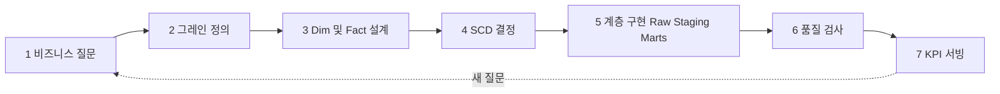

# DW 모델링 과정

분석용 데이터웨어하우스(DW)를 설계할 때 보통 거치는 순서다. 테이블부터 만들지 않고, 답할 질문에서 거꾸로 내려온다.

## 전체 흐름 { #overview }

1~4단계는 종이 위의 설계, 5~7단계는 구현과 운영이다. 설계 단계에서 그레인을 잘못 잡으면 구현 뒤에 고치기가 가장 비싸다.

## 1단계. 비즈니스 질문 { #step-1-questions }

**목적**: DW가 답해야 할 질문과 KPI를 먼저 고정한다. 질문이 모델의 범위와 상세 수준을 정한다.

**하는 일**

- "요금제별 월 매출", "국가별 주간 활성 사용자(WAU)"처럼 질문을 문장으로 적는다
- 각 KPI의 정의(분자, 분모, 기간, 제외 조건)를 합의한다
- 질문을 측정값(얼마나)과 관점(누구·무엇·언제·어디)으로 쪼갠다
- 필요한 소스 테이블·로그를 연결한다

**흔한 선택지**

| 선택 | 언제 고르나 |
|------|-------------|
| 질문 중심 설계 | 쓰는 사람이 정해져 있고 KPI가 명확할 때. 대부분 여기서 시작 |
| 소스 중심 설계 | 질문이 아직 없고 소스를 통합해 두는 게 우선일 때 |

**흔한 실수**

- "활성 사용자"처럼 정의가 사람마다 다른 지표를 합의 없이 만든다
- 질문 없이 소스 테이블을 그대로 복사해 놓고 DW라고 부른다

**관련 기술 노트**: [Dim · Fact · SCD](../stack/modeling/dim-fact-scd.md)

**관련 내 프로젝트**

- Backpacker Spark 배치 <!-- PROJECT-LINK: [Backpacker Spark 배치](../projects/personal-backpacker-spark.md) -->
- Smart Factory Data Agent <!-- PROJECT-LINK: [Smart Factory Data Agent](../projects/personal-smart-factory-agent.md) -->

## 2단계. 그레인 정의 { #step-2-grain }

**목적**: Fact 한 행이 무엇을 뜻하는지 한 문장으로 정한다. 모든 키와 측정값이 이 문장에 맞춰진다.

**하는 일**

- "이벤트 1건 = 1행", "사용자별 하루 = 1행"처럼 문장으로 쓴다
- 가능한 한 가장 상세한(원자) 수준으로 잡는다
- 그레인을 정하는 키 조합이 유일한지 확인한다
- 집계 테이블이 필요하면 원자 Fact 위에 따로 만든다

**흔한 선택지**

| 선택 | 언제 고르나 |
|------|-------------|
| Transaction fact (이벤트 1건) | 이벤트 로그, 주문처럼 건별로 발생하는 데이터 |
| Periodic snapshot (기간별 상태) | 일별 잔액, 일별 재고처럼 상태를 주기적으로 찍을 때 |
| Accumulating snapshot | 주문→결제→배송처럼 단계가 정해진 과정을 한 행에서 갱신할 때 |

**흔한 실수**

- 한 Fact에 건별 행과 일별 합계 행을 섞는다
- 처음부터 집계 수준으로 잡아 나중에 더 잘게 볼 수 없다

**관련 기술 노트**: [Dim · Fact · SCD](../stack/modeling/dim-fact-scd.md)

**관련 내 프로젝트**: DW 기반 이벤트 로그 ELT Pipeline <!-- PROJECT-LINK: [DW 기반 이벤트 로그 ELT Pipeline](../projects/personal-dw-elt.md) -->

## 3단계. Dim · Fact 설계 { #step-3-dim-fact }

**목적**: 측정값은 Fact에, 설명 속성은 Dim에 두어 집계 쿼리가 단순한 조인으로 끝나게 한다.

**하는 일**

- Fact에 측정값과 Dim 키만 남긴다
- Dim에 사용자·상품·날짜처럼 잘라 볼 관점의 속성을 모은다
- Dim에 surrogate key를 붙이고 소스의 natural key는 속성으로 둔다
- 날짜 Dim을 미리 만들어 요일·주차·월 같은 달력 속성을 한 곳에 둔다
- 여러 Fact가 같은 Dim을 공유하도록(conformed dimension) 맞춘다

**흔한 선택지**

| 선택 | 언제 고르나 |
|------|-------------|
| Star schema | 기본값. 조인 한 단계, 쿼리가 단순 |
| Snowflake schema | Dim이 매우 크고 계층 속성 중복이 부담일 때 |
| 넓은 단일 테이블 | BI 도구 하나가 읽고 변경이 거의 없을 때 |

**흔한 실수**

- Fact에 이름·주소 같은 설명 속성을 넣어 행이 불어난다
- natural key로 바로 조인해 이력 관리를 할 수 없게 된다

**관련 기술 노트**: [Dim · Fact · SCD](../stack/modeling/dim-fact-scd.md), [PostgreSQL](../stack/storage/postgresql.md)

**관련 내 프로젝트**: DW 기반 이벤트 로그 ELT Pipeline <!-- PROJECT-LINK: [DW 기반 이벤트 로그 ELT Pipeline](../projects/personal-dw-elt.md) -->

## 4단계. SCD 결정 { #step-4-scd }

**목적**: Dim 속성이 바뀔 때 과거 이벤트를 "그 당시 값"으로 볼지 "지금 값"으로 볼지 속성마다 정한다.

**하는 일**

- 바뀔 수 있는 속성(등급, 요금제, 소속, 주소)을 나열한다
- 속성마다 이력 필요 여부를 정한다
- 이력이 필요하면 `valid_from`, `valid_to`, `is_current` 컬럼을 둔다
- Fact 적재 때 이벤트 시각에 유효했던 Dim 행의 key를 매핑하는 규칙을 정한다

**흔한 선택지**

| 선택 | 언제 고르나 |
|------|-------------|
| Type 1 (덮어쓰기) | 오타 수정처럼 과거 값이 의미 없을 때 |
| Type 2 (새 행 추가) | 요금제별 매출처럼 당시 값 기준 집계가 필요할 때 |
| Type 3 (이전 값 컬럼) | 직전 값 하나만 비교하면 될 때 |

**흔한 실수**

- 모든 속성을 Type 2로 잡아 Dim 행이 쓸데없이 불어난다
- 유효기간 경계를 `<=`와 `<`로 섞어 한 이벤트가 두 행에 걸린다
- 늦게 도착한 변경(late-arriving)을 고려하지 않는다

**관련 기술 노트**: [Dim · Fact · SCD](../stack/modeling/dim-fact-scd.md)

**관련 내 프로젝트**: DW 기반 이벤트 로그 ELT Pipeline <!-- PROJECT-LINK: [DW 기반 이벤트 로그 ELT Pipeline](../projects/personal-dw-elt.md) -->

## 5단계. 계층 구현 (Raw · Staging · Marts) { #step-5-layers }

**목적**: 원본 보존, 정제, 분석 모델을 계층으로 나눠 각 단계를 따로 다시 만들 수 있게 한다.

**하는 일**

- Raw: 원본을 그대로 적재한다
- Staging: 타입·이름·중복을 정리하고 소스 간 기준을 맞춘다
- Marts: Dim·Fact와 KPI 집계 테이블을 만든다
- 각 계층을 스키마로 분리하고 Airflow DAG에서 순서대로 실행한다
- 적재를 멱등하게 만든다(구간 삭제 후 삽입, 또는 upsert)

**흔한 선택지**

| 선택 | 언제 고르나 |
|------|-------------|
| PostgreSQL 스키마 분리 | 데이터가 한 DB로 감당되는 규모 |
| S3 + Parquet + Hive 테이블 | 양이 크고 Spark로 처리할 때 |
| 전체 재생성 vs 증분 적재 | 작으면 전체 재생성이 단순, 크면 날짜 구간 증분 |

**흔한 실수**

- Marts가 Raw를 직접 읽어 정제 로직이 Marts마다 복사된다
- 재실행할 때마다 Fact 행이 중복으로 쌓인다

**관련 기술 노트**: [ETL · ELT · 계층](../stack/modeling/etl-elt-layers.md), [PostgreSQL](../stack/storage/postgresql.md), [S3 · Hive · Parquet](../stack/storage/s3-hive-parquet.md), [Airflow](../stack/orchestration/airflow.md)

**관련 내 프로젝트**

- DW 기반 이벤트 로그 ELT Pipeline <!-- PROJECT-LINK: [DW 기반 이벤트 로그 ELT Pipeline](../projects/personal-dw-elt.md) -->
- Backpacker Spark 배치 <!-- PROJECT-LINK: [Backpacker Spark 배치](../projects/personal-backpacker-spark.md) -->

## 6단계. 품질 검사 { #step-6-quality }

**목적**: 모델이 설계한 대로 채워졌는지 숫자로 확인한다.

**하는 일**

- 그레인 키 유일성 검사(같은 키 조합이 두 행 이상인지)
- Fact의 Dim 키가 모두 Dim에 있는지(참조 무결성) 검사
- SCD Type 2에서 한 natural key당 `is_current` 행이 하나인지, 유효기간이 겹치지 않는지 검사
- Raw 건수와 Marts 합계를 대조한다

**흔한 선택지**

| 선택 | 언제 고르나 |
|------|-------------|
| SQL 검사 쿼리를 DAG 태스크로 | 검사가 적을 때. 결과 0건이면 통과 |
| 검사 결과 테이블에 기록 | 추세를 보고 싶을 때 |

**흔한 실수**

- 조인 후 행 수가 늘어난 것(fan-out)을 못 보고 매출이 부풀려진다
- 검사가 실패해도 대시보드가 갱신된다

**관련 기술 노트**: [ETL · ELT · 계층](../stack/modeling/etl-elt-layers.md), [Airflow](../stack/orchestration/airflow.md)

**관련 내 프로젝트**: DW 기반 이벤트 로그 ELT Pipeline <!-- PROJECT-LINK: [DW 기반 이벤트 로그 ELT Pipeline](../projects/personal-dw-elt.md) -->

## 7단계. KPI 서빙 { #step-7-kpi }

**목적**: 1단계 질문에 대한 답을 사람이 바로 볼 수 있게 내보낸다.

**하는 일**

- KPI별 집계 테이블이나 뷰를 Marts에 둔다
- 대시보드에서 기간·관점 필터를 제공한다
- KPI 정의와 기준 시각을 화면에 함께 적는다
- 자연어로 KPI를 묻는 도구를 붙인다면 Marts 스키마 설명을 같이 준비한다

**흔한 선택지**

| 선택 | 언제 고르나 |
|------|-------------|
| Streamlit 대시보드 | Python으로 빠르게 화면을 만들 때 |
| BI 도구 | 비개발자가 직접 차트를 만들 때 |
| 조회 API | 다른 서비스가 KPI를 가져갈 때 |

**흔한 실수**

- 대시보드가 Fact 원본을 매번 전체 집계해 느려진다
- 화면마다 KPI를 따로 계산해 숫자가 서로 다르다

**관련 기술 노트**: [Streamlit · SQLAlchemy · Pydantic](../stack/serving/streamlit-sqlalchemy-pydantic.md), [PostgreSQL](../stack/storage/postgresql.md)

**관련 내 프로젝트**

- Smart Factory Data Agent <!-- PROJECT-LINK: [Smart Factory Data Agent](../projects/personal-smart-factory-agent.md) -->
- Backpacker Spark 배치 <!-- PROJECT-LINK: [Backpacker Spark 배치](../projects/personal-backpacker-spark.md) -->

## 체크리스트 { #checklist }

- [ ] 이 DW가 답할 질문 세 개와 각 KPI 정의를 적을 수 있다
- [ ] 주요 Fact의 그레인을 한 문장으로 말할 수 있다
- [ ] transaction fact와 periodic snapshot의 차이를 예로 설명할 수 있다
- [ ] Fact와 Dim에 각각 무엇을 두는지 기준을 말할 수 있다
- [ ] surrogate key가 필요한 이유를 SCD Type 2와 연결해 설명할 수 있다
- [ ] Dim 속성마다 SCD Type 1·2·3 중 무엇을 쓸지 정했다
- [ ] 이벤트 시각으로 Dim 행을 고르는 시점 조인 조건을 쓸 수 있다
- [ ] Raw, Staging, Marts 각 계층의 책임을 한 줄씩 말할 수 있다
- [ ] 같은 날짜를 두 번 적재해도 Fact 행 수가 같다
- [ ] 그레인 유일성, 참조 무결성, `is_current` 유일성 검사를 돌린다
- [ ] 조인 fan-out으로 숫자가 부풀려지는 경우를 알아챌 수 있다
- [ ] 대시보드에 KPI 정의와 기준 시각이 보인다
