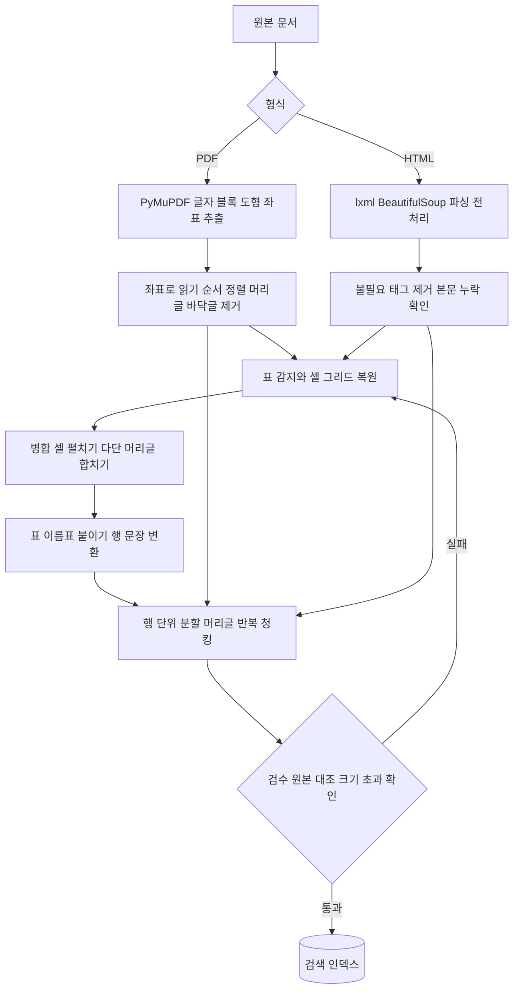

# PDF · HTML 문서와 표 처리

## 한 줄 정의 {#definition}

문서 처리는 PDF·HTML에서 본문, 제목, 표, 그림을 구조를 살려 꺼내고, 검색·LLM이 읽을 수 있는 텍스트와 청크로 바꾸는 일이다. PyMuPDF는 PDF에서 글자·블록·도형을 좌표와 함께 꺼내는 라이브러리이고, lxml·BeautifulSoup은 HTML을 트리로 파싱하는 라이브러리다.

**언제 쓰나**

- RAG 검색 인덱스에 넣을 문서(규정, 상품 설명서, 보고서)를 텍스트·청크로 만들 때
- 표의 숫자를 "어느 행·어느 열의 값인지"까지 살려 질의응답에 써야 할 때
- PDF에 그려진 흐름도·도형을 구조 데이터(노드·간선)로 바꿀 때

## 핵심 개념 {#concepts}

| 용어 | 설명 |
|------|------|
| 텍스트 PDF / 스캔 PDF | 텍스트 PDF는 글자 정보가 들어 있어 바로 추출된다. 스캔 PDF는 이미지라 OCR이 필요하다. |
| 벡터 PDF | 선·사각형·화살표가 이미지가 아니라 좌표가 있는 도형 명령으로 그려진 PDF. 도형을 좌표로 읽을 수 있다. |
| Block / Line / Span | PyMuPDF 텍스트 계층. Block(문단 덩어리) → Line(줄) → Span(같은 글꼴의 글자 묶음). 각각 bbox 좌표를 가진다. |
| bbox | 요소를 감싸는 사각형 `(x0, y0, x1, y1)`. 위치로 읽기 순서, 같은 행·열 여부, 표 안팎을 판단한다. |
| 읽기 순서 | PDF 내부 저장 순서는 화면 순서와 다를 수 있다. 다단 편집은 좌표로 다시 정렬해야 한다. |
| 표 감지 | 선(ruling line)으로 칸을 찾거나, 글자 정렬(같은 x 위치)로 열을 추정하는 방법. PyMuPDF는 `page.find_tables()`를 제공한다. |
| 병합 셀 (rowspan / colspan) | 여러 행·열을 차지하는 셀. 펼치지 않으면 값이 엉뚱한 열에 붙는다. |
| 다단 머리글 | 열 머리글이 두 줄 이상인 표(예: "2024년 > 상반기 / 하반기"). 열 이름을 경로로 합쳐야 의미가 산다. |
| 표 → 문장 변환 | 표 행을 "행 이름의 열 이름은 값이다" 같은 문장으로 바꿔 임베딩·키워드 검색이 의미를 잡게 하는 방법. |
| 표 구조 보존 청킹 | 표를 행 단위로 나누되 각 청크에 머리글을 다시 붙여, 청크 하나만 봐도 열 의미를 알 수 있게 하는 분할. |

## 동작 원리 {#how-it-works}



1. **추출**: PDF는 PyMuPDF로 글자를 bbox와 함께 꺼낸다. HTML은 lxml·BeautifulSoup으로 트리를 만들고 스크립트·스타일·내비게이션을 걷어 낸다. 전처리 후 원본 대비 본문 단어가 빠지지 않았는지 확인한다.
2. **정렬과 정리**: 좌표(y, 그다음 x)로 읽기 순서를 맞추고, 모든 페이지에 반복되는 머리글·바닥글은 빼낸다.
3. **표 복원**: 선이나 `<table>` 구조로 셀 그리드를 만든다. `rowspan`/`colspan`은 펼쳐 모든 칸에 값을 채우고, 다단 머리글은 "상위 > 하위" 경로로 합친다.
4. **표 → 텍스트**: 표 앞 제목·소제목을 표 이름표로 붙이고, 행마다 문장(또는 머리글:값 목록)으로 바꾼다.
5. **청킹**: 본문은 문단 경계로, 표는 행 단위로 나누고 각 청크에 머리글을 반복한다. 청크 크기 상한을 넘지 않는지 검사한다.
6. **검수**: 변환 결과를 원본 표와 대조하고, 청크 크기 초과·빈 열 이름 같은 오류를 자동 검사한다.

**PyMuPDF 좌표 추출**

```python
import fitz  # PyMuPDF

doc = fitz.open("report.pdf")
page = doc[0]
for x0, y0, x1, y1, text, block_no, block_type in page.get_text("blocks", sort=True):
    print(round(y0), round(x0), text[:30])       # sort=True: 위→아래, 왼→오른 순

for tab in page.find_tables().tables:            # 선 기반 표 감지
    rows = tab.extract()                         # 2차원 리스트 (병합 셀은 None)

for d in page.get_drawings():                    # 벡터 도형: 선, 사각형, 곡선
    print(d["rect"], [item[0] for item in d["items"]])   # 'l' 선, 're' 사각형, 'c' 곡선
```

**HTML 표 → 행 문장**

```python
from bs4 import BeautifulSoup

def table_to_sentences(table_html, caption):
    t = BeautifulSoup(table_html, "lxml").table
    grid = expand_spans(t)                 # rowspan/colspan을 펼친 2차원 격자
    header, *body = grid
    for row in body:
        pairs = [f"{h}: {v}" for h, v in zip(header[1:], row[1:]) if v]
        yield f"[{caption}] {row[0]} - " + ", ".join(pairs)
```

## 내가 썼던 방식 {#my-usage}

- 지식기반 검색 RAG 파이프라인 (프로젝트 스택에 PyMuPDF 포함):
    - HTML 추출 파이프라인을 구축해 표 37개를 변환하고 52청크를 적재했다. HTML 문서 검색·답변 평가셋 27문항을 만들어 정답률 26/27을 확인했다.
    - HTML 전처리 파서를 구축해 본문 누락 단어를 374개에서 0개로 줄였다.
    - 좌표형 HTML에서 표 밖 텍스트를 좌표 기반으로 복구해 106줄을 복구했고 손실은 0건이었다.
    - 다단 머리글 등 복잡한 표의 문장 변환 규칙을 구현했고, 원본 대조 검수 104/104를 통과했다.
    - HTML 파서를 플러그인 규격으로 개편해 문서 328건을 오류 없이 처리했다.
    - 표 구조 보존 청커(행 단위 분할·머리글 반복)를 만들어 HTML 234건을 15,458청크로 나눴고, 크기 초과 청크는 0건이었다.
    - 벡터 PDF 업무흐름도를 도형·글자 좌표로 노드·간선 그래프로 바꿔, 7건 모두 원본과 일치시키고 Mermaid로 산출했다.
    - 트러블슈팅:
        - 표 열 이름이 `----`로 잘못 적재(7청크): PDF 파서의 구분선 오인을 확인하고 구분선 행을 제거한 뒤 재적재했다. 오류 청크 7 → 0, 표 질의 벡터 MRR 0.85 → 0.92.
        - 여러 열에 병합된 합계 숫자가 첫 열에 배치되어 값 의미가 바뀜: 숫자 병합값은 마지막 열에 배치하고 단일값 행은 예외 처리했다. 의도치 않은 변경 54개 표 → 2개 표.
        - 표 바로 앞 소제목이 빠져 당기·전기 수치 답변이 뒤바뀜: 표 앞 짧은 소제목을 표 이름표에 붙여 해당 문항을 정답 처리했다.
        - 대형 표 분할 시 청크 크기 초과(최대 2,932자): 긴 머리글 반복을 중단하고 각주는 별도 청크로 분리했다. 초과 청크 183개 → 0개.
        - 그림 설명 생성 시 없는 내용을 지어냄: 작은 이미지를 제외하고 로컬 VLM(Qwen2.5-VL-7B)으로 설명을 다시 생성해 그림 28개의 제목·축·글자 추출을 개선했다.
        - 흐름도에서 조각난 연결선과 선 중간의 갈래선이 간선으로 인식되지 않음: 끝점 거리(36pt) 기반으로 조각을 잇고, 점-선분 거리로 선을 묶고, 화살촉 도형을 분리했다. 흐름도 7건 모두 원본 일치.

표 청크 크기와 분할 기준은 청킹 노트 참고.

## 장단점과 함정 {#pros-cons}

**좌표 기반 추출의 장점**

- 화면에 보이는 위치 그대로 판단하므로 다단 편집, 표 밖 주석, 도형 속 글자처럼 구조 태그가 없는 정보도 살린다.
- 규칙이 명시적이라 실패 사례를 재현하고 고치기 쉽다.

**좌표 기반 추출의 단점**

- 문서 양식마다 기준값(거리, 여백)이 달라 규칙이 늘어난다. 양식별 검수 세트가 필요하다.
- 스캔 PDF에는 쓸 수 없다. OCR이나 레이아웃 모델이 따로 필요하다.

**표 → 문장 변환의 장단점**

- 행 하나가 독립된 의미 단위가 되어 벡터 검색·키워드 검색이 값의 맥락(행·열 이름)을 잡는다.
- 텍스트 양이 늘고, 변환 규칙이 틀리면 값의 의미가 조용히 바뀐다. 원본 대조 검수가 필수다.

!!! tip "함정"
    - 표를 통째로 한 청크에 넣으면 크기 상한을 넘거나, 잘린 뒤쪽 청크에 머리글이 없어 숫자의 의미를 잃는다.
    - 구분선(`----`)이나 빈 행을 데이터 행으로 오인하기 쉽다. 열 이름이 기호뿐인 행은 걸러 낸다.
    - 병합 셀을 펼칠 때 값을 어느 열에 둘지 규칙이 없으면 합계·소계가 엉뚱한 열에 붙는다.
    - 표 제목이 표 밖(바로 위 소제목)에 있으면 표만 떼어 낸 청크는 "어느 기간의 수치인지" 모른다. 표 이름표를 붙인다.
    - 전처리에서 태그를 지우다 본문까지 지우는 경우가 많다. 원본 대비 단어 누락 수를 지표로 둔다.

## 비교 {#comparison}

| 도구 | 대상 | 강점 | 약점 |
|------|------|------|------|
| PyMuPDF (fitz) | PDF | 빠름, 글자·블록·도형 좌표, 표 감지, 이미지 추출 | 레이아웃 이해(제목 계층)는 직접 규칙 필요 |
| pdfplumber | PDF | 글자·선 좌표가 상세, 표 추출 설정이 세밀함 | PyMuPDF보다 느림 |
| Camelot · Tabula | PDF 표 | 선 기반(lattice)·정렬 기반(stream) 표 추출 전용 | 본문·도형 처리는 안 함 |
| lxml | HTML·XML | 매우 빠름, XPath | 깨진 HTML에 덜 관대 |
| BeautifulSoup | HTML | 깨진 HTML에도 관대, API가 쉬움 | 단독 파서(html.parser)는 느림, 보통 lxml을 파서로 씀 |
| 레이아웃 모델·VLM | PDF 이미지, 그림 | 스캔 문서, 그림 설명 | 느리고 비용 큼, 없는 내용을 생성할 수 있음 |

## 예상 질문 {#interview}

[예상질문 보기](../../interview/serving-infra.md#pdf-html)

## 더 보기 {#links}

- [PyMuPDF: Text extraction](https://pymupdf.readthedocs.io/en/latest/app1.html)
- [PyMuPDF: Page.find_tables](https://pymupdf.readthedocs.io/en/latest/page.html#Page.find_tables)
- [PyMuPDF: Extracting drawings](https://pymupdf.readthedocs.io/en/latest/recipes-drawing-and-graphics.html)
- [Beautiful Soup Documentation](https://www.crummy.com/software/BeautifulSoup/bs4/doc/)
- [lxml: Parsing HTML](https://lxml.de/lxmlhtml.html)
