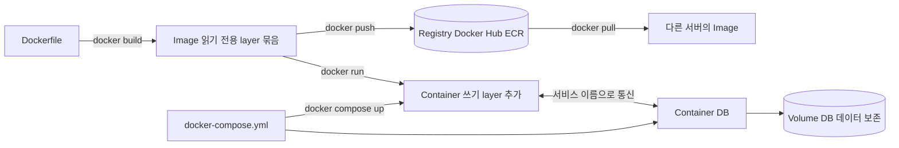

# Docker · Docker Compose

## 한 줄 정의 {#definition}

Docker는 애플리케이션과 실행 환경(OS 라이브러리, 런타임, 의존성)을 이미지 하나로 묶어 어디서나 같은 방식으로 컨테이너로 실행하게 하는 도구이고, Docker Compose는 여러 컨테이너(앱, DB, 스케줄러)를 YAML 파일 하나로 정의해 한 명령으로 띄우는 도구다.

**언제 쓰나**

- "내 PC에서는 되는데" 문제 없이 누구나 같은 환경으로 실행하게 하고 싶을 때
- 앱 + PostgreSQL + Airflow처럼 여러 구성요소를 로컬에서 한 번에 띄워 파이프라인을 재현할 때
- 클라우드(ECS, Kubernetes)에 배포할 단위를 만들 때

## 핵심 개념 {#concepts}

| 용어 | 설명 |
|------|------|
| Image | 실행에 필요한 파일 시스템과 설정을 읽기 전용 층(layer)으로 쌓은 묶음. `Dockerfile`로 만든다. |
| Layer | Dockerfile 명령 한 줄(`RUN`, `COPY`)이 만드는 층. 바뀌지 않은 층은 캐시를 재사용한다. |
| Container | 이미지를 실행한 프로세스. 이미지 위에 쓰기 가능한 층이 하나 붙고, 컨테이너를 지우면 그 층도 사라진다. |
| Dockerfile | 이미지 빌드 순서. `FROM`(기반 이미지) → `COPY` → `RUN` → `CMD`(실행 명령). |
| Volume / Bind mount | 컨테이너 밖에 데이터를 두는 방법. Volume은 Docker가 관리, bind mount는 호스트 경로를 그대로 연결한다. DB 데이터는 반드시 여기 둔다. |
| Network | 컨테이너끼리 통신하는 가상 네트워크. Compose는 프로젝트별 네트워크를 만들고 서비스 이름을 호스트명으로 쓰게 한다. |
| Registry | 이미지를 저장·배포하는 곳. Docker Hub, AWS ECR 등. |
| Multi-stage build | 빌드용 단계와 실행용 단계를 나눠, 컴파일러·빌드 도구를 최종 이미지에서 빼는 방법. |
| Compose service | `docker-compose.yml`의 컨테이너 정의 단위. 이미지/빌드, 포트, 환경 변수, 볼륨, 의존성을 적는다. |

## 동작 원리 {#how-it-works}



1. `docker build`는 Dockerfile을 위에서부터 실행하며 명령마다 layer를 만든다. 앞 layer와 명령이 같으면 캐시를 쓴다. 그래서 자주 바뀌는 소스 코드 `COPY`는 뒤에, 잘 안 바뀌는 의존성 설치는 앞에 둔다.
2. 컨테이너는 VM이 아니라 호스트 커널을 공유하는 격리된 프로세스다. namespace로 보이는 범위를, cgroup으로 CPU·메모리를 제한한다. 그래서 VM보다 훨씬 빨리 뜬다.
3. Compose는 `docker-compose.yml`을 읽어 네트워크·볼륨을 만들고 서비스를 띄운다. 같은 Compose 프로젝트의 컨테이너는 `db`, `warehouse`처럼 서비스 이름으로 서로를 찾는다.

**의존성 캐시를 살리는 Dockerfile**

```dockerfile
FROM python:3.12-slim
WORKDIR /app
COPY requirements.txt .                 # 의존성 목록만 먼저 복사
RUN pip install --no-cache-dir -r requirements.txt   # 목록이 안 바뀌면 캐시 재사용
COPY . .                                # 소스는 마지막에
CMD ["uvicorn", "main:app", "--host", "0.0.0.0", "--port", "8000"]
```

**Multi-stage build**

```dockerfile
FROM eclipse-temurin:11-jdk-jammy AS builder   # 1단계: 빌드 도구 포함
WORKDIR /build
COPY . .
RUN sbt assembly                                # Fat JAR 생성

FROM apache/spark:3.5.0                         # 2단계: 실행에 필요한 것만
COPY --from=builder /build/target/scala-2.12/app.jar /app/app.jar
CMD ["/opt/spark/bin/spark-submit", "/app/app.jar"]
```

**Compose 예시 (앱 + DB)**

```yaml
services:
  db:
    image: postgres:15
    environment:
      POSTGRES_PASSWORD: ${DB_PASSWORD}      # 값은 .env에서
    volumes:
      - pgdata:/var/lib/postgresql/data      # 컨테이너를 지워도 데이터 유지
    healthcheck:
      test: ["CMD", "pg_isready", "-U", "postgres"]
  app:
    build: .
    depends_on:
      db:
        condition: service_healthy           # DB가 실제로 준비된 뒤 시작
    environment:
      DATABASE_URL: postgresql://postgres:${DB_PASSWORD}@db:5432/postgres   # 호스트명 = 서비스 이름
    volumes:
      - ./data/raw:/app/data/raw             # 호스트에서 원시 파일 확인
volumes:
  pgdata:
```

## 내가 썼던 방식 {#my-usage}

- DW 기반 이벤트 로그 ELT Pipeline: `docker compose up --build` 한 번으로 `event-db`(PostgreSQL)와 `event-app`(Python 앱) 컨테이너가 뜨고 ELT가 실행되게 구성했다. Docker 볼륨으로 로컬 `./data/raw`에서 원시 JSONL 파일을 직접 확인할 수 있게 했다.
- User Behavior Data Warehouse: Docker Compose로 Airflow와 Postgres(웨어하우스)를 `docker compose up -d`로 띄워 별도 설치 없이 재현되게 했다. Airflow Connection(`warehouse_pg`)의 Host를 `warehouse`로 지정해 Airflow 컨테이너에서 웨어하우스 Postgres에 연결했다.
- NLP 기반 한국어 텍스트 처리 Pipeline: `docker/Dockerfile`과 `docker-compose.yml`을 두어 `docker-compose up`으로 실행할 수 있게 했다.
- Backpacker (개인, Spark 배치): 2단계 빌드(1단계 SBT로 Fat JAR 컴파일, 2단계 Spark 런타임에서 `spark-submit` 실행)로 최종 이미지를 3GB에서 1.5GB로 줄였다. Compose에서 입력 데이터·Hive 웨어하우스·결과 CSV를 볼륨으로 연결하고 Spark UI 포트 4040을 열었다.
- 올리브영 클론 프로젝트 (부트캠프 실습): 프론트엔드(Nginx), FastAPI 백엔드, Streamlit 챗봇을 각각 Dockerfile로 만들고 DB 초기화 SQL(`init.sql`, `seed.sql`)과 함께 `docker-compose up --build`로 실행했다. 데이터 초기화는 `docker-compose down -v`, 캐시 무시 재빌드는 `build --no-cache`로 했다. 백엔드·Streamlit 이미지는 ECR에 push해 ECS(Fargate)로 배포하는 구성이다.
- 지식기반 검색 RAG 파이프라인: 프로젝트 스택에 Docker Compose가 포함되어 있다.

## 장단점과 함정 {#pros-cons}

**장점**

- 실행 환경이 이미지에 고정되어 개발·테스트·운영 차이가 줄어든다.
- VM보다 가볍고 빨리 뜬다. 여러 버전의 DB·런타임을 한 PC에서 동시에 띄울 수 있다.
- Compose 파일 하나가 실행 문서 역할을 한다.

**단점**

- 컨테이너 자체는 상태가 없다. 데이터 보존은 볼륨 설계가 필요하다.
- 이미지가 커지면 빌드·전송·시작이 느려진다.
- Compose는 한 호스트 기준이라 여러 서버에 걸친 확장·자동 복구는 Kubernetes 같은 오케스트레이터가 필요하다.

!!! tip "함정"
    - `depends_on`만으로는 DB가 "접속 가능"해질 때까지 기다리지 않는다. healthcheck + `condition: service_healthy`를 쓰거나 앱에서 재시도한다.
    - 컨테이너 안에서 `localhost`는 그 컨테이너 자신이다. 다른 서비스는 서비스 이름으로 접근한다.
    - `docker compose down -v`는 볼륨까지 지운다. DB 데이터가 초기화된다.
    - `.env`와 비밀번호를 이미지에 `COPY`하면 이미지를 받은 누구나 볼 수 있다. `.dockerignore`에 넣고 런타임 환경 변수로 넘긴다.
    - Apple Silicon(arm64)에서 빌드한 이미지를 amd64 서버에서 돌리면 실행이 안 된다. `--platform linux/amd64`로 빌드한다.

## 비교 {#comparison}

**Docker Compose vs Kubernetes**

| 항목 | Docker Compose | Kubernetes |
|------|----------------|------------|
| 범위 | 한 호스트 | 여러 노드 클러스터 |
| 정의 파일 | `docker-compose.yml` 하나 | Deployment, Service 등 여러 리소스 YAML |
| 자동 복구 | `restart` 정책 정도 | 원하는 상태를 유지하도록 Pod 재생성·재배치 |
| 확장 | 수동 (`--scale`) | HPA로 부하 기반 자동 확장 |
| 서비스 발견 | 서비스 이름 DNS | Service 리소스 DNS, 로드밸런싱 |
| 학습·운영 비용 | 낮음 | 높음 |
| 잘 맞는 곳 | 로컬 개발, 데모, 단일 서버 소규모 서비스 | 운영 환경, 여러 서비스·팀, 배치 작업 격리 |

로컬 재현과 단일 서버는 Compose, 여러 서버에서 자동 복구·확장이 필요하면 Kubernetes(또는 ECS 같은 관리형 서비스)를 쓴다.

## 예상 질문 {#interview}

[예상질문 보기](../../interview/serving-infra.md#docker)

## 더 보기 {#links}

- [Docker: Dockerfile reference](https://docs.docker.com/reference/dockerfile/)
- [Docker: Multi-stage builds](https://docs.docker.com/build/building/multi-stage/)
- [Docker: Build cache](https://docs.docker.com/build/cache/)
- [Docker Compose: Compose file reference](https://docs.docker.com/reference/compose-file/)
- [Docker Compose: Control startup order](https://docs.docker.com/compose/how-tos/startup-order/)
