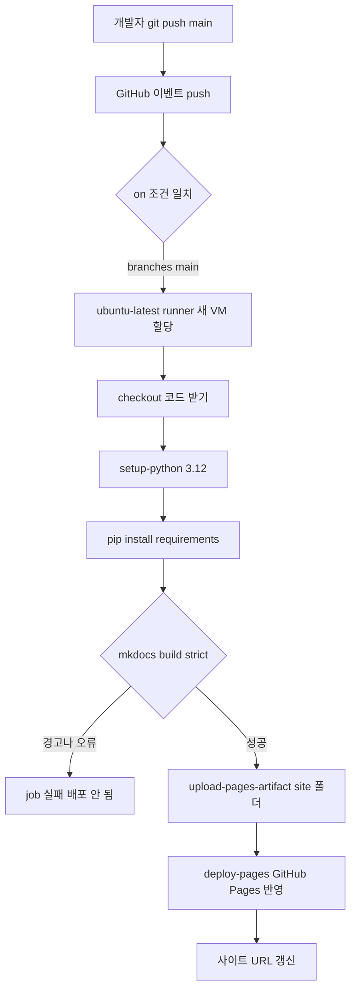

# GitHub Actions

## 한 줄 정의 {#definition}

GitHub Actions는 저장소에 push, PR, 일정 같은 이벤트가 생기면 YAML로 정의한 작업(빌드, 테스트, 배포)을 GitHub가 제공하는 가상 머신(runner)에서 실행하는 CI/CD 서비스다.

**언제 쓰나**

- push·PR마다 테스트·린트·빌드를 자동으로 돌려 깨진 코드가 main에 들어오지 않게 할 때(CI)
- main에 합쳐지면 정적 사이트, 컨테이너 이미지, 패키지를 자동으로 배포할 때(CD)
- 저장소와 붙어 있는 가벼운 정기 작업(의존성 점검, 링크 검사)을 돌릴 때

## 핵심 개념 {#concepts}

| 용어 | 설명 |
|------|------|
| Workflow | `.github/workflows/*.yml` 파일 하나. 언제(`on`) 무엇을(`jobs`) 실행할지 정의한다. |
| Event (trigger) | 워크플로우를 시작시키는 사건. `push`, `pull_request`, `schedule`(cron), `workflow_dispatch`(수동 실행) 등. |
| Job | 같은 runner에서 순서대로 실행되는 step 묶음. job끼리는 기본적으로 병렬이고 `needs`로 순서를 건다. |
| Step | job 안의 한 단계. 셸 명령(`run`) 또는 남이 만든 action(`uses`)이다. |
| Action | 재사용 가능한 step 패키지. `actions/checkout@v4`처럼 `소유자/이름@버전`으로 쓴다. |
| Runner | job을 실행하는 머신. GitHub 호스팅(`ubuntu-latest`)은 job마다 깨끗한 VM이 새로 뜬다. |
| Permissions / GITHUB_TOKEN | 워크플로우가 자동으로 받는 토큰의 권한 범위. 필요한 것만 열어 둔다. |
| Secrets | 저장소 설정에 저장한 비밀값. `${{ secrets.NAME }}`으로 꺼내며 로그에서 가려진다. |
| Cache / Artifact | Cache는 실행 사이에 재사용할 파일(의존성), Artifact는 job 결과물(빌드 산출물)을 저장·전달한다. |
| Environment | 배포 대상 단위(`github-pages`, `production`). 승인 규칙과 환경별 secret을 붙일 수 있다. |

## 동작 원리 {#how-it-works}

이 사이트의 배포 워크플로우(`.github/workflows/deploy.yml`)를 예로 든다.

```yaml
name: deploy
on:
  push:
    branches: [main]          # main에 push하면 실행
  workflow_dispatch:          # Actions 탭에서 수동 실행도 가능
permissions:
  contents: read              # 코드 읽기
  pages: write                # Pages에 배포
  id-token: write             # Pages 배포 인증용 OIDC 토큰 발급
jobs:
  deploy:
    runs-on: ubuntu-latest
    environment: github-pages
    steps:
      - uses: actions/checkout@v4                 # 1. 저장소 코드 받기
      - uses: actions/setup-python@v5             # 2. Python 3.12 설치
        with:
          python-version: "3.12"
      - run: pip install -r requirements.txt      # 3. MkDocs 등 설치
      - run: mkdocs build --strict                # 4. 경고도 실패로 보고 site/ 생성
      - uses: actions/upload-pages-artifact@v3    # 5. site/를 Pages용 artifact로 업로드
        with:
          path: site
      - uses: actions/deploy-pages@v4             # 6. artifact를 GitHub Pages에 배포
```



1. **트리거**: main에 push하면 `on.push.branches` 조건이 맞아 워크플로우가 시작된다. 다른 브랜치 push는 무시된다.
2. **runner 할당**: job마다 깨끗한 Ubuntu VM이 뜬다. 이전 실행의 파일은 없으므로 매번 checkout과 설치를 한다.
3. **step 순차 실행**: 한 step이라도 0이 아닌 종료 코드를 내면 job이 멈춘다. `--strict` 덕분에 깨진 링크·경고가 있으면 배포 전에 실패한다.
4. **배포**: 빌드 결과(`site/`)를 artifact로 올리고, `deploy-pages`가 OIDC 토큰(`id-token: write`)으로 인증해 Pages에 반영한다.

**의존성 캐시 추가**

```yaml
      - uses: actions/setup-python@v5
        with:
          python-version: "3.12"
          cache: pip                    # requirements.txt 해시를 키로 pip 캐시 재사용
```

**PR에서만 테스트하는 CI 예시**

```yaml
on:
  pull_request:
    branches: [main]
jobs:
  test:
    runs-on: ubuntu-latest
    strategy:
      matrix:
        python: ["3.11", "3.12"]        # 버전별로 병렬 실행
    steps:
      - uses: actions/checkout@v4
      - uses: actions/setup-python@v5
        with: { python-version: "${{ matrix.python }}" }
      - run: pip install -r requirements.txt && pytest
```

## 내가 썼던 방식 {#my-usage}

- Tech Notes (이 사이트): main push 또는 수동 실행 시 Python 3.12 설치 → `requirements.txt` 설치 → `mkdocs build --strict` → `upload-pages-artifact` → `deploy-pages` 순서로 GitHub Pages에 배포하는 워크플로우를 두었다. 권한은 `contents: read`, `pages: write`, `id-token: write`만 열었다.
- AI 기반 숏폼 영상 생성 시스템: 저장소에 CI 워크플로우(`.github/workflows/ci.yml`)를 두었다. 기본 검사는 `make check`로 `python -m compileall` 문법 검사, `scripts/check_architecture.py`(import 경계·보호 파일·예제 JSON 확인), `unittest` 계약 테스트를 실행한다.

## 장단점과 함정 {#pros-cons}

**장점**

- 저장소 안에 YAML 하나로 끝난다. 별도 CI 서버를 운영하지 않는다.
- Marketplace의 action을 가져다 쓰면 설치·로그인·배포 step을 짧게 쓴다.
- PR 화면에 결과가 바로 붙어 리뷰 흐름과 자연스럽게 이어진다.

**단점**

- 호스팅 runner는 매번 새 VM이라 설치 시간이 반복된다. 캐시를 잘 써야 빠르다.
- 장시간·대용량 작업, 사내망 접근이 필요한 작업은 self-hosted runner가 필요하다.
- `schedule`은 정확한 시각을 보장하지 않고 부하가 높으면 지연된다. 데이터 파이프라인 스케줄러로는 부족하다.

!!! tip "함정"
    - `permissions`를 안 쓰면 저장소 기본값을 따른다. 쓰기 권한이 넓게 열려 있을 수 있으니 필요한 것만 명시한다.
    - 외부 action을 `@main`으로 쓰면 그쪽 변경이 그대로 들어온다. 버전 태그나 커밋 SHA로 고정한다.
    - fork에서 온 PR에는 secret이 전달되지 않는다. PR에서 배포 step이 실패하는 흔한 이유다.
    - 로컬에서는 통과하는데 CI에서 실패하면 Python 버전, OS(macOS vs Linux 대소문자), 설치되지 않은 시스템 패키지를 먼저 본다.
    - `schedule` 워크플로우는 저장소에 60일간 활동이 없으면 자동으로 꺼진다.

## 비교 {#comparison}

**CI용 GitHub Actions vs 데이터 작업용 cron · Airflow**

| 항목 | GitHub Actions | cron | Airflow |
|------|----------------|------|---------|
| 주 목적 | 코드 변경에 반응하는 빌드·테스트·배포 | 서버 한 대의 정기 명령 실행 | 데이터 파이프라인 스케줄링·의존성 관리 |
| 트리거 | push, PR, 수동, 대략적인 일정 | 시각 | 일정, 데이터 도착(sensor·dataset), 수동 |
| 작업 간 의존성 | job `needs` (단순) | 없음 | DAG로 task 의존성 표현 |
| 재시도·백필 | 수동 재실행 | 없음 | task별 retry, 과거 구간 backfill |
| 실행 이력·상태 | 실행 로그 (보존 기간 제한) | 직접 로그 관리 | 메타DB에 task 상태·로그 |
| 실행 환경 | 매번 새 VM | 고정 서버 | worker·Pod |
| 잘 맞는 곳 | 테스트, 정적 사이트·이미지 배포 | 단순 정기 스크립트 | 일 증분 적재, 다단계 ETL |

코드가 바뀔 때 도는 일은 GitHub Actions, 데이터가 쌓일 때 도는 일은 Airflow가 맡는 식으로 나눈다.

## 예상 질문 {#interview}

[예상질문 보기](../../interview/serving-infra.md#github-actions)

## 더 보기 {#links}

- [GitHub Actions: Understanding GitHub Actions](https://docs.github.com/en/actions/about-github-actions/understanding-github-actions)
- [Workflow syntax for GitHub Actions](https://docs.github.com/en/actions/writing-workflows/workflow-syntax-for-github-actions)
- [Using custom workflows with GitHub Pages](https://docs.github.com/en/pages/getting-started-with-github-pages/using-custom-workflows-with-github-pages)
- [actions/setup-python: Caching packages](https://github.com/actions/setup-python#caching-packages-dependencies)
- [Security hardening for GitHub Actions](https://docs.github.com/en/actions/security-for-github-actions/security-guides/security-hardening-for-github-actions)
