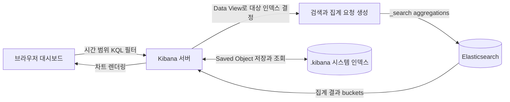

# Kibana

## 한 줄 정의 {#definition}

Kibana는 Elasticsearch에 저장된 데이터를 검색·탐색하고, 차트와 대시보드로 시각화하며, 클러스터 상태를 관리하는 Elastic의 웹 UI다.

**언제 쓰나**

- 매일 적재되는 로그·분석 결과(예: 감성 분석 점수)를 시간대별 차트와 대시보드로 공유할 때
- 적재된 문서가 의도대로 들어갔는지(필드, 값, 건수) 눈으로 확인할 때
- Dev Tools 콘솔에서 매핑·쿼리·분석기 동작을 바로 시험할 때
- 인덱스 크기, 샤드 상태, 노드 자원을 확인할 때

## 핵심 개념 {#concepts}

| 용어 | 설명 |
|------|------|
| Data View (구 Index Pattern) | Kibana가 어떤 인덱스들을 볼지 정하는 이름 패턴(`sentiment-*`)과 시간 필드. Discover·시각화의 출발점이다. |
| Discover | 문서를 시간 범위와 검색어로 걸러 원본 필드를 그대로 보는 화면. 적재 확인에 가장 많이 쓴다. |
| Visualize / Lens | 집계 결과를 막대·선·파이·표로 그리는 편집기. Lens는 필드를 끌어다 놓는 방식이다. |
| Dashboard | 여러 시각화와 검색 결과를 한 화면에 배치한 것. 시간 범위·필터를 전체에 한 번에 적용한다. |
| KQL | Kibana Query Language. `sentiment: "negative" and source: news`처럼 검색창에 쓰는 간단한 필터 문법. |
| Filter | 검색창 아래에 붙이는 조건 칩. 켜고 끄거나 반대로 뒤집기 쉽다. |
| Dev Tools Console | ES REST API를 직접 호출하는 콘솔. `GET index/_search`, `GET _cat/indices` 등을 실행한다. |
| ES\|QL | 파이프(`FROM ... WHERE ... STATS`) 방식의 Elasticsearch 쿼리 언어. Discover에서 쓸 수 있다(8.11+). |
| Saved Object | Data View, 시각화, 대시보드 같은 Kibana 설정. 내보내기/가져오기로 다른 환경에 옮긴다. |

## 동작 원리 {#how-it-works}

Kibana는 데이터를 따로 저장하지 않는다. 화면의 모든 차트는 Elasticsearch에 보내는 검색·집계 요청의 결과다.



1. 사용자가 대시보드를 열면 Kibana는 각 패널마다 Data View의 인덱스 패턴, 시간 범위, KQL·필터를 합쳐 ES 쿼리를 만든다.
2. 차트는 집계(aggregation)로 계산된다. 예를 들어 "일별 부정 비율"은 `date_histogram`(일 단위) 안에 `terms`(감성 라벨) 집계다.
3. ES가 bucket 결과를 돌려주면 Kibana가 그린다. 대시보드·시각화 정의는 `.kibana` 시스템 인덱스에 Saved Object로 저장된다.
4. 그래서 차트가 느리면 Kibana보다 ES 쿼리(시간 범위, 필드 타입, 집계 크기)를 먼저 의심한다.

**KQL 예시**

```text
sentiment: "negative"                       # 정확히 일치
sentiment: "negative" and not source: blog  # 조건 조합
score >= 0.8                                # 범위
title: *배송*                               # 와일드카드 (느릴 수 있음)
```

**Dev Tools로 적재 확인**

```text
GET _cat/indices/sentiment-*?v&s=index      # 인덱스별 문서 수와 크기
GET sentiment-2025.01.10/_count             # 특정 날짜 인덱스 건수
GET sentiment-*/_search
{
  "size": 0,
  "aggs": {
    "by_day": {
      "date_histogram": { "field": "created_at", "calendar_interval": "day" },
      "aggs": { "by_label": { "terms": { "field": "sentiment" } } }
    }
  }
}
```

**집계에 쓰는 필드는 `keyword` 타입이어야 한다.** `text` 필드는 분석(토큰화)되어 저장되므로 `terms` 집계나 정렬에 쓸 수 없다. 동적 매핑은 문자열을 `text` + `.keyword` 하위 필드로 만들기 때문에 차트에서는 `sentiment.keyword`를 고르게 된다.

## 내가 썼던 방식 {#my-usage}

- 데이터 수집 · 감성 분석 대시보드 운영: 일 배치로 적재한 데이터와 감성 분석 결과를 Kibana 대시보드로 시각화해 운영했다. Airflow·Spark·Kafka·ES 파이프라인을 점검하고 장애를 조치했으며, 장애 구간 코드를 리팩토링해 운영 안정성을 유지했다.
- 지식기반 검색 RAG 파이프라인: 프로젝트 스택에 Elasticsearch, Kibana, Kubernetes(ECK)가 포함되어 있다.

## 장단점과 함정 {#pros-cons}

**장점**

- Elasticsearch와 바로 연결되어 별도 BI 도구 없이 대시보드를 만든다.
- 시간 범위·필터를 클릭으로 바꾸며 탐색하기 쉽다. 장애 시 "언제부터 건수가 줄었나"를 빠르게 본다.
- Dev Tools, 인덱스 관리, 모니터링까지 한 곳에서 한다.

**단점**

- Elasticsearch 데이터만 시각화한다. RDB 데이터는 ES로 옮겨야 한다.
- 조인이 없다. 분석에 필요한 필드는 적재할 때 문서에 미리 넣어야 한다(비정규화).
- 복잡한 계산·리포트 서식은 일반 BI 도구보다 약하다.

!!! tip "함정"
    - Data View의 시간 필드를 잘못 고르면(수집 시각 vs 이벤트 시각) 차트가 엉뚱한 날짜에 쌓인다.
    - 시간대: ES는 UTC로 저장하고 Kibana는 브라우저 시간대로 보여 준다. 일 집계 경계가 9시간 어긋날 수 있다.
    - 매핑이 `text`로 잡힌 필드는 집계 목록에 안 나온다. 인덱스 템플릿에서 `keyword`로 미리 정의한다.
    - 대시보드에 긴 시간 범위 + 큰 `terms` 크기를 걸면 ES 부하가 크다. 기본 시간 범위를 짧게 둔다.
    - 대시보드는 Saved Object로 내보내 버전 관리해 두지 않으면 수정 이력을 잃는다.

## 비교 {#comparison}

| 항목 | Kibana | Grafana | Superset·Metabase |
|------|--------|---------|-------------------|
| 주 데이터 소스 | Elasticsearch | Prometheus 등 시계열 DB, ES·SQL DB도 가능 | SQL DB (PostgreSQL, 웨어하우스) |
| 강한 분야 | 로그·문서 검색과 탐색, 텍스트 데이터 | 지표 모니터링, 알림 | 비즈니스 지표, SQL 기반 분석 |
| 쿼리 | KQL, Lucene, ES\|QL | 소스별 쿼리(PromQL 등) | SQL |
| 조인 | 없음 | 소스에 따라 제한 | SQL 조인 |
| 잘 맞는 곳 | ES에 쌓인 로그·분석 결과 대시보드 | 인프라·애플리케이션 모니터링 | 웨어하우스 Marts 위 리포트 |

## 예상 질문 {#interview}

[예상질문 보기](../../interview/serving-infra.md#kibana)

## 더 보기 {#links}

- [Kibana Guide](https://www.elastic.co/docs/explore-analyze)
- [Kibana Query Language (KQL)](https://www.elastic.co/docs/explore-analyze/query-filter/languages/kql)
- [ES|QL](https://www.elastic.co/docs/explore-analyze/query-filter/languages/esql)
- [Data views](https://www.elastic.co/docs/explore-analyze/find-and-organize/data-views)
- [Dashboards](https://www.elastic.co/docs/explore-analyze/dashboards)
