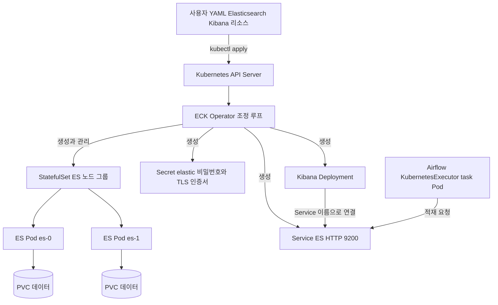

# Kubernetes · ECK

## 한 줄 정의 {#definition}

Kubernetes(K8s)는 여러 서버(노드)에 컨테이너를 배치하고, 선언한 상태(몇 개를, 어떤 이미지로, 어떤 자원으로)를 계속 유지하도록 재시작·재배치·확장을 자동으로 하는 컨테이너 오케스트레이션 플랫폼이다. ECK(Elastic Cloud on Kubernetes)는 Elasticsearch·Kibana를 Kubernetes 위에서 배포·운영하게 해 주는 Operator다.

**언제 쓰나**

- 여러 서비스를 여러 서버에 띄우고 장애 시 자동 복구, 부하에 따른 확장이 필요할 때
- 배치 작업마다 다른 이미지·CPU·메모리를 주고 끝나면 자원을 돌려받고 싶을 때(Airflow KubernetesExecutor)
- Elasticsearch처럼 상태가 있는 클러스터를 YAML 선언으로 배포·업그레이드하고 싶을 때(ECK)

## 핵심 개념 {#concepts}

| 용어 | 설명 |
|------|------|
| Cluster / Node | 클러스터는 제어부(control plane)와 일하는 서버(node)들의 묶음. Pod는 node 위에서 실행된다. |
| Pod | 배포의 최소 단위. 컨테이너 하나 이상이 네트워크·저장소를 공유한다. 언제든 죽고 다시 만들어질 수 있다. |
| Deployment | 상태 없는 Pod를 원하는 개수(replicas)로 유지하고, 이미지 변경 시 순차 교체(rolling update)한다. |
| StatefulSet | 고정 이름(`es-0`, `es-1`)과 Pod별 저장소가 필요한 DB·검색 엔진용. ECK가 내부적으로 쓴다. |
| Service | Pod들 앞의 고정 주소(DNS 이름)와 로드밸런싱. Pod IP가 바뀌어도 Service 이름으로 접근한다. |
| ConfigMap / Secret | 설정값과 비밀값(비밀번호, 토큰)을 이미지 밖에 두고 환경 변수나 파일로 Pod에 넣는다. |
| PVC (PersistentVolumeClaim) | Pod가 요청하는 저장소. Pod가 다시 만들어져도 데이터가 남는다. |
| Namespace | 클러스터 안의 논리적 구획. 팀·환경별로 리소스와 권한을 나눈다. |
| Operator / CRD | CRD로 새 리소스 종류(`Elasticsearch`, `Kibana`)를 정의하고, Operator가 그 선언을 실제 리소스로 만들고 관리하는 컨트롤러다. |

## 동작 원리 {#how-it-works}

Kubernetes의 기본 원리는 **조정 루프(reconcile loop)** 다. 사용자는 원하는 상태를 YAML로 선언하고, 컨트롤러가 현재 상태를 계속 비교해 차이를 메운다. ECK도 같은 방식으로 동작한다.



1. 사용자가 `Elasticsearch`, `Kibana` 커스텀 리소스를 적용하면 API Server에 저장된다.
2. ECK Operator가 이를 감지해 StatefulSet(ES 노드), Service, Secret(elastic 사용자 비밀번호, TLS 인증서), Kibana Deployment를 만든다.
3. ES Pod마다 PVC가 붙어 Pod가 재시작돼도 인덱스 데이터가 유지된다.
4. 버전이나 노드 수를 바꾸면 Operator가 샤드 이동을 고려해 노드를 한 대씩 순차 교체한다.
5. 다른 Pod(예: Airflow task Pod)는 Service DNS 이름(`<이름>-es-http`)으로 ES에 접근한다.

**ECK 리소스 예시**

```yaml
apiVersion: elasticsearch.k8s.elastic.co/v1
kind: Elasticsearch
metadata:
  name: search
spec:
  version: 8.15.0
  nodeSets:
    - name: default
      count: 3
      volumeClaimTemplates:
        - metadata: { name: elasticsearch-data }
          spec:
            accessModes: ["ReadWriteOnce"]
            resources: { requests: { storage: 50Gi } }
---
apiVersion: kibana.k8s.elastic.co/v1
kind: Kibana
metadata:
  name: search
spec:
  version: 8.15.0
  count: 1
  elasticsearchRef: { name: search }   # 연결·인증서 설정을 Operator가 처리
```

**자주 쓰는 명령**

```bash
kubectl get pods -n search                      # Pod 상태
kubectl describe pod search-es-default-0        # 이벤트: 스케줄 실패, 이미지 pull 오류
kubectl logs -f <pod>                           # 로그
kubectl get elasticsearch                       # ECK 리소스 상태(health, phase)
kubectl get secret search-es-elastic-user -o go-template='{{.data.elastic | base64decode}}'
```

**Airflow KubernetesExecutor**: Scheduler가 task 하나마다 Pod를 새로 만들고, task가 끝나면 Pod를 지운다. task별로 `executor_config`나 `pod_override`로 이미지와 CPU·메모리를 다르게 줄 수 있다.

## 내가 썼던 방식 {#my-usage}

- 지식기반 검색 RAG 파이프라인: Airflow(KubernetesExecutor) 기반 데이터 적재 배치를 설계했다. 프로젝트 스택은 Elasticsearch, Kibana, Kubernetes(ECK), Airflow, Docker Compose다.

## 장단점과 함정 {#pros-cons}

**장점**

- 선언한 상태를 자동으로 유지한다. Pod가 죽으면 다시 만들고, 노드가 죽으면 다른 노드로 옮긴다.
- rolling update와 rollback, 부하 기반 자동 확장(HPA)이 기본 기능이다.
- Operator로 Elasticsearch 같은 복잡한 시스템도 YAML 몇 줄로 운영 절차를 자동화한다.

**단점**

- 개념과 리소스 종류가 많아 학습·운영 비용이 크다. 작은 서비스에는 과하다.
- 네트워크, 저장소, 권한(RBAC) 문제가 겹치면 디버깅이 어렵다.
- 상태 있는 서비스는 PVC·StorageClass·노드 배치까지 신경 써야 한다.

!!! tip "함정"
    - 자원 `requests`/`limits`를 안 주면 한 Pod가 노드 메모리를 다 쓰고 다른 Pod가 쫓겨난다(OOMKilled, Evicted).
    - Elasticsearch는 JVM heap과 컨테이너 메모리 limit을 같이 맞춰야 한다. heap은 보통 메모리의 절반 이하.
    - Secret은 base64 인코딩일 뿐 암호화가 아니다. Git에 YAML로 올리지 않는다.
    - KubernetesExecutor는 task마다 Pod를 띄우므로 시작에 수 초~수십 초가 걸린다. 아주 짧은 task가 많으면 오버헤드가 커진다.
    - `latest` 태그 이미지는 노드마다 다른 버전이 돌 수 있다. 고정 태그를 쓴다.

## 비교 {#comparison}

**Airflow KubernetesExecutor vs CeleryExecutor**

| 항목 | KubernetesExecutor | CeleryExecutor |
|------|--------------------|----------------|
| 실행 단위 | task마다 새 Pod | 상시 떠 있는 Celery worker 프로세스 |
| 추가 구성 | Kubernetes 클러스터 | 메시지 broker(Redis·RabbitMQ) + worker |
| 자원 격리 | task별 이미지·CPU·메모리 지정, 서로 영향 없음 | 같은 worker의 task가 자원을 공유 |
| 시작 지연 | Pod 생성 시간만큼 느림 | 거의 없음 |
| 유휴 비용 | task 없으면 자원 사용 없음 | worker를 항상 띄워 둠 |
| 의존성 관리 | task별 이미지로 분리 가능 | 모든 worker 이미지에 맞춰야 함 |
| 잘 맞는 곳 | 무겁고 드문 배치, task마다 환경이 다를 때 | 짧은 task가 자주 많이 돌 때 |

둘을 섞은 CeleryKubernetesExecutor도 있다. 기본은 Celery로, 특정 queue의 task만 Pod로 실행한다.

**ECK vs 직접 배포**

| 항목 | ECK Operator | Helm 차트·직접 StatefulSet |
|------|--------------|----------------------------|
| TLS·인증서 | 자동 생성·갱신 | 직접 구성 |
| 버전 업그레이드 | 노드 순차 교체를 Operator가 처리 | 절차를 직접 수행 |
| Kibana 연결 | `elasticsearchRef` 한 줄 | 주소·인증 정보 직접 설정 |
| 자유도 | Operator가 허용하는 범위 | 모두 직접 제어 |

## 예상 질문 {#interview}

[예상질문 보기](../../interview/serving-infra.md#kubernetes)

## 더 보기 {#links}

- [Kubernetes: Concepts](https://kubernetes.io/docs/concepts/)
- [Kubernetes: Operator pattern](https://kubernetes.io/docs/concepts/extend-kubernetes/operator/)
- [Elastic Cloud on Kubernetes (ECK)](https://www.elastic.co/docs/deploy-manage/deploy/cloud-on-k8s)
- [Airflow: Kubernetes Executor](https://airflow.apache.org/docs/apache-airflow-providers-cncf-kubernetes/stable/kubernetes_executor.html)
- [Airflow: Celery Executor](https://airflow.apache.org/docs/apache-airflow-providers-celery/stable/celery_executor.html)
