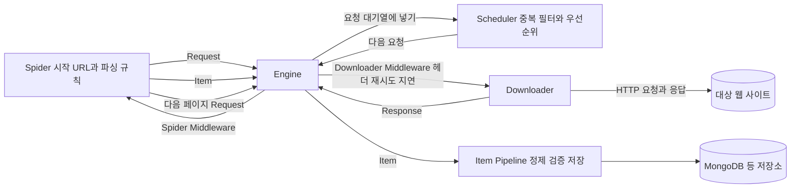

# 웹 스크래핑 (Scrapy · Selenium · BeautifulSoup)

## 한 줄 정의 {#definition}

웹 스크래핑은 웹 페이지를 요청해 받은 HTML(또는 브라우저가 렌더링한 결과)에서 필요한 값을 골라 구조화된 데이터로 저장하는 일이다. Scrapy는 이를 대량·비동기로 하는 크롤링 프레임워크, Selenium·Playwright는 실제 브라우저를 조종하는 도구, BeautifulSoup은 HTML 파서다.

**언제 쓰나**

- 공개 API가 없는 사이트에서 목록·상세 정보를 정기적으로 모을 때
- 수집 결과를 DB에 쌓아 증분 적재·분석의 입력으로 쓸 때
- 로그인, 버튼 클릭, 무한 스크롤처럼 JavaScript 실행이 필요한 페이지에서 값을 꺼낼 때(브라우저 자동화)

## 핵심 개념 {#concepts}

| 용어 | 설명 |
|------|------|
| 정적 페이지 | 서버가 보낸 HTML 안에 데이터가 이미 들어 있는 페이지. HTTP 요청 + 파서로 충분하다. |
| 동적 페이지 | 브라우저에서 JavaScript가 실행된 뒤 데이터가 채워지는 페이지. 브라우저 자동화나 내부 API 호출이 필요하다. |
| Selector (CSS / XPath) | HTML에서 원하는 요소를 가리키는 경로. `div.price::text`, `//h1/text()` 같은 형태. |
| robots.txt | 사이트가 크롤러에게 허용·금지 경로를 알리는 파일. 지키는 것이 기본 예의이고 Scrapy는 설정으로 따른다. |
| Rate limiting | 요청 간격·동시 요청 수를 제한해 대상 서버에 부담을 주지 않는 것. 너무 빠르면 차단(429, 403)된다. |
| Retry | 타임아웃, 5xx, 429 같은 일시 오류에서 다시 요청하는 것. 횟수와 간격(backoff)을 정해 둔다. |
| User-Agent | 요청 주체를 알리는 헤더. 기본값 그대로면 차단되는 경우가 많다. |
| Pagination | 목록이 여러 페이지로 나뉜 구조. "다음" 링크를 따라가거나 페이지 번호를 바꿔 요청한다. |
| Item / Pipeline | Scrapy에서 추출 결과를 담는 객체(Item)와, 그것을 정제·검증·저장하는 후처리 단계(Pipeline). |

## 동작 원리 {#how-it-works}

Scrapy는 Twisted 기반 비동기 엔진이 요청과 응답을 흘려 보내는 구조다.



1. **Spider**가 시작 URL로 `Request`를 만든다. 응답을 받으면 `parse()`에서 Selector로 값을 뽑아 `Item`을 내보내고, 다음 페이지·상세 페이지 링크는 새 `Request`로 내보낸다.
2. **Scheduler**는 요청을 큐에 넣고 같은 URL 중복 요청을 걸러 낸다.
3. **Downloader**가 실제 HTTP 요청을 보낸다. 그 앞의 Downloader Middleware에서 User-Agent, 재시도(`RetryMiddleware`), 요청 지연이 적용된다.
4. **Item Pipeline**이 Item을 받아 타입 변환·검증·중복 제거 후 DB에 쓴다.
5. 응답을 기다리는 동안 다른 요청을 계속 보내므로(비동기) 스레드 없이도 동시성이 높다.

**Spider와 설정 예시**

```python
import scrapy

class BooksSpider(scrapy.Spider):
    name = "books"
    start_urls = ["http://books.toscrape.com/"]

    def parse(self, response):
        for book in response.css("article.product_pod"):
            yield {
                "title": book.css("h3 a::attr(title)").get(),
                "price": float(book.css("p.price_color::text").get().lstrip("£")),
            }
        next_page = response.css("li.next a::attr(href)").get()
        if next_page:
            yield response.follow(next_page, self.parse)
```

```python
# settings.py: 요청 제어
ROBOTSTXT_OBEY = True
DOWNLOAD_DELAY = 1.0                 # 요청 간격(초)
CONCURRENT_REQUESTS_PER_DOMAIN = 4
RETRY_ENABLED = True
RETRY_TIMES = 3                      # 일시 오류 재시도 횟수
AUTOTHROTTLE_ENABLED = True          # 응답 속도를 보고 지연 자동 조절
LOG_FILE = "crawl.log"
```

**동적 페이지 처리 순서**

1. 브라우저 개발자 도구 Network 탭에서 페이지가 호출하는 내부 JSON API가 있는지 먼저 본다. 있으면 그 API를 직접 요청하는 것이 가장 빠르고 안정적이다.
2. 없으면 Selenium·Playwright로 페이지를 띄우고, 요소가 나타날 때까지 명시적 대기(explicit wait)를 건 뒤 렌더링된 HTML을 BeautifulSoup 등으로 파싱한다.

## 내가 썼던 방식 {#my-usage}

- Scrapy 기반 데이터 수집 Pipeline: Scrapy 스파이더로 도서 목록 사이트(Books to Scrape)의 정적 HTML을 파싱해 50개 카테고리, 약 1,000건의 도서 정보(제목, 가격, 별점, 재고상태, 카테고리)를 수집했다. 과도한 요청을 막도록 요청 간격과 재시도를 설정했고, 로그 파일로 장애 분석과 중간 결과를 확인했다. Pipeline에서 가격의 통화 기호를 빼 float로, 별점 텍스트를 숫자로 바꿔 MongoDB에 적재하고 Excel 파일로 중복·누락·타입을 검토했다.
- 데이터 수집 API · ETL 파이프라인: Selenium·BeautifulSoup 스크래핑 모듈을 API로 제공해 재사용하게 했고, RabbitMQ 비동기 요청과 Redis 캐싱으로 수집 요청 처리를 구조화했다. 초기 데이터 약 50,000건을 수집·적재한 뒤 Airflow DAG로 일 단위 증분 수집·적재를 자동화했다.
- NLP 기반 한국어 텍스트 처리 Pipeline: Scrapy로 한국어 텍스트를 수집해 Spark로 처리하는 흐름을 구성하고, Airflow로 수집·처리 워크플로우를 오케스트레이션했다.
- 외부 소스 수집 워크플로우 (서브 프로젝트): 뉴스·의약품 등 외부 소스 수집 워크플로우를 개발하고 Airflow 증분 적재를 구성했다.

## 장단점과 함정 {#pros-cons}

**Scrapy 장점**

- 비동기 요청, 중복 필터, 재시도, 요청 지연, 로그, 파이프라인이 프레임워크에 다 들어 있다.
- 수천~수만 페이지 크롤링에서도 메모리·속도가 안정적이다.

**Scrapy 단점**

- JavaScript 렌더링을 못 한다. 동적 페이지는 내부 API를 찾거나 브라우저 도구와 연동(scrapy-playwright 등)해야 한다.
- 프레임워크 구조(Spider, Middleware, Pipeline, settings)를 익히는 데 시간이 든다.

**브라우저 자동화(Selenium·Playwright) 장단점**

- 사람이 보는 화면 그대로 다룰 수 있어 로그인·클릭·스크롤이 필요한 페이지에 강하다.
- 페이지마다 브라우저가 렌더링하므로 느리고 메모리를 많이 쓴다. 대량 수집에는 맞지 않는다.

!!! tip "함정"
    - 사이트 구조가 바뀌면 Selector가 조용히 `None`을 돌려준다. 필수 필드가 비면 경고를 남기고 건수를 모니터링한다.
    - `time.sleep()` 고정 대기는 느리고 불안정하다. Selenium은 `WebDriverWait`로 요소 조건을 기다린다.
    - 재시도 없이 돌리면 일시 오류 한 번에 해당 페이지가 영구 누락된다. 반대로 4xx(404, 403)를 무한 재시도하면 차단이 심해진다.
    - 수집 시각과 원본 URL을 같이 저장해야 나중에 누락·중복을 추적할 수 있다.
    - 이용약관과 robots.txt를 먼저 확인한다. 개인정보가 포함된 페이지는 수집 대상에서 뺀다.

## 비교 {#comparison}

| 항목 | Requests + BeautifulSoup | Scrapy | Selenium | Playwright |
|------|--------------------------|--------|----------|------------|
| 페이지 종류 | 정적 | 정적 (동적은 연동 필요) | 정적·동적 | 정적·동적 |
| 방식 | HTTP 요청 + HTML 파서 | 비동기 크롤링 프레임워크 | 실제 브라우저 조종 (WebDriver) | 실제 브라우저 조종 (자체 프로토콜) |
| 속도 | 빠름 (요청 단위) | 가장 빠름 (대량) | 느림 | Selenium보다 빠른 편 |
| 동시성 | 직접 구현(스레드, asyncio) | 기본 내장 | 브라우저 여러 개 필요 | async API, 브라우저 컨텍스트 여러 개 |
| 재시도·지연·중복 필터 | 직접 구현 | 설정으로 제공 | 직접 구현 | 직접 구현 |
| 대기 처리 | 해당 없음 | 해당 없음 | 명시적 대기 코드 필요 | 자동 대기(auto-wait) 내장 |
| 학습 곡선 | 낮음 | 중간 | 낮음~중간 | 중간 |
| 잘 맞는 곳 | 페이지 수가 적은 단발 수집 | 정적 사이트 대량 정기 수집 | 로그인·클릭이 필요한 소량 수집, 레거시 | 동적 페이지 수집, E2E 테스트 |

정적이면 Requests+BS4(소량) 또는 Scrapy(대량), 동적이면 먼저 내부 API를 찾고, 없을 때 Playwright·Selenium을 쓴다.

## 예상 질문 {#interview}

[예상질문 보기](../../interview/ingestion.md#scraping)

## 더 보기 {#links}

- [Scrapy: Architecture overview](https://docs.scrapy.org/en/latest/topics/architecture.html)
- [Scrapy: Settings](https://docs.scrapy.org/en/latest/topics/settings.html)
- [Beautiful Soup Documentation](https://www.crummy.com/software/BeautifulSoup/bs4/doc/)
- [Selenium: Waiting Strategies](https://www.selenium.dev/documentation/webdriver/waits/)
- [Playwright for Python](https://playwright.dev/python/docs/intro)
