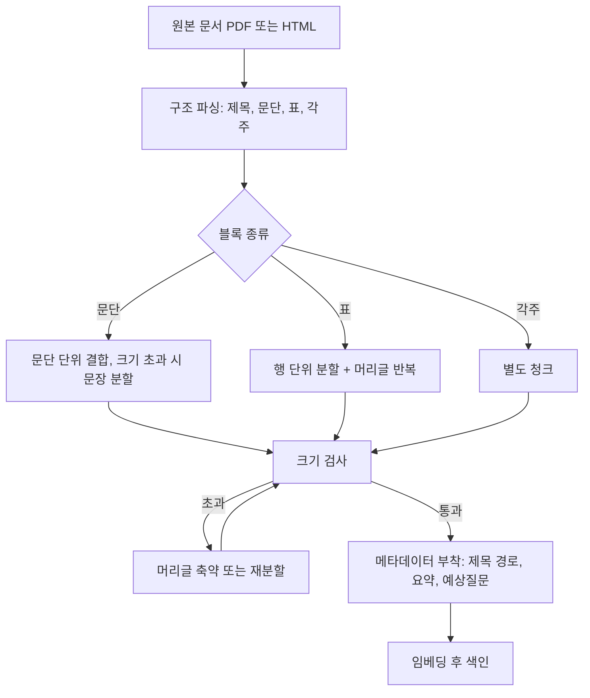

# 청킹

## 한 줄 정의 {#definition}

청킹(chunking)은 긴 문서를 검색·임베딩·LLM 입력에 맞는 크기의 조각(청크)으로 나누는 일이다. RAG 품질은 "무엇을 한 덩어리로 묶었나"에 크게 좌우된다.

**언제 쓰나**

- 문서가 임베딩 모델의 최대 입력 길이나 LLM 컨텍스트에 그대로 들어가지 않을 때
- 검색 결과로 문서 전체가 아니라 질문에 답하는 부분만 돌려주고 싶을 때
- 표·목록·각주처럼 구조가 있는 문서를 의미가 깨지지 않게 나눠야 할 때

청크가 너무 크면 관련 없는 내용이 섞여 검색 점수가 흐려지고, 너무 작으면 답에 필요한 맥락이 잘린다.

## 핵심 개념 {#concepts}

| 용어 | 설명 |
|------|------|
| Chunk size | 청크 하나의 최대 길이. 글자 수 또는 토큰 수로 잰다. 임베딩 모델 입력 한도보다 작아야 한다. |
| Overlap | 이웃 청크가 겹치는 길이. 경계에서 문장이 잘려 맥락을 잃는 것을 줄인다. 대신 저장량과 중복 결과가 는다. |
| Separator | 나눌 경계. 문단(빈 줄), 문장, 제목, 표 행 같은 구조 단위가 글자 수보다 낫다. |
| Recursive split | 큰 구분자(문단)로 먼저 나누고, 그래도 크면 작은 구분자(문장, 공백)로 다시 나누는 방식. |
| 표 보존 분할 | 표를 행 단위로 나누되 각 청크에 머리글(열 이름)을 반복해 붙여, 청크 하나만 봐도 값의 의미를 알게 하는 방식. |
| Parent-child | 작은 청크(child)로 검색하고, 답변 생성에는 그 청크가 속한 큰 단위(parent)를 넘기는 방식. |
| Contextual metadata | 청크마다 문서 제목, 소제목 경로, 요약, 예상질문을 함께 저장해 검색 단서를 늘리는 것. |
| 각주 분리 | 표 아래 각주처럼 모든 행에 공통인 설명을 별도 청크로 떼어 청크 크기 폭증을 막는 것. |

## 동작 원리 {#how-it-works}



1. **파싱이 먼저다.** 글자만 뽑은 뒤 길이로 자르면 표가 한 줄로 뭉개지고 제목과 본문의 관계가 사라진다. 제목·문단·표·각주를 블록으로 구분해 두고 나눈다.
2. **블록 종류별로 다르게 나눈다.** 문단은 이어 붙이다 크기를 넘으면 자르고, 표는 행 단위로 나누며 머리글을 반복한다.
3. **크기 검사를 마지막에 반드시 한다.** 큰 표는 머리글만으로도 길어질 수 있다. 초과하면 머리글 반복을 줄이거나 다시 나눈다.
4. **메타데이터를 붙인다.** 청크 본문만으로는 "어느 문서의 어느 절"인지 모를 수 있으므로, 상위 제목 경로와 요약·예상질문 필드를 함께 저장한다.

**표 행 분할 예시**

```text
[원본 표] 구분 | 2024 | 2025
          매출 | 100  | 120
          비용 | 80   | 90

[청크 1] 표: 연도별 실적 / 구분: 매출 / 2024: 100 / 2025: 120
[청크 2] 표: 연도별 실적 / 구분: 비용 / 2024: 80 / 2025: 90
```

행마다 표 이름과 열 이름이 붙어 있어, 청크 하나만 검색돼도 "2025년 매출 120"이라는 의미가 유지된다.

**크기와 겹침 정하기**

| 선택 | 장점 | 단점 |
|------|------|------|
| 작은 청크 (수백 자) | 검색이 정밀, 노이즈가 적음 | 맥락 부족, 청크 수 증가 |
| 큰 청크 (수천 자) | 맥락이 풍부 | 점수가 흐려짐, 모델 입력 한도 초과 위험 |
| overlap 있음 | 경계에서 맥락 보존 | 저장량 증가, 비슷한 청크가 중복으로 검색됨 |
| overlap 없음 | 단순, 중복 없음 | 문장·표 행이 경계에서 잘릴 위험 |

정답은 없고, 평가셋으로 몇 가지 설정을 비교해 고른다.

## 내가 썼던 방식 {#my-usage}

- 지식기반 검색 RAG 파이프라인:
    - 표 구조 보존 청커(행 단위 분할·머리글 반복)를 구축해 HTML 234건을 15,458청크로 나눴고 크기 초과 청크는 0건이었다.
    - 대형 표를 분할할 때 청크 크기 초과(최대 2,932자)가 생겨, 긴 머리글 반복을 중단하고 각주를 별도 청크로 분리했다. 초과 청크 183개 → 0개.
    - 표 바로 앞 소제목이 빠져 당기·전기 수치 답변이 뒤바뀌는 문제를, 표 앞 짧은 소제목을 표 이름표에 붙여 해결했고 해당 문항은 정답 처리됐다.
    - 설명요약·예상질문 메타데이터 필드로 RAG 검색을 확장하는 구조를 설계했다.
    - HTML 추출 파이프라인을 구축해 표 37개를 변환하고 52청크를 적재했다.
    - 다단 머리글 등 복잡한 표를 문장으로 바꾸는 규칙을 구현했고, 원본 대조 검수 104/104를 통과했다.

## 장단점과 함정 {#pros-cons}

**장점**

- 구조 기반 청킹은 표·목록 질문의 정답률을 직접 올린다.
- 메타데이터(제목 경로, 요약, 예상질문)를 붙이면 본문에 없는 표현으로도 찾을 수 있다.
- 청크 단위로 출처(문서, 페이지)를 남겨 답변 근거를 보여주기 쉽다.

**단점**

- 문서 형식(PDF, HTML, 표 구조)마다 파서와 규칙이 따로 필요하다.
- 규칙을 바꾸면 전체 재청킹·재임베딩·재색인이 필요하다.
- 요약·예상질문 생성은 LLM 호출 비용이 든다.

!!! tip "함정"
    - 글자 수 고정 분할은 표 한 행을 두 청크로 쪼개 숫자와 열 이름을 분리시킨다.
    - 표 바로 앞 소제목, 단위 표기("단위: 백만원"), 기준 시점 같은 짧은 문장이 표와 떨어지면 수치 답변이 틀린다. 표 이름표에 함께 붙인다.
    - 머리글 반복은 행이 많고 열 이름이 긴 표에서 청크 크기를 폭증시킨다. 크기 검사 결과를 숫자로 확인한다.
    - 청크 수가 늘면 임베딩 비용과 벡터 메모리도 같이 는다.

## 비교 {#comparison}

**청킹 전략**

| 전략 | 나누는 기준 | 강한 문서 | 약점 |
|------|-------------|-----------|------|
| 고정 길이 | N자 또는 N토큰 + overlap | 구조 없는 평문 | 문장·표가 중간에 잘림 |
| Recursive | 문단 → 문장 → 공백 순으로 재귀 분할 | 일반 문서, 블로그, 매뉴얼 | 표 구조는 모름 |
| 문단·제목 단위 | 제목 계층과 문단 경계 | 절이 잘 나뉜 규정·보고서 | 절 길이 편차가 크면 크기 초과 |
| 표 보존 (행 분할 + 머리글 반복) | 표 행, 열 이름 반복 | 표가 많은 금융·통계 문서 | 긴 머리글이면 크기 폭증, 각주 처리 필요 |
| Parent-child | 작은 청크로 검색, 큰 단위로 답변 | 맥락이 긴 설명 문서 | 저장 구조와 조회 로직이 복잡 |
| 요약·예상질문 메타데이터 | 본문 + LLM 생성 요약·질문 필드 | 바꿔 말한 질문이 많은 서비스 | 생성 비용, 생성 오류가 검색에 섞일 위험 |

## 예상 질문 {#interview}

[예상질문 보기](../../interview/llm-rag.md#chunking)

## 더 보기 {#links}

- [LangChain: Text splitters](https://python.langchain.com/docs/concepts/text_splitters/)
- [Anthropic: Contextual Retrieval](https://www.anthropic.com/news/contextual-retrieval)
- [Pinecone: Chunking strategies](https://www.pinecone.io/learn/chunking-strategies/)
- [Elasticsearch: Semantic search with chunking](https://www.elastic.co/docs/solutions/search/semantic-search)
