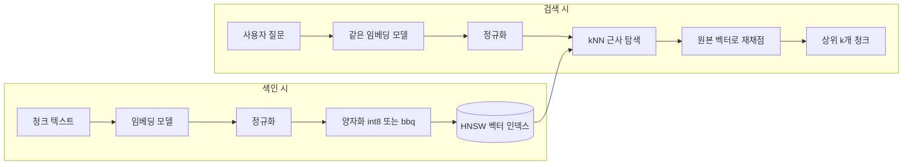

# 임베딩

## 한 줄 정의 {#definition}

임베딩(embedding)은 문장·문서를 고정 길이 숫자 벡터로 바꾼 것이다. 의미가 비슷한 글은 벡터 공간에서 가깝게 놓이므로, 벡터 사이 거리로 "비슷한 문서"를 찾을 수 있다.

**언제 쓰나**

- RAG에서 질문과 의미가 가까운 청크를 찾을 때 (벡터 검색, kNN)
- 표현은 다르지만 뜻이 같은 질문(바꿔 말한 질문, 동의어)을 찾아야 할 때
- 문서 군집화, 중복 탐지, 분류 모델의 입력 특징으로 쓸 때

정확한 용어·코드·숫자 일치는 키워드 검색(BM25)이 더 강하다. 실무에서는 둘을 합친 하이브리드 검색을 많이 쓴다.

## 핵심 개념 {#concepts}

| 용어 | 설명 |
|------|------|
| Dense vector | 모든 차원에 값이 있는 실수 벡터(예: 1024차원). 의미 유사도를 잡는다. 보통 "임베딩"이라 하면 이것이다. |
| Sparse vector | 대부분 0이고 일부 토큰 위치에만 가중치가 있는 벡터. BM25나 학습된 sparse 모델(lexical weight)이 만든다. 단어 일치를 잡는다. |
| Multi-vector (ColBERT) | 문서를 토큰마다 벡터 하나씩 저장하고, 질문 토큰과 문서 토큰의 최대 유사도를 합산(late interaction)한다. 정확하지만 저장 공간이 크다. |
| Dimension | 벡터 길이. 클수록 표현력이 크지만 메모리·계산이 늘어난다. 인덱스의 `dims`는 모델 출력 차원과 같아야 한다. |
| Cosine similarity | 두 벡터의 각도만 본 유사도. 길이(크기)는 무시한다. |
| Dot product | 내적. 벡터를 길이 1로 정규화(normalize)해 두면 cosine과 같은 순위를 내고 계산이 더 싸다. |
| Normalization | 벡터를 길이 1로 맞추는 것. 색인과 질문 양쪽에 같은 처리를 해야 점수가 맞는다. |
| bge-m3 | BAAI의 다국어 임베딩 모델. 100개 이상 언어, 최대 8192 토큰 입력, 1024차원 dense 출력에 sparse·multi-vector 출력도 함께 낸다. |
| Quantization | float32 벡터를 int8, 1비트 등 작은 형식으로 압축해 메모리를 줄이는 것. 정확도 손실은 재채점(rescoring)으로 메운다. |
| HNSW | 벡터를 여러 층의 근접 그래프로 연결해, 전체를 다 비교하지 않고 가까운 이웃을 근사로 찾는 인덱스. |

## 동작 원리 {#how-it-works}



1. 색인할 청크를 임베딩 모델에 넣어 벡터를 만든다. 질문도 **같은 모델, 같은 전처리**로 벡터화해야 같은 공간에서 비교된다.
2. 벡터는 HNSW 그래프에 들어간다. 검색은 위층에서 대략 가까운 노드를 찾고 아래층으로 내려가며 이웃을 좁힌다. `num_candidates`(후보 수)를 늘리면 정확도는 오르고 속도는 떨어진다.
3. 양자화된 인덱스는 압축 벡터로 후보를 빠르게 고른 뒤, 원본(float32) 벡터로 상위 후보 점수를 다시 계산해 순위를 바로잡는다.
4. 모델의 최대 입력 길이를 넘는 텍스트는 잘린다. 그래서 문서를 그대로 넣지 않고 청킹한 뒤 임베딩한다.

**양자화 방식별 메모리 (1024차원 기준)**

| 형식 | 차원당 크기 | 벡터 1개 | float32 대비 | 특징 |
|------|-------------|----------|--------------|------|
| float32 | 4 byte | 4 KB | 1 | 원본. 가장 정확하지만 메모리가 가장 크다. |
| int8 | 1 byte | 1 KB | 약 1/4 | 정확도 손실이 작아 무난한 기본 선택. |
| int4 | 0.5 byte | 0.5 KB | 약 1/8 | int8보다 작고 손실이 조금 더 크다. |
| bbq (1비트) | 1 bit | 128 byte | 약 1/32 | Better Binary Quantization. 차원당 1비트와 보정값만 저장하고, 원본 벡터로 재채점해 정확도를 지킨다. |

벡터 자체 크기는 위와 같지만, 실제 메모리에는 HNSW 그래프와 보정값도 들어가므로 전체 절감 폭은 표의 비율보다 작게 나온다. 그래서 같은 평가셋으로 정확도와 실제 메모리를 함께 재 보고 고른다.

**Elasticsearch `dense_vector` 설정**

```json
"content_vec": {
  "type": "dense_vector",
  "dims": 1024,
  "similarity": "cosine",
  "index_options": { "type": "bbq_hnsw" }
}
```

- `index_options.type`: `hnsw`(float32), `int8_hnsw`, `int4_hnsw`, `bbq_hnsw`, 그래프 없이 전수 비교하는 `flat` 계열(`int8_flat`, `bbq_flat` 등).
- `similarity`: `cosine`, `dot_product`(정규화된 벡터 필요), `l2_norm`, `max_inner_product`.

## 내가 썼던 방식 {#my-usage}

- 지식기반 검색 RAG 파이프라인:
    - bge-m3 벡터의 양자화 방식을 비교 평가해, bbq 적용으로 정확도 손실 없이 메모리를 1/7로 줄였다.
    - 설명요약·예상질문 메타데이터 필드로 검색을 확장하는 구조를 설계했고, 요약·예상질문 벡터를 추가한 하이브리드 검색으로 바꿔말한 질문 검색을 16/20 → 18/20으로 올렸다.
    - 표 열 이름이 '----'로 잘못 적재된 7청크를 PDF 파서의 구분선 오인으로 확인하고 구분선 행을 제거해 재적재했다. 오류 청크 7 → 0, 표 질의 벡터 MRR 0.85 → 0.92.
- 올리브영 클론 프로젝트 (부트캠프 실습): S3 Vectors 적재 스크립트를 수정했다.

## 장단점과 함정 {#pros-cons}

**장점**

- 표현이 달라도 뜻이 같으면 찾는다. 동의어 사전을 따로 관리할 필요가 줄어든다.
- 다국어 모델이면 한국어 질문으로 영어 문서를 찾는 식의 교차 언어 검색도 된다.
- 텍스트 외에 이미지·코드 임베딩도 같은 방식(벡터 + kNN)으로 다룰 수 있다.

**단점**

- 정확한 숫자, 코드, 고유명사 일치에 약하다.
- 모델을 바꾸면 전체 문서를 다시 임베딩하고 재색인해야 한다.
- 벡터 인덱스는 메모리를 많이 쓴다. 문서 수 × 차원 × 4 byte가 원본 크기의 출발점이다.

!!! tip "함정"
    - 색인과 질문에 다른 모델·다른 정규화를 쓰면 점수가 의미 없어진다. 모델 이름과 버전을 인덱스 메타데이터로 남긴다.
    - 모델의 최대 입력 길이를 넘는 청크는 조용히 잘린다. 청크 크기를 토큰 기준으로 확인한다.
    - 일부 모델은 질문과 문서에 다른 접두어(instruction prefix)를 요구한다. 모델 카드를 확인한다.
    - 양자화 비교는 "메모리 몇 배"만 보지 말고 같은 평가셋의 Hit@k·MRR로 손실 여부를 확인한다.

## 비교 {#comparison}

**임베딩 모델 선택 기준**

| 기준 | 확인할 것 | 예 |
|------|-----------|----|
| 언어 | 한국어 성능, 다국어 지원 | 다국어 모델(bge-m3 등) vs 영어 중심 모델 |
| 입력 길이 | 최대 토큰 수가 청크 크기보다 큰가 | bge-m3는 8192 토큰 |
| 차원 | 메모리 예산 안에 들어가는가 | 1024차원 vs 3072차원 |
| 출력 종류 | dense만인가, sparse·multi-vector도 주는가 | bge-m3는 세 가지 모두 |
| 실행 위치 | 로컬(GPU 필요) vs API(호출 비용, 외부 전송) | 오픈 모델 로컬 서빙 vs OpenAI `text-embedding-3` 계열 API |
| 실제 성능 | 내 문서·질문 평가셋의 Hit@k, MRR | 공개 벤치마크보다 자체 평가셋을 우선 |

**Dense vs Sparse vs Multi-vector**

| 항목 | Dense | Sparse | Multi-vector (ColBERT) |
|------|-------|--------|------------------------|
| 잡는 것 | 의미 | 단어 일치와 가중치 | 토큰 단위 세밀한 일치 |
| 저장 크기 | 문서당 벡터 1개 | 등장 토큰 수만큼 (작음) | 토큰 수 × 차원 (큼) |
| 강한 경우 | 바꿔 말한 질문 | 고유명사, 용어 | 긴 질문, 정밀 순위 |
| 흔한 용도 | 1차 후보 검색 | 1차 후보 검색 (BM25 대체·보완) | 상위 후보 재순위 |

## 예상 질문 {#interview}

[예상질문 보기](../../interview/llm-rag.md#embeddings)

## 더 보기 {#links}

- [BAAI bge-m3 모델 카드](https://huggingface.co/BAAI/bge-m3)
- [Elasticsearch: dense_vector field type](https://www.elastic.co/docs/reference/elasticsearch/mapping-reference/dense-vector)
- [Elasticsearch: kNN search](https://www.elastic.co/docs/solutions/search/vector/knn)
- [Elastic Search Labs: Better Binary Quantization](https://www.elastic.co/search-labs/blog/better-binary-quantization-lucene-elasticsearch)
- [OpenAI: Embeddings guide](https://platform.openai.com/docs/guides/embeddings)
