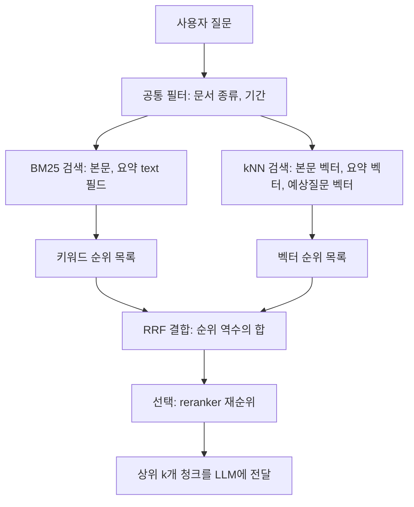

# 하이브리드 검색

## 한 줄 정의 {#definition}

하이브리드 검색(hybrid search)은 키워드 검색(BM25)과 벡터 검색(kNN)을 함께 실행하고 두 결과를 하나의 순위로 합치는 방식이다. 단어 일치와 의미 유사도의 약점을 서로 메운다.

**언제 쓰나**

- 질문에 고유명사·숫자·코드(키워드가 강함)와 문장형 표현(벡터가 강함)이 섞여 있을 때
- 사용자가 문서와 다른 말로 물어보는 경우가 많을 때 (바꿔 말한 질문)
- RAG에서 LLM에 넘길 상위 k개 청크의 재현율(recall)을 높이고 싶을 때

## 핵심 개념 {#concepts}

| 용어 | 설명 |
|------|------|
| BM25 | 키워드 관련도 점수. 질문 단어가 문서에 자주 나올수록(TF), 전체에서 드문 단어일수록(IDF) 높고, 긴 문서는 길이로 보정한다. TF 효과는 포화되어 같은 단어를 계속 반복해도 점수가 무한히 오르지 않는다. |
| kNN / ANN | 질문 벡터와 가까운 k개 벡터를 찾는 것. 대규모에서는 HNSW 같은 근사(ANN) 인덱스를 쓴다. |
| `num_candidates` | kNN에서 shard마다 살펴볼 후보 수. k보다 크게 잡을수록 정확하고 느려진다. |
| RRF | Reciprocal Rank Fusion. 각 검색 결과의 **순위**만 써서 `1 / (rank_constant + 순위)`를 더한다. 점수 크기가 다른 검색을 정규화 없이 합칠 수 있다. |
| Linear fusion | 각 점수를 0~1로 정규화한 뒤 가중합한다(예: 0.3 × BM25 + 0.7 × 벡터). 가중치 튜닝이 필요하다. |
| Filter | 문서 종류, 기간, 권한 같은 조건. 검색 전에 후보를 줄이는 pre-filter가 정확하다. |
| Reranker | 1차 검색 상위 수십 개를 cross-encoder 같은 무거운 모델로 다시 점수 매겨 순서를 바로잡는 단계. |
| Multi-field 검색 | 본문, 요약, 예상질문처럼 같은 청크의 여러 필드(또는 여러 벡터)를 함께 검색하는 것. |

## 동작 원리 {#how-it-works}



1. 같은 필터를 두 검색에 똑같이 건다. 한쪽만 걸면 결합 결과에 조건 밖 문서가 섞인다.
2. BM25와 kNN을 각각 실행해 순위 목록 두 개를 얻는다. 벡터 쪽은 본문 벡터 외에 요약·예상질문 벡터를 더 둘 수 있다.
3. RRF로 합친다. 두 목록 모두에서 상위권인 문서가 가장 높아진다.
4. 필요하면 reranker로 상위 후보를 다시 정렬하고, 최종 상위 k개를 LLM 프롬프트에 넣는다.

**RRF 계산 예시** (rank_constant = 60)

| 문서 | BM25 순위 | 벡터 순위 | RRF 점수 |
|------|-----------|-----------|----------|
| A | 1 | 3 | 1/61 + 1/63 = 0.0323 |
| B | 2 | 1 | 1/62 + 1/61 = 0.0325 |
| C | - | 2 | 1/62 = 0.0161 |
| D | 3 | - | 1/63 = 0.0159 |

B가 키워드에서는 2위였지만 두 목록 모두 상위라 최종 1위가 된다. 한 목록에만 있는 C, D는 뒤로 밀린다.

**Elasticsearch RRF 쿼리 예시**

```json
GET rag_chunks/_search
{
  "retriever": {
    "rrf": {
      "retrievers": [
        { "standard": { "query": { "match": { "content": "당기 순이익 증감" } } } },
        { "knn": { "field": "content_vec", "query_vector": [0.12, -0.03],
                   "k": 20, "num_candidates": 100 } }
      ],
      "rank_window_size": 50,
      "rank_constant": 60
    }
  }
}
```

`query_vector`는 실제로는 질문 임베딩 전체(예: 1024차원)를 넣는다.

## 내가 썼던 방식 {#my-usage}

- 지식기반 검색 RAG 파이프라인:
    - 검색 평가셋 22문항을 만들어 BM25·벡터·하이브리드의 Hit@5 비교를 자동화했다.
    - 설명요약·예상질문 메타데이터 필드로 검색을 확장하는 구조를 설계했고, 요약·예상질문 벡터를 추가한 하이브리드 검색을 적용해 바꿔말한 질문 검색을 16/20 → 18/20으로 올렸다.
    - 문서 스키마 7종을 Elasticsearch 인덱스 매핑으로 설계했다.

## 장단점과 함정 {#pros-cons}

**장점**

- 질문 유형이 섞여 있어도 한쪽 방식의 약점이 덜 드러난다.
- RRF는 점수 정규화와 가중치 튜닝 없이도 안정적인 기본값을 준다.
- 필터·집계·키워드·벡터를 한 엔진에서 처리하면 구성이 단순하다.

**단점**

- 두 검색을 함께 돌려 지연 시간과 자원이 는다.
- RRF는 점수 크기 정보를 버리므로, "한쪽이 압도적으로 확신하는" 경우를 살리지 못한다.
- 결합 방식, 후보 수, 가중치 등 조정할 값이 많아 평가셋 없이는 좋아졌는지 알 수 없다.

!!! tip "함정"
    - BM25 점수와 cosine 유사도를 그대로 더하면 크기 차이 때문에 한쪽이 결과를 지배한다. 정규화하거나 RRF를 쓴다.
    - kNN의 `k`, `num_candidates`가 작으면 RRF에 들어갈 후보 자체가 부족하다. `rank_window_size`와 함께 맞춘다.
    - 필터를 kNN 바깥(post-filter)에 걸면 k개 중 대부분이 걸러져 결과가 비는 경우가 있다. kNN 안의 `filter`로 건다.
    - 한국어 BM25는 analyzer가 성능을 좌우한다. 형태소 분석기(nori) 설정과 사용자 사전을 먼저 확인한다.

## 비교 {#comparison}

**BM25 vs 벡터 vs 하이브리드(RRF)**

| 항목 | BM25 | 벡터 (kNN) | 하이브리드 (RRF) |
|------|------|------------|------------------|
| 찾는 기준 | 단어 일치 | 의미 유사도 | 두 순위의 합의 |
| 강한 질문 | 용어, 고유명사, 숫자, 코드 | 바꿔 말한 질문, 문장형 질문 | 유형이 섞인 실제 질문 |
| 약한 질문 | 표현이 다른 질문 | 정확한 용어·숫자 일치 | 한쪽만 맞히는 질문(순위가 희석됨) |
| 준비물 | analyzer | 임베딩 모델, 벡터 메모리 | 둘 다 |
| 튜닝 | analyzer, 필드 boost | 모델, 후보 수, 양자화 | rank_constant, window, 후보 수 |
| 설명 가능성 | 높음 (어떤 단어가 맞았나) | 낮음 | 중간 |

**결합 방식: RRF vs 가중합**

| 항목 | RRF | 선형 가중합 |
|------|-----|-------------|
| 입력 | 순위 | 정규화된 점수 |
| 튜닝 | 거의 없음 (rank_constant) | 가중치·정규화 방식 필요 |
| 장점 | 점수 크기 차이에 강함, 기본값으로 안정적 | 점수 차이를 살려 세밀한 조정 가능 |
| 단점 | 점수 차이 정보 손실 | 데이터가 바뀌면 가중치 재조정 |

## 예상 질문 {#interview}

[예상질문 보기](../../interview/llm-rag.md#hybrid-search)

## 더 보기 {#links}

- [Elasticsearch: Reciprocal rank fusion](https://www.elastic.co/docs/reference/elasticsearch/rest-apis/reciprocal-rank-fusion)
- [Elasticsearch: Retrievers](https://www.elastic.co/docs/solutions/search/retrievers-overview)
- [Elasticsearch: kNN search](https://www.elastic.co/docs/solutions/search/vector/knn)
- [Elasticsearch: Similarity (BM25)](https://www.elastic.co/docs/reference/elasticsearch/index-settings/similarity)
- [Cormack et al., Reciprocal Rank Fusion (SIGIR 2009)](https://plg.uwaterloo.ca/~gvcormac/cormacksigir09-rrf.pdf)
