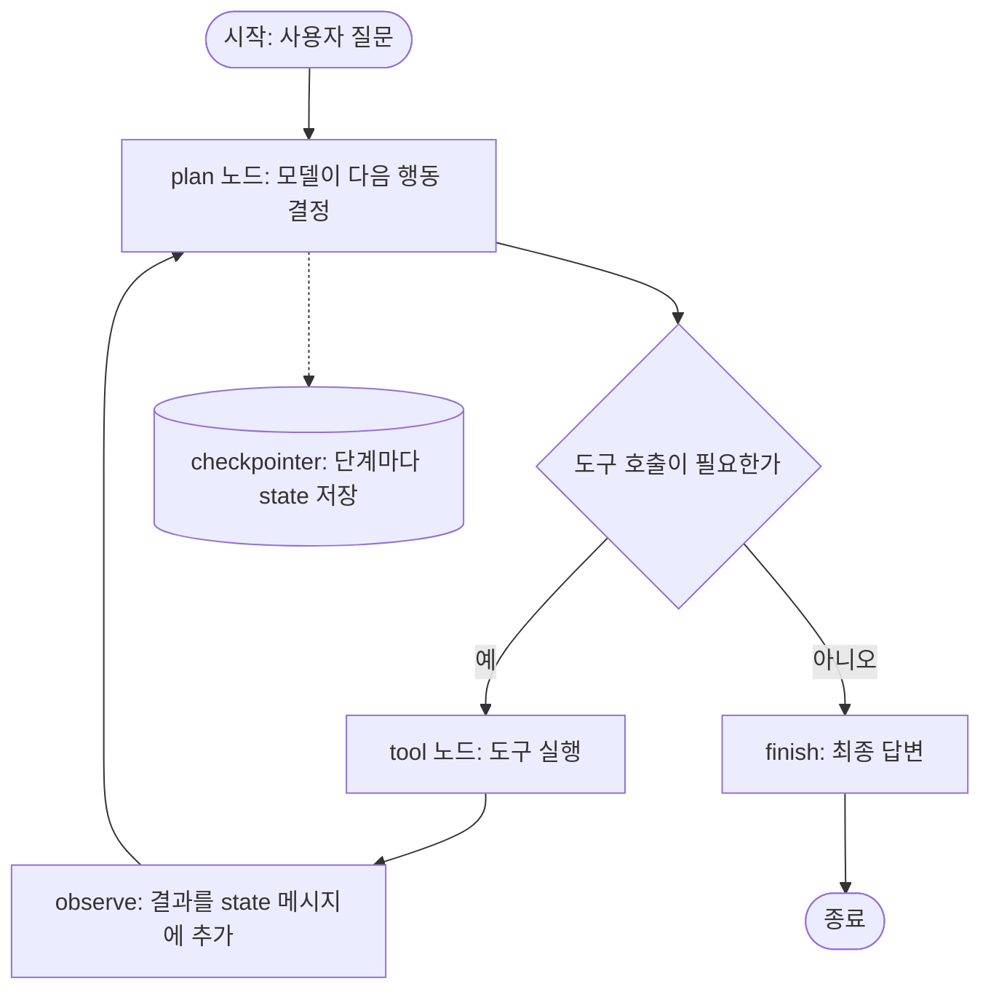

# LangChain · LangGraph

## 한 줄 정의 {#definition}

LangChain은 프롬프트·모델 호출·출력 파싱·도구 호출을 부품(runnable)으로 만들어 이어 붙이는 Python/JS 라이브러리이고, LangGraph는 그 위에서 상태(state)를 가진 그래프로 반복·분기·사람 승인이 있는 에이전트 흐름을 짜는 라이브러리다.

**언제 쓰나**

- 여러 LLM 제공자(OpenAI, Gemini, Anthropic 등)를 같은 인터페이스로 바꿔 끼우고 싶을 때
- "프롬프트 → 모델 → 파서"처럼 고정된 체인을 짧게 쓰고, 배치·스트리밍·재시도를 공통으로 붙일 때
- 모델이 도구를 고르고, 결과를 보고, 다시 판단하는 루프(에이전트)를 상태와 체크포인트로 관리할 때

한 번 호출하고 끝나는 작업이면 제공자 SDK를 직접 쓰는 편이 단순하다. 라이브러리는 부품 교체와 흐름 제어가 필요할 때 이득이 크다.

## 핵심 개념 {#concepts}

| 용어 | 설명 |
|------|------|
| Runnable | `invoke`, `batch`, `stream`을 공통으로 가진 실행 단위. 프롬프트, 모델, 파서, 검색기가 모두 runnable이다. |
| LCEL | LangChain Expression Language. 파이프 연산자로 prompt, model, parser 같은 runnable을 이어 체인을 만든다. |
| Prompt template | 변수 자리를 둔 프롬프트. `ChatPromptTemplate`은 system/user 메시지 목록을 만든다. |
| Output parser | 모델 출력 문자열을 dict, Pydantic 객체 등으로 바꾼다. 요즘은 `with_structured_output`으로 스키마를 직접 강제하는 경우가 많다. |
| Tool | 모델이 호출할 수 있는 함수. 이름·설명·인자 스키마가 모델에게 전달되고, 모델이 호출을 요청하면 코드가 실행한다. |
| Retriever | 질문을 받아 관련 문서 목록을 돌려주는 runnable. 벡터 저장소나 검색 엔진을 감싼다. |
| Memory | 대화 기록을 다음 호출에 넣는 방식. LangGraph에서는 체크포인트에 저장된 상태가 이 역할을 한다. |
| State (LangGraph) | 그래프 전체가 공유하는 dict 형태 데이터. 노드는 state를 읽고 바꿀 부분만 돌려준다. |
| Node / Edge | 노드는 한 단계 작업(함수), edge는 다음 노드로의 연결. conditional edge는 state를 보고 다음 노드를 고른다. |
| Checkpointer | 각 단계 뒤 state를 저장한다. 중단 후 재개, 대화 스레드 유지, human-in-the-loop 승인에 쓴다. |

## 동작 원리 {#how-it-works}



1. **LangChain 체인**은 위에서 아래로 한 번 흐른다. 프롬프트가 메시지를 만들고, 모델이 답하고, 파서가 형식을 맞춘다. 분기·반복이 없다.
2. **LangGraph 그래프**는 state를 들고 노드 사이를 돈다. plan 노드에서 모델이 도구 호출을 요청하면 tool 노드가 실행하고, 결과를 state에 붙인 뒤 다시 plan으로 돌아간다. 도구 호출이 없으면 finish로 빠진다.
3. 루프가 끝나지 않는 상황을 막기 위해 최대 단계 수(recursion limit)를 둔다.
4. checkpointer가 있으면 특정 노드 앞에서 멈추고(interrupt) 사람이 승인·수정한 뒤 이어서 실행할 수 있다. 이것이 human-in-the-loop다.

**LCEL 체인 예시**

```python
from langchain_core.prompts import ChatPromptTemplate
from langchain_openai import ChatOpenAI
from pydantic import BaseModel

class Item(BaseModel):
    name: str
    category: str

prompt = ChatPromptTemplate.from_messages([
    ("system", "문서에서 항목 이름과 분류를 뽑아라."),
    ("user", "{text}"),
])
llm = ChatOpenAI(temperature=0)
chain = prompt | llm.with_structured_output(Item)

result = chain.invoke({"text": "..."})       # Item 객체
results = chain.batch([{"text": t} for t in texts])  # 여러 건 병렬
```

**LangGraph 최소 구조**

```python
from typing import Annotated, TypedDict
from langgraph.graph import StateGraph, START, END
from langgraph.graph.message import add_messages

class State(TypedDict):
    messages: Annotated[list, add_messages]

def plan(state: State):
    return {"messages": [llm_with_tools.invoke(state["messages"])]}

def route(state: State):
    return "tools" if state["messages"][-1].tool_calls else END

g = StateGraph(State)
g.add_node("plan", plan)
g.add_node("tools", tool_node)
g.add_edge(START, "plan")
g.add_conditional_edges("plan", route)
g.add_edge("tools", "plan")
app = g.compile(checkpointer=checkpointer)
```

- `add_messages`는 노드가 돌려준 메시지를 기존 목록에 덧붙이는 reducer다. reducer가 없으면 값이 덮어써진다.
- 같은 `thread_id`로 다시 호출하면 checkpointer가 이전 state를 불러와 대화가 이어진다.

## 내가 썼던 방식 {#my-usage}

- 데이터 수집 API · ETL 파이프라인: LangChain·OpenAI로 초기 데이터와 파일에서 통합 데이터를 추출했고, 매핑·정제·분류 단계를 추가해 데이터 정합성과 LLM 추출 정확도를 개선했다.
- 해외 법령 적재 · DB 관리: LangChain으로 법령 자동 번역과 참조 법령 탐색을 구현했고, 국가별 법령문 약 20,000건과 번역본을 서비스 DB에 반영했다.
- LLM & Agent 실습 (`ds` 저장소): langchain, langchain-openai, langgraph를 의존성으로 두고 LLM·에이전트 호출을 실습했다.

## 장단점과 함정 {#pros-cons}

**장점**

- 제공자별 모델 클래스가 같은 인터페이스라 모델 교체가 쉽다.
- `batch`, `stream`, 재시도, fallback 같은 공통 기능을 체인 전체에 붙일 수 있다.
- LangGraph는 반복·분기·중단 후 재개를 코드 구조로 드러내 에이전트 흐름을 디버깅하기 쉽게 한다.

**단점**

- 추상화 층이 두꺼워 에러가 났을 때 실제로 어떤 요청이 나갔는지 보기 어렵다.
- 버전이 빠르게 바뀌어 예전 예제(`LLMChain`, 구형 agent executor)가 그대로 안 돌아가는 경우가 많다.
- 단순 호출에는 SDK 직접 호출보다 코드가 오히려 길어진다.

!!! tip "함정"
    - 구조화 출력이 필요한데 문자열 파싱에 의존하면 형식이 조금만 달라도 깨진다. 스키마 기반 출력(`with_structured_output`, tool 인자 스키마)을 쓴다.
    - LangGraph state에서 리스트 필드에 reducer를 안 달면 노드가 돌려준 값이 기존 목록을 덮어쓴다.
    - 에이전트 루프에 최대 단계 수와 도구별 타임아웃이 없으면 비용이 폭주한다.
    - 프롬프트·모델·파서 버전을 고정하지 않으면 같은 입력이 다른 결과를 낸다. 추출 작업은 temperature 0과 평가셋으로 회귀를 확인한다.

## 비교 {#comparison}

**LangChain vs LangGraph vs 직접 API 호출**

| 항목 | LangChain (LCEL) | LangGraph | 직접 API 호출 (SDK) |
|------|------------------|-----------|---------------------|
| 흐름 모양 | 한 방향 체인 | 상태를 가진 그래프, 반복·분기 | 코드로 자유롭게 |
| 상태 관리 | 거의 없음 (입력 → 출력) | state + checkpointer | 직접 구현 |
| 사람 승인 | 직접 구현 | interrupt로 기본 지원 | 직접 구현 |
| 모델 교체 | 쉬움 (공통 인터페이스) | 쉬움 (LangChain 모델 사용) | 제공자별 코드 수정 |
| 디버깅 | 추상화 때문에 요청이 가려짐 | 노드 단위로 추적 | 요청·응답이 그대로 보임 |
| 잘 맞는 일 | 추출·번역·요약 같은 고정 파이프라인 | 도구를 쓰는 에이전트, 다단계 판단 | 단순 호출, 세밀한 제어, 최신 기능 바로 사용 |

## 예상 질문 {#interview}

- [예상질문 보기: LangChain](../../interview/llm-rag.md#langchain)
- [예상질문 보기: LangGraph 에이전트](../../interview/agent.md#langgraph-agent)

## 더 보기 {#links}

- [LangChain 문서](https://python.langchain.com/docs/introduction/)
- [LangChain: Runnable interface](https://python.langchain.com/docs/concepts/runnables/)
- [LangChain: Structured outputs](https://python.langchain.com/docs/concepts/structured_outputs/)
- [LangGraph 문서](https://langchain-ai.github.io/langgraph/)
- [LangGraph: Persistence](https://langchain-ai.github.io/langgraph/concepts/persistence/)
- [LangGraph: Human-in-the-loop](https://langchain-ai.github.io/langgraph/concepts/human_in_the_loop/)
