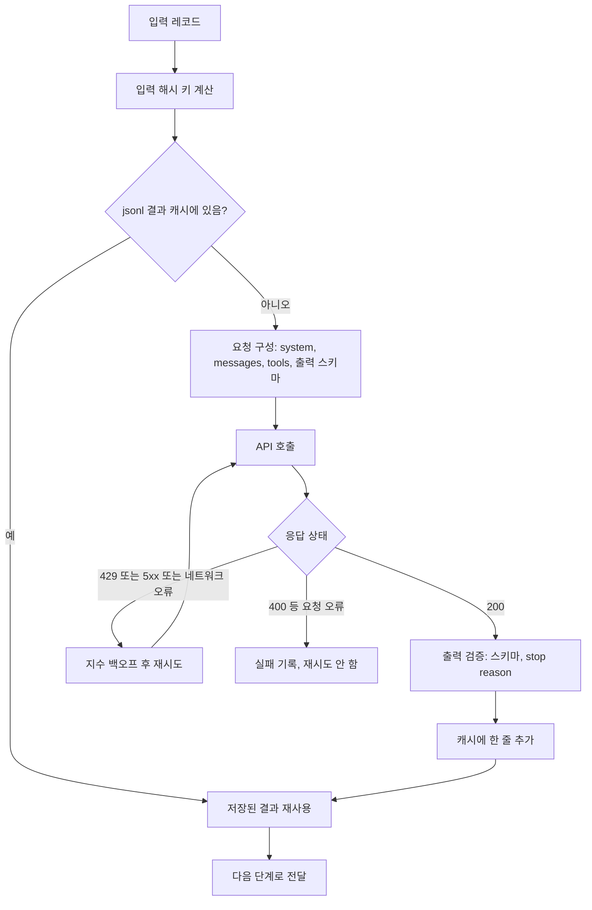

# LLM API

## 한 줄 정의 {#definition}

LLM API는 OpenAI, Google Gemini, Anthropic Claude 같은 모델 제공자가 HTTP로 여는 호출 창구다. 메시지(지시 + 입력)를 보내면 생성된 텍스트, 도구 호출 요청, 구조화된 JSON을 돌려받고, 입력·출력 토큰 수만큼 과금된다.

**언제 쓰나**

- 추출·번역·요약·분류처럼 텍스트를 이해하고 만들어야 하는 작업을 코드에 넣을 때
- 이미지·영상을 분석하거나 생성할 때 (멀티모달)
- 모델이 함수(도구)를 골라 호출하게 하는 에이전트를 만들 때

대량 배치에서는 모델 품질만큼 **재시도, 결과 캐시, 비용 관리**가 중요하다.

## 핵심 개념 {#concepts}

| 용어 | 설명 |
|------|------|
| Messages | 대화 형식의 입력. system(역할·규칙), user(질문·자료), assistant(이전 답) 메시지로 구성한다. API는 상태가 없어 매 요청에 필요한 기록을 다시 보낸다. |
| Token | 과금과 길이 제한의 단위. 한국어는 영어보다 같은 글자 수에 토큰이 더 많이 드는 경향이 있다. 입력 토큰과 출력 토큰 단가가 다르다. |
| Context window | 한 요청에 넣을 수 있는 입력 + 출력 토큰 상한. 최근 모델은 수십만~100만 토큰급이다. |
| Temperature | 출력의 무작위성. 추출·분류는 낮게, 아이디어·카피 생성은 높게 둔다. 일부 최신 모델은 sampling 파라미터 대신 reasoning effort 같은 다른 조절 값을 쓴다. |
| Streaming | 응답을 토큰이 생성되는 대로 조각(SSE 이벤트)으로 받는 것. 체감 지연을 줄이고, 긴 출력의 HTTP 타임아웃을 피한다. |
| Tool use (function calling) | 도구 이름·설명·인자 스키마를 보내면 모델이 "이 도구를 이 인자로 호출하라"는 요청을 돌려준다. 실제 실행은 내 코드가 하고 결과를 다시 보낸다. |
| Structured output | JSON Schema를 지정해 출력 형식을 강제하는 기능. 문자열 파싱 실패를 줄인다. |
| Rate limit | 분당 요청 수·토큰 수 제한. 넘으면 429 응답이 오고 `retry-after` 헤더로 대기 시간을 알려준다. |
| Exponential backoff | 실패 시 1초, 2초, 4초…처럼 대기 시간을 늘리며 재시도하는 것. 무작위 지연(jitter)을 더해 동시 재시도를 흩는다. |
| Prompt caching | 요청 앞부분(시스템 프롬프트, 긴 문서)이 같으면 제공자가 처리 결과를 재사용해 입력 비용과 지연을 줄이는 기능. 앞부분이 한 글자라도 바뀌면 캐시가 깨진다. |
| 결과 캐시 (idempotent cache) | 내 쪽에서 "같은 입력이면 같은 결과"를 저장해 두는 것. 입력의 해시를 키로 저장하면 재실행 시 완료분을 다시 호출하지 않는다. |
| Token counting | 요청 전에 입력 토큰 수를 세는 기능. 비용 추정과 컨텍스트 초과 방지에 쓴다. |

## 동작 원리 {#how-it-works}



1. **요청 구성**: 고정된 지시는 system에, 바뀌는 입력은 user 메시지에 둔다. 출력 형식은 structured output이나 도구 인자 스키마로 강제한다.
2. **결과 캐시 확인**: 입력(모델 이름, 프롬프트 버전, 입력 텍스트)의 해시를 키로 jsonl 파일을 먼저 본다. 이미 있으면 호출하지 않는다.
3. **호출과 재시도**: 429·5xx·네트워크 오류는 일시적이므로 백오프 후 재시도한다. 400(잘못된 요청)·401(인증)은 재시도해도 같으므로 바로 실패 처리한다.
4. **검증 후 저장**: `stop_reason`(또는 `finish_reason`)이 길이 초과가 아닌지, 출력이 스키마에 맞는지 확인하고 캐시에 한 줄씩 append한다. 한 줄 단위로 쓰면 도중에 죽어도 그 전까지의 결과는 남는다.

**해시 키 jsonl 캐시**

```python
import hashlib, json, pathlib

CACHE = pathlib.Path("llm_cache.jsonl")
done = {}
if CACHE.exists():
    for line in CACHE.open(encoding="utf-8"):
        row = json.loads(line)
        done[row["key"]] = row["output"]

def cached_call(model: str, prompt_version: str, text: str, call):
    key = hashlib.sha256(f"{model}|{prompt_version}|{text}".encode()).hexdigest()
    if key in done:
        return done[key]
    output = call(text)  # 내부에서 지수 백오프 재시도
    with CACHE.open("a", encoding="utf-8") as f:
        f.write(json.dumps({"key": key, "output": output}, ensure_ascii=False) + "\n")
    done[key] = output
    return output
```

**비용 감 잡기**: 비용 ≈ 입력 토큰 × 입력 단가 + 출력 토큰 × 출력 단가. 같은 시스템 프롬프트를 수천 번 보내는 배치라면 prompt caching과 결과 캐시가 가장 먼저 효과를 낸다. 급하지 않은 대량 작업은 제공자의 batch API(비동기, 할인 단가)도 고려한다.

## 내가 썼던 방식 {#my-usage}

- 지식기반 검색 RAG 파이프라인:
    - 수천 회 외부 LLM 호출 배치가 중간 DNS 오류로 중단되자, 호출 결과를 해시 키 jsonl 캐시로 저장해 재실행 시 완료분을 재사용하게 했다. 재실행 추가 호출 0회로 복구했고 재과금은 없었다.
    - 검색 → 답변 → 이중 판정(토큰·심판 LLM) 자동 평가 파이프라인에서 심판 LLM으로 탐침 질문 96건을 자동 채점했다.
- 데이터 수집 API · ETL 파이프라인: LangChain·OpenAI로 초기 데이터와 파일에서 통합 데이터를 추출했다.
- Smart Factory Data Agent: 백엔드에서 OpenAI API로 사용자 질문을 SELECT 전용 SQL로 변환했다. API 키는 `.env`의 `OPENAI_API_KEY`로 둔다.
- AI 기반 숏폼 영상 생성 시스템:
    - Gemini 2.5 Flash로 레퍼런스 영상 분석과 스크립트·훅 생성을 했다. 훅은 7가지 유형 중 하나를 랜덤으로 고르고 temperature 1.2로 같은 입력에도 매번 다른 훅이 나오게 했다.
    - Gemini 2.5 Flash Image로 씬별 이미지를 만들고, Veo 3.1 계열로 비디오 클립을 선택적으로 생성했다. `VEO_MODEL`을 비워두면 호출하지 않고, Veo quota 초과 시 MoviePy Ken Burns 이미지 영상으로 대체한다.
    - 나레이션은 Edge-TTS로 만들고, API 키는 `.env`의 `GEMINI_API_KEY`에만 둔다.
- 올리브영 클론 프로젝트 (부트캠프 실습): AI 챗봇에서 DB에서 조회한 상품 정보를 프롬프트에 포함해 AWS Bedrock InvokeModel로 Claude를 직접 호출하는 구성을 다뤘다.
- LLM & Agent 실습 (`ds` 저장소): `02_gemini.py`, `03_claude.py`, `chat_system.py`, `chat_stream_usage.py`, `count_tokens.py`, `prompt_techniques.py` 등으로 Gemini·Claude 호출, system 프롬프트, 스트리밍과 사용량, 토큰 계산, 프롬프트 기법을 실습했다.

## 장단점과 함정 {#pros-cons}

**장점**

- 모델을 직접 학습·서빙하지 않고도 최신 모델을 바로 쓴다.
- 멀티모달, 도구 호출, 구조화 출력 같은 기능을 API 옵션으로 켠다.
- 사용량만큼 과금되어 작은 실험의 시작 비용이 낮다.

**단점**

- 호출 수가 많아지면 비용과 rate limit이 병목이 된다.
- 네트워크·서비스 장애가 내 배치의 장애가 된다.
- 모델 버전이 바뀌거나 지원 종료되면 출력이 달라지므로 회귀 평가가 필요하다.

!!! tip "함정"
    - 재시도만 있고 결과 캐시가 없으면, 긴 배치가 중간에 죽었을 때 처음부터 다시 호출해 비용을 두 번 낸다.
    - 캐시 키에 모델 이름·프롬프트 버전을 넣지 않으면 프롬프트를 고쳐도 옛 결과가 재사용된다.
    - 400 같은 요청 오류까지 재시도하면 같은 실패를 반복하며 시간만 쓴다. 재시도 대상 상태 코드를 정한다.
    - 시스템 프롬프트에 현재 시각이나 요청 id를 넣으면 prompt caching이 매번 깨진다. 바뀌는 값은 뒤쪽 메시지에 둔다.
    - 출력이 `max_tokens`에서 잘렸는지(stop reason) 확인하지 않으면 잘린 JSON을 파싱하다 실패한다.
    - API 키를 코드에 넣지 않는다. `.env`나 비밀 저장소에 두고 저장소에는 올리지 않는다.

## 비교 {#comparison}

**OpenAI vs Gemini vs Anthropic (정성 비교)**

| 항목 | OpenAI | Google Gemini | Anthropic Claude |
|------|--------|---------------|------------------|
| 기본 호출 | Responses API, Chat Completions | `generateContent` | Messages API |
| 시스템 지시 | system·developer 메시지 | `system_instruction` | 최상위 `system` 필드 |
| 멀티모달 입력 | 텍스트, 이미지, 오디오 | 텍스트, 이미지, 오디오, 영상, PDF (영상 직접 입력이 강점) | 텍스트, 이미지, PDF |
| 구조화 출력 | JSON Schema 기반 structured outputs | `response_schema`로 JSON 강제 | `output_config.format` 또는 `strict` 도구 스키마 |
| 프롬프트 캐시 | 긴 공통 앞부분을 자동 캐시 | 암묵적 캐시 + 명시적 context caching | `cache_control`로 캐시 지점 지정 (앞부분 일치 방식) |
| 긴 컨텍스트 | 모델별로 다름 | 100만 토큰급 모델 제공 | 현재 주력 모델은 100만 토큰급 |
| 토큰 세기 | tiktoken 로컬 계산 등 | `countTokens` API | `count_tokens` 엔드포인트 |
| 생성 기능 | 이미지 생성 모델 별도 제공 | 이미지(Gemini Image), 영상(Veo) 생성 | 텍스트 출력 중심 |

현재 Claude 모델은 Claude Fable 5.1(`claude-fable-5-1`), Claude Opus 5.5, Claude Sonnet 5.5, Claude Haiku 4.5다. 세부 한도와 단가는 자주 바뀌므로 각 제공자 문서에서 확인한다.

**재시도 대상**

| 응답 | 의미 | 처리 |
|------|------|------|
| 429 | rate limit | `retry-after`만큼 기다리거나 지수 백오프 |
| 5xx, 529 등 | 서버 오류, 과부하 | 지수 백오프 + jitter |
| 네트워크 오류 (DNS, 연결 끊김) | 일시 장애 | 백오프 재시도, 결과 캐시로 완료분 보호 |
| 400, 401, 403, 404 | 요청·인증 문제 | 재시도하지 않고 원인 수정 |

## 예상 질문 {#interview}

[예상질문 보기](../../interview/llm-rag.md#llm-apis)

## 더 보기 {#links}

- [OpenAI API 문서](https://platform.openai.com/docs/overview)
- [OpenAI: Prompt caching](https://platform.openai.com/docs/guides/prompt-caching)
- [Gemini API 문서](https://ai.google.dev/gemini-api/docs)
- [Gemini API: Context caching](https://ai.google.dev/gemini-api/docs/caching)
- [Anthropic: Messages API](https://docs.anthropic.com/en/api/messages)
- [Anthropic: Prompt caching](https://docs.anthropic.com/en/docs/build-with-claude/prompt-caching)
