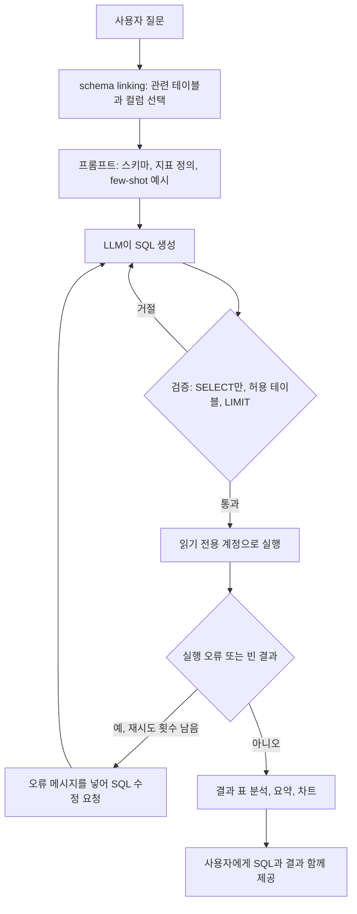

# NL2SQL

## 한 줄 정의 {#definition}

NL2SQL(Text-to-SQL)은 사용자의 자연어 질문을 LLM이 데이터베이스 SQL로 바꾸고, 그 SQL을 실행한 결과로 답하는 방식이다. SQL을 모르는 사람도 DB에 직접 질문할 수 있게 한다.

**언제 쓰나**

- KPI, 매출, 재고처럼 정형 테이블에 있는 값을 자연어로 조회·집계하고 싶을 때
- 대시보드에 없는 즉석 질문(필터·기간·그룹 조합)이 많을 때
- RAG가 문서 검색이라면, NL2SQL은 숫자가 DB에 있을 때의 검색이다

정답이 문서 문장 안에 있으면 RAG, 테이블 집계로 나오면 NL2SQL이 맞다. 둘을 함께 쓰는 에이전트도 많다.

## 핵심 개념 {#concepts}

| 용어 | 설명 |
|------|------|
| Schema linking | 질문의 단어를 실제 테이블·컬럼 이름에 연결하는 단계. "불량률" → `defects` 테이블의 어떤 컬럼인지 찾는 일. NL2SQL 실패의 가장 큰 원인이다. |
| Schema prompt | 테이블 이름, 컬럼 이름·타입, 설명, 예시 값을 프롬프트에 넣은 것. 테이블이 많으면 질문과 관련된 것만 골라 넣는다. |
| Few-shot | "질문 → 정답 SQL" 예시를 몇 개 넣어 회사 고유의 용어와 쿼리 패턴을 알려주는 것. |
| Business glossary | "OEE", "납기 지연"처럼 계산식이 정해진 지표의 정의. 모델이 추측하지 않게 프롬프트나 view로 고정한다. |
| Read-only guard | 생성된 SQL이 SELECT만인지 검사하고, DB 계정도 읽기 권한만 주는 이중 방어. |
| LIMIT / timeout | 결과 행 수와 실행 시간 상한. 잘못된 조인으로 수백만 행을 읽는 사고를 막는다. |
| Table allowlist | 조회해도 되는 테이블·view 목록. 목록 밖 테이블을 참조하면 실행 전에 거절한다. |
| Self-correction | SQL 실행 오류 메시지나 빈 결과를 다시 LLM에 주고 SQL을 고치게 하는 루프. 최대 횟수를 둔다. |
| Execution accuracy | 생성 SQL의 실행 결과가 정답 SQL의 결과와 같은지로 평가하는 지표. |

## 동작 원리 {#how-it-works}



1. **schema linking**: 질문에 나온 단어와 테이블·컬럼 설명을 맞춰 관련 테이블만 프롬프트에 넣는다. 테이블이 적으면 전부 넣어도 된다.
2. **생성**: 스키마, 지표 정의, few-shot 예시를 함께 주고 SQL만 출력하게 한다. 구조화 출력(JSON의 `sql` 필드)으로 받으면 파싱이 안정적이다.
3. **검증**: 실행 전에 SQL 파서로 문장 종류(SELECT만), 참조 테이블(allowlist), LIMIT 유무를 확인한다. 문자열 검사만으로는 주석·세미콜론 우회를 막기 어렵다.
4. **실행과 자기 수정**: DB 오류("column does not exist")나 빈 결과는 LLM에 돌려줘 고치게 한다. 무한 루프를 막기 위해 2~3회로 제한한다.
5. **답변**: 결과 표를 요약하고, 필요하면 차트로 그린다. 사용자가 검증할 수 있게 실행한 SQL도 함께 보여준다.

**검증 예시 (sqlglot 사용)**

```python
import sqlglot
from sqlglot import exp

ALLOWED = {"production", "defects", "shipments"}

def validate(sql: str) -> str:
    tree = sqlglot.parse_one(sql, read="postgres")
    if not isinstance(tree, exp.Select):
        raise ValueError("SELECT만 허용")
    tables = {t.name for t in tree.find_all(exp.Table)}
    if not tables <= ALLOWED:
        raise ValueError(f"허용되지 않은 테이블: {tables - ALLOWED}")
    if not tree.args.get("limit"):
        tree = tree.limit(1000)
    return tree.sql(dialect="postgres")
```

검증과 별개로 DB 계정 자체를 읽기 전용으로 만들고 `statement_timeout`을 건다. 코드 검사는 실수로 빠질 수 있지만 권한은 DB가 강제한다.

## 내가 썼던 방식 {#my-usage}

- Smart Factory Data Agent:
    - NL2SQL로 스마트 팩토리·물류 KPI 자연어 질의를 지원했다. 사용자 질문을 안전한 SELECT 전용 SQL 쿼리로 자동 변환한다.
    - 흐름은 사용자 질문 → FastAPI → LLM → SQL 생성 → PostgreSQL → KPI·데이터 분석 → Plotly 시각화 → 결과 제공이다.
    - KPI 분석 → 근본 원인 분석 → Plotly 시각화를 하나의 흐름으로 구성했다. KPI는 OEE, 납기 지연(Delivery Delay), 피킹 생산성(Picking Productivity), 불량률(Defect Rate)을 계산하고, 운영 요약 일일 리포트를 자동 생성한다.
    - 백엔드는 FastAPI + Python(Pandas, SQLAlchemy, OpenAI API), 프론트엔드는 Streamlit + Plotly, DB는 PostgreSQL이며 스키마와 모의 데이터를 `data/schema.sql`, `data/seed_data.py`로 초기화한다.

## 장단점과 함정 {#pros-cons}

**장점**

- 대시보드에 없는 질문도 바로 조회할 수 있다.
- 답의 근거가 SQL과 결과 표로 남아 검증이 쉽다. 문서 RAG보다 수치 정확도가 높다.
- 지표 정의를 view나 프롬프트로 고정하면 사람마다 다른 계산을 막는다.

**단점**

- 스키마가 크거나 컬럼 이름이 불친절하면 정확도가 급격히 떨어진다.
- 문법은 맞지만 의미가 틀린 SQL(잘못된 조인, 기간 조건 누락)은 오류 없이 틀린 답을 낸다.
- 보안 검증·권한·타임아웃 같은 가드레일을 직접 갖춰야 한다.

!!! tip "함정"
    - LLM이 만든 SQL을 쓰기 권한이 있는 계정으로 실행하면 안 된다. 코드 검사와 DB 권한을 둘 다 건다.
    - "지난달", "이번 분기" 같은 상대 기간은 기준 날짜를 프롬프트에 넣지 않으면 모델이 임의로 정한다.
    - 같은 이름의 컬럼이 여러 테이블에 있으면 조인 키를 틀리기 쉽다. 조인 관계를 스키마 설명에 명시한다.
    - 빈 결과는 오류가 아니어서 그대로 "데이터 없음"으로 답하기 쉽다. 빈 결과도 재확인 대상으로 둔다.

## 비교 {#comparison}

**자주 나는 실패 유형**

| 실패 유형 | 예 | 대책 |
|-----------|----|------|
| 잘못된 테이블·컬럼 | 없는 컬럼 이름 생성 | schema linking, 컬럼 설명과 예시 값 제공, 실행 오류 기반 자기 수정 |
| 지표 계산 오류 | 불량률 분모를 생산량이 아닌 검사량으로 계산 | 지표 정의를 view 또는 glossary로 고정 |
| 조인 오류 | 중복 행으로 합계가 부풀려짐 | 조인 키 명시, few-shot에 올바른 조인 예시 |
| 기간 조건 누락·오해 | "지난달"을 임의 해석 | 기준 날짜 주입, 기간 조건 필수 검사 |
| 위험한 문장 | UPDATE, DELETE, 다중 문장 | SQL 파서 검증 + 읽기 전용 계정 |
| 과도한 조회 | LIMIT 없는 전체 스캔 | LIMIT 강제, statement timeout |

**NL2SQL vs 문서 RAG**

| 항목 | NL2SQL | 문서 RAG |
|------|--------|----------|
| 데이터 | 정형 테이블 | 문서, 비정형 텍스트 |
| 답의 근거 | SQL과 실행 결과 | 검색된 청크 |
| 강한 질문 | 집계, 필터, 순위, 추이 | 정의, 절차, 규정, 설명 |
| 주요 위험 | 의미가 틀린 SQL, 보안 | 검색 실패, 근거 밖 생성 |

## 예상 질문 {#interview}

[예상질문 보기](../../interview/llm-rag.md#nl2sql)

## 더 보기 {#links}

- [OpenAI: Structured outputs](https://platform.openai.com/docs/guides/structured-outputs)
- [sqlglot 문서](https://sqlglot.com/sqlglot.html)
- [PostgreSQL: statement_timeout](https://www.postgresql.org/docs/current/runtime-config-client.html)
- [Spider: Text-to-SQL 벤치마크](https://yale-lily.github.io/spider)
- [LangChain: SQL Q&A tutorial](https://python.langchain.com/docs/tutorials/sql_qa/)
