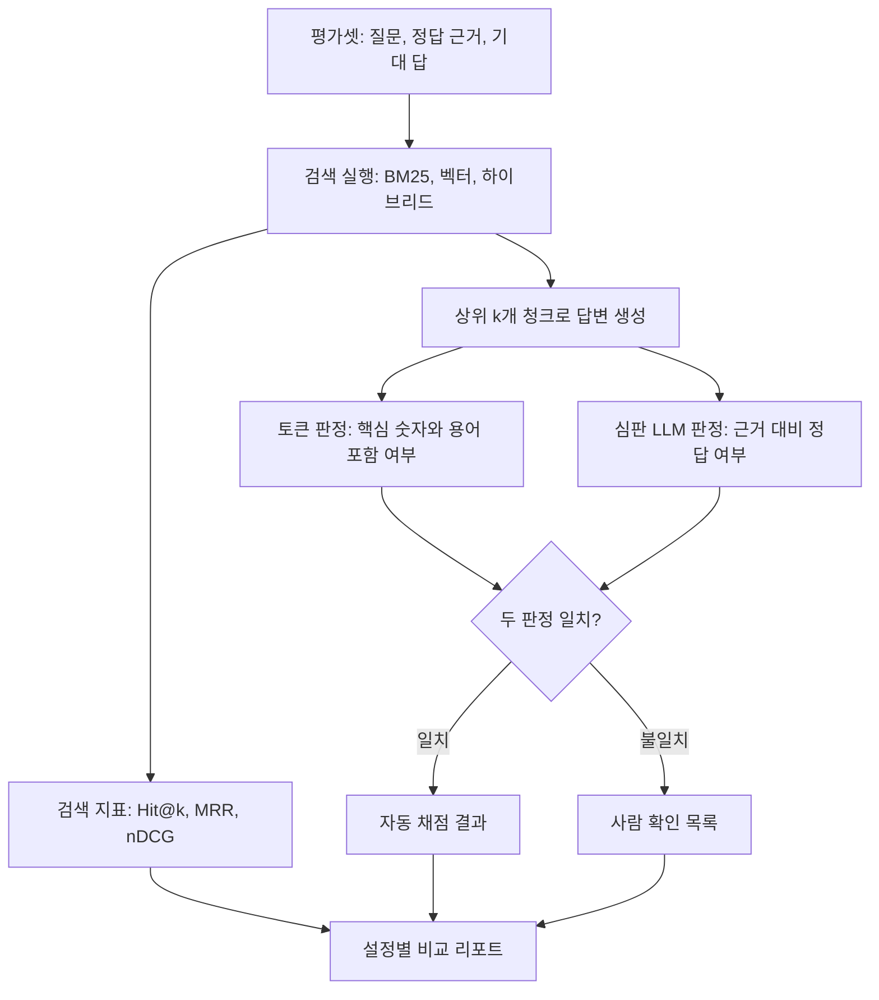

# RAG 평가

## 한 줄 정의 {#definition}

RAG 평가는 "검색이 정답 근거를 찾았나"(retrieval)와 "그 근거로 맞는 답을 했나"(generation)를 고정된 질문 세트로 반복 측정하는 일이다. 바꾼 설정이 실제로 나아졌는지를 숫자로 판단하게 해 준다.

**언제 쓰나**

- 청킹 규칙, 임베딩 모델, 양자화, 검색 결합 방식 등을 바꾸기 전후를 비교할 때
- 문서 파서·적재 로직을 고친 뒤 기존에 맞던 질문이 깨지지 않았는지(회귀) 확인할 때
- 어떤 질문 유형(표, 수치, 바꿔 말한 질문)에서 약한지 찾을 때

## 핵심 개념 {#concepts}

| 용어 | 설명 |
|------|------|
| 평가셋 (eval set) | 질문, 정답 근거 청크(또는 문서), 기대 답변을 묶은 목록. 평가의 기준점이다. |
| Hit@k | 상위 k개 결과 안에 정답 근거가 하나라도 있으면 1, 없으면 0. 질문 전체 평균을 낸다. |
| Recall@k | 정답 근거가 여러 개일 때, 그중 상위 k개 안에 들어온 비율. |
| MRR | Mean Reciprocal Rank. 첫 정답이 나온 순위의 역수(1위 1, 2위 0.5, 3위 0.33)를 평균한다. 순위가 앞일수록 높다. |
| nDCG@k | 관련도 등급(예: 0~2)과 순위를 함께 반영한 점수. 이상적인 순서 대비 비율이라 0~1 사이다. |
| 정답률 | 생성된 답이 기대 답과 맞는 비율. 맞음 판정 방법이 핵심이다. |
| Token overlap | 기대 답의 핵심 토큰(숫자, 용어)이 생성 답에 들어 있는지로 판정. 싸고 결정적이지만 표현 차이에 약하다. |
| LLM-as-judge | 다른 LLM에게 질문·근거·답을 주고 맞음/틀림이나 점수를 매기게 하는 것. 표현 차이에 강하지만 판정 자체가 틀릴 수 있다. |
| 이중 판정 | 토큰 판정과 LLM 심판 판정을 함께 돌려, 둘이 엇갈리는 문항만 사람이 확인하는 방식. |
| 탐침 질문 (probe) | 특정 약점(표 수치, 기간 비교, 바꿔 말한 표현)을 찌르도록 일부러 만든 질문. |

## 동작 원리 {#how-it-works}

1. 평가셋은 코드와 함께 버전 관리한다. 질문이 바뀌면 이전 결과와 비교할 수 없다.
2. 검색 단계와 생성 단계를 나눠 잰다. 답이 틀렸을 때 "못 찾았나"와 "찾았는데 잘못 읽었나"를 구분해야 고칠 곳이 보인다.
3. 생성 답은 싼 판정(토큰)과 비싼 판정(LLM 심판)을 함께 쓴다. 둘이 같으면 자동 확정, 다르면 사람이 본다.
4. 모든 결과를 설정(청커 버전, 모델, 검색 방식)별로 한 표에 모아 비교한다.

**작은 계산 예시** (질문 3개, 상위 5개 검색)

| 질문 | 정답 근거의 순위 | Hit@5 | Reciprocal Rank |
|------|------------------|-------|-----------------|
| Q1 | 1 | 1 | 1.00 |
| Q2 | 3 | 1 | 0.33 |
| Q3 | 순위 밖 | 0 | 0 |
| 평균 | | 0.67 | MRR 0.44 |

Hit@5는 "찾았나"만 보고, MRR은 "얼마나 앞에서 찾았나"까지 본다. Q2의 정답을 1위로 올리면 Hit@5는 그대로지만 MRR은 0.67로 오른다.

**nDCG 직관**: 관련도 2(정답), 1(부분 관련), 0(무관)을 매기고, 순위가 뒤일수록 log로 깎아 더한 값(DCG)을 이상적인 순서의 값(IDCG)으로 나눈다. 정답이 여러 개이거나 부분 정답이 있을 때 Hit@k보다 정보가 많다.

**평가셋 만드는 법**

- 실제 사용자 질문 로그가 있으면 거기서 뽑고, 없으면 문서를 보며 직접 쓴다.
- 질문마다 정답 근거를 청크 id가 아니라 문서 id + 위치처럼 **재청킹해도 유지되는 키**로 남긴다.
- 유형을 섞는다: 단순 사실, 표 수치, 기간 비교, 바꿔 말한 질문, 답이 없는 질문.
- 처음에는 20~30문항으로 시작해 자주 틀리는 유형을 탐침 질문으로 늘린다.

## 내가 썼던 방식 {#my-usage}

- 지식기반 검색 RAG 파이프라인:
    - 검색 평가셋 22문항을 만들어 BM25·벡터·하이브리드의 Hit@5 비교를 자동화했다.
    - HTML 문서 검색·답변 평가셋 27문항을 만들어 정답률 26/27을 확인했다.
    - 검색 → 답변 → 이중 판정(토큰·심판 LLM) 자동 평가 파이프라인을 구축해 탐침 질문 96건을 자동 채점했다.
    - 표 열 이름 오적재(7청크)를 고친 뒤 표 질의 벡터 MRR이 0.85 → 0.92로 올랐다.
    - 요약·예상질문 벡터를 추가한 하이브리드 검색으로 바꿔말한 질문 검색이 16/20 → 18/20이 됐다.

## 장단점과 함정 {#pros-cons}

**장점**

- 설정 변경의 효과를 감이 아니라 숫자로 비교한다.
- 회귀 테스트처럼 매번 돌려 파서·청커 수정이 다른 질문을 깨뜨리지 않았는지 확인한다.
- 이중 판정은 LLM 심판 비용과 사람 검토량을 함께 줄인다.

**단점**

- 평가셋을 만들고 정답 근거를 다는 데 시간이 든다.
- 평가셋이 작으면 1~2문항 차이가 큰 비율 차이로 보인다.
- LLM 심판은 비용이 들고 판정이 흔들릴 수 있다.

!!! tip "함정"
    - 정답 근거를 청크 id로만 저장하면 재청킹 후 평가셋이 통째로 무효가 된다.
    - 평가셋에 맞춰 규칙을 계속 고치면 평가셋에만 맞는 과적합이 생긴다. 새 탐침 질문으로 따로 확인한다.
    - LLM 심판에게 근거 없이 답만 보여주면 그럴듯한 오답을 맞다고 판정한다. 근거와 기대 답을 함께 준다.
    - 검색 지표만 보고 끝내면 "찾았지만 잘못 읽은" 실패(예: 당기·전기 수치 역전)를 놓친다.

## 비교 {#comparison}

**평가 지표**

| 지표 | 단계 | 보는 것 | 장점 | 약점 |
|------|------|---------|------|------|
| Hit@k | 검색 | 상위 k개 안에 정답이 있나 | 단순, 해석 쉬움 | 순위 차이를 못 봄 |
| Recall@k | 검색 | 정답 여러 개 중 몇 개를 찾았나 | 다중 근거 질문에 적합 | 순위 차이를 못 봄 |
| MRR | 검색 | 첫 정답의 순위 | 순위 개선이 드러남 | 첫 정답만 봄 |
| nDCG@k | 검색 | 관련도 등급 + 순위 | 가장 정보가 많음 | 관련도 등급을 매겨야 함 |
| 정답률 (토큰 판정) | 생성 | 핵심 숫자·용어 포함 | 싸고 결정적 | 표현이 다르면 오판 |
| LLM 심판 | 생성 | 근거 대비 의미상 정답 | 표현 차이에 강함 | 비용, 판정 흔들림 |
| 이중 판정 | 생성 | 두 판정의 합의 | 자동화와 신뢰도의 균형 | 불일치 문항은 사람이 확인 |

## 예상 질문 {#interview}

[예상질문 보기](../../interview/llm-rag.md#rag-evaluation)

## 더 보기 {#links}

- [Elasticsearch: Ranking evaluation API](https://www.elastic.co/docs/api/doc/elasticsearch/operation/operation-rank-eval)
- [Ragas 문서](https://docs.ragas.io/)
- [Zheng et al., Judging LLM-as-a-Judge (2023)](https://arxiv.org/abs/2306.05685)
- [Wikipedia: Discounted cumulative gain](https://en.wikipedia.org/wiki/Discounted_cumulative_gain)
