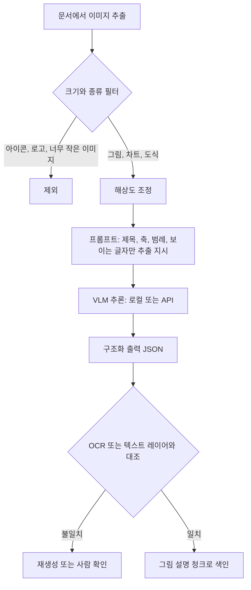

# VLM

## 한 줄 정의 {#definition}

VLM(Vision-Language Model)은 이미지(또는 영상 프레임)와 텍스트를 함께 입력받아 텍스트로 답하는 모델이다. 그림 설명, 차트·표 읽기, 화면 속 글자 추출, 영상 내용 분석에 쓴다.

**언제 쓰나**

- 문서 속 그림·차트를 RAG에서 검색할 수 있도록 텍스트 설명으로 바꿀 때
- 스캔 문서, 스크린샷처럼 텍스트 레이어가 없는 이미지에서 정보를 뽑을 때
- 영상의 톤·구도·편집 리듬 같은 시각적 특징을 구조화된 값(JSON)으로 뽑을 때

텍스트 레이어가 있는 PDF의 글자·표는 VLM보다 파서로 뽑는 편이 정확하고 싸다. VLM은 파서가 못 읽는 시각 정보에 쓴다.

## 핵심 개념 {#concepts}

| 용어 | 설명 |
|------|------|
| Vision encoder | 이미지를 작은 패치로 나눠 벡터(시각 토큰)로 바꾸는 부분. 이 토큰이 텍스트 토큰과 함께 언어 모델에 들어간다. |
| 이미지 토큰 | 이미지 한 장이 차지하는 입력 토큰. 해상도가 클수록 많아져 비용과 지연이 는다. |
| 해상도 조절 | 너무 작은 이미지는 글자를 못 읽고, 너무 크면 토큰이 폭증한다. 모델별 권장 크기로 맞춘다. |
| 멀티모달 프롬프트 | 이미지와 "이 차트의 제목, 축 이름, 범례를 JSON으로" 같은 지시를 함께 넣은 요청. |
| Hallucination (환각) | 이미지에 없는 숫자·글자·항목을 그럴듯하게 지어내는 것. 작은 이미지, 흐린 글자, 모호한 지시에서 잘 생긴다. |
| OCR 대조 | OCR이나 PDF 텍스트 레이어로 얻은 글자와 VLM 출력을 비교해 지어낸 글자를 걸러내는 검증. |
| 로컬 VLM | 오픈 웨이트 모델(예: Qwen2.5-VL)을 자체 GPU에서 실행하는 것. 데이터가 외부로 나가지 않는다. |
| 영상 입력 | 영상을 직접 받는 모델은 프레임 샘플링과 오디오를 내부에서 처리한다. 그렇지 않으면 대표 프레임을 뽑아 이미지 여러 장으로 넣는다. |

## 동작 원리 {#how-it-works}



1. 이미지를 추출한 뒤 아이콘·장식처럼 정보가 없거나 너무 작은 이미지는 미리 뺀다. 이런 이미지에서 VLM이 내용을 지어내는 경우가 많다.
2. 프롬프트는 "보이는 것만" 뽑도록 범위를 좁힌다. 자유 서술보다 제목·축·범례·글자 같은 필드를 정한 JSON이 검증하기 쉽다.
3. 출력의 글자와 숫자를 OCR 결과나 PDF 텍스트 레이어와 대조한다. 원문에 없는 숫자는 의심한다.
4. 통과한 설명은 원본 이미지 위치(문서, 페이지)와 함께 청크로 색인해 RAG에서 검색되게 한다.

**영상 분석 fallback 패턴**

영상을 직접 넣는 분석이 실패할 수 있으므로 단계별 대안을 둔다: 원본 영상 → 재인코딩한 짧은 영상(오디오 제거, 길이 축소, 표준 코덱) → 대표 프레임 몇 장. 어느 단계에서 성공하든 같은 JSON 스키마로 결과를 받으면 뒤 단계 코드는 바뀌지 않는다.

**프롬프트 예시**

```text
이미지에 실제로 보이는 정보만 JSON으로 답하라.
{"title": 그림 제목, "x_axis": x축 이름, "y_axis": y축 이름,
 "legend": [범례 항목], "visible_text": [읽을 수 있는 글자]}
보이지 않거나 읽을 수 없는 항목은 null로 둔다. 추측하지 마라.
```

## 내가 썼던 방식 {#my-usage}

- 지식기반 검색 RAG 파이프라인: 그림 설명 생성 시 없는 내용을 지어내는 문제가 있어, 작은 이미지를 제외하고 로컬 VLM(Qwen2.5-VL-7B)으로 설명을 재생성했다. 그림 28개의 제목·축·글자 추출이 개선됐다.
- AI 기반 숏폼 영상 생성 시스템:
    - Gemini 멀티모달 API(Gemini 2.5 Flash)로 레퍼런스 영상의 톤·페이싱·훅 패턴·카메라 구도·컷 리듬을 분석해 Style Profile(`style_profile.json`)로 추출했다.
    - 원본 직접 분석이 실패하면 clean 영상(오디오 제거, 8초, H.264)을 분석하고, 그래도 실패하면 대표 프레임 분석으로 넘어가는 fallback을 두었다.
    - 입력이 파일 경로이면 확장자에 따라 이미지·비디오로 분석하고, 아니면 텍스트 입력으로 처리한다.

## 장단점과 함정 {#pros-cons}

**장점**

- 파서가 못 읽는 차트·도식·스캔 이미지의 정보를 텍스트로 꺼낸다.
- 영상의 시각적 스타일처럼 규칙으로 정의하기 어려운 특징을 구조화할 수 있다.
- 로컬 모델을 쓰면 문서가 외부 API로 나가지 않는다.

**단점**

- 작은 글자, 빽빽한 표, 정밀한 숫자 읽기에서 환각이 잦다.
- 이미지 토큰 때문에 텍스트 요청보다 비용과 지연이 크다.
- 로컬 모델은 GPU 메모리와 서빙 구성이 필요하다.

!!! tip "함정"
    - 모든 이미지를 VLM에 넣으면 로고·아이콘에서 지어낸 설명이 색인을 오염시킨다. 크기·종류 필터를 먼저 둔다.
    - "이 그림을 설명하라" 같은 열린 지시는 그럴듯한 해석을 덧붙인다. 필드를 정하고 "보이지 않으면 null"을 명시한다.
    - VLM이 읽은 숫자를 검증 없이 답변 근거로 쓰면 틀린 수치가 그대로 나간다. 텍스트 레이어나 OCR과 대조한다.
    - 영상 직접 입력은 길이·코덱·용량 제한으로 실패할 수 있다. 재인코딩과 프레임 샘플링 fallback을 준비한다.

## 비교 {#comparison}

**로컬 VLM vs API VLM**

| 항목 | 로컬 (예: Qwen2.5-VL-7B) | API (Gemini, GPT, Claude 등) |
|------|--------------------------|------------------------------|
| 데이터 위치 | 내부에 머묾 | 외부 서비스로 전송 |
| 비용 구조 | GPU 고정비 | 호출당 과금 (이미지 토큰 포함) |
| 성능 | 모델 크기에 따라 제한 | 대체로 높음 |
| 영상 입력 | 직접 지원 범위가 모델마다 다름 | Gemini는 영상 직접 입력 지원 |
| 운영 | 서빙, 배치, 메모리 관리 필요 | 키 관리, rate limit, 재시도 |
| 맞는 경우 | 대량 문서 일괄 처리, 외부 전송 제한 | 소량·고품질, 영상 분석, 빠른 시작 |

**용도별 선택**

| 용도 | 1순위 | 보조 |
|------|-------|------|
| 텍스트 레이어 있는 PDF 글자·표 | PDF·HTML 파서 | VLM으로 레이아웃 확인 |
| 스캔 문서 글자 | OCR | VLM으로 구조 해석 |
| 차트·그림 의미 | VLM (필드 지정 JSON) | OCR 대조 |
| 영상 스타일 분석 | 영상 입력 가능한 VLM | 대표 프레임 분석 fallback |

## 예상 질문 {#interview}

[예상질문 보기](../../interview/llm-rag.md#vlm)

## 더 보기 {#links}

- [Qwen2.5-VL 모델 카드](https://huggingface.co/Qwen/Qwen2.5-VL-7B-Instruct)
- [Gemini API: Video understanding](https://ai.google.dev/gemini-api/docs/video-understanding)
- [Gemini API: Image understanding](https://ai.google.dev/gemini-api/docs/image-understanding)
- [Anthropic: Vision](https://docs.anthropic.com/en/docs/build-with-claude/vision)
- [OpenAI: Images and vision](https://platform.openai.com/docs/guides/images-vision)
