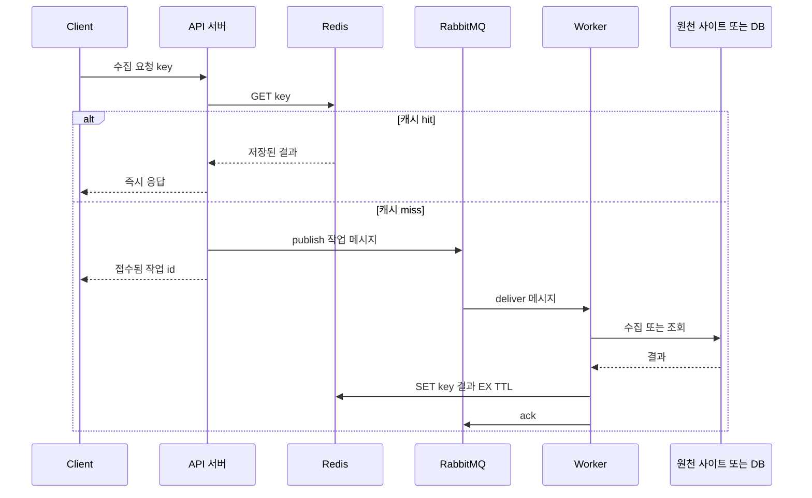

# RabbitMQ · Redis

## 한 줄 정의 {#definition}

- **RabbitMQ**: AMQP 프로토콜 기반 메시지 브로커. 생산자가 보낸 메시지를 규칙에 따라 큐로 라우팅하고, 소비자가 처리 완료(ack)할 때까지 보관한다.
- **Redis**: 메모리에 데이터를 두는 key-value 저장소. 응답이 밀리초 이하라서 캐시, 세션, 카운터, 분산 락, 간단한 큐로 쓴다.

**언제 쓰나**

- RabbitMQ: API가 오래 걸리는 작업(스크래핑, 파일 변환, LLM 호출)을 바로 처리하지 않고 큐에 넣어 worker가 비동기로 처리하게 할 때. 요청 폭주를 큐로 흡수하고 worker 수로 처리 속도를 조절할 때.
- Redis: 같은 요청이 반복되는데 원천 조회가 비쌀 때 결과를 잠시 저장해 두고 재사용할 때. 만료 시간이 있는 데이터(세션, 토큰, 중복 요청 방지 키)를 다룰 때.

두 기술은 함께 쓰이는 일이 많다. 요청은 RabbitMQ로 비동기 처리하고, 이미 처리한 결과는 Redis에서 바로 돌려주는 구조가 대표적이다.

## 핵심 개념 {#concepts}

**RabbitMQ (AMQP)**

| 용어 | 설명 |
|------|------|
| Producer / Consumer | 메시지를 보내는 쪽 / 큐에서 받아 처리하는 쪽. |
| Exchange | producer가 메시지를 보내는 곳. 직접 큐로 보내지 않고 exchange가 라우팅 규칙으로 큐를 고른다. |
| Exchange 종류 | `direct`(routing key 정확히 일치), `topic`(패턴 `log.*.error`), `fanout`(묶인 모든 큐로 복사), `headers`(헤더 값으로 판단). |
| Queue | 메시지가 소비될 때까지 쌓이는 버퍼. FIFO. |
| Binding | exchange와 queue를 잇는 규칙. "routing key가 X면 이 큐로". |
| Ack / Nack | consumer가 처리 완료를 알리면(ack) 큐에서 삭제된다. 실패를 알리거나(nack) 연결이 끊기면 다시 큐에 들어간다. |
| Prefetch | consumer 하나가 ack 없이 동시에 받을 수 있는 메시지 수(`basic_qos`). 1로 두면 바쁜 worker에 일이 몰리지 않는다. |
| Durable / Persistent | 큐를 durable로, 메시지를 persistent로 선언해야 broker 재시작 후에도 남는다. |
| DLX (Dead Letter Exchange) | 거절되거나 만료된 메시지를 보내는 별도 exchange. 실패 메시지를 따로 모아 분석·재처리한다. |

**Work queue 패턴**: 큐 하나에 worker 여러 개를 붙이면 메시지가 worker들에게 나눠 배분된다. worker를 늘리면 처리량이 늘고, 하나가 죽어도 ack하지 않은 메시지는 다른 worker에게 재전달된다.

**Redis**

| 용어 | 설명 |
|------|------|
| String | 가장 기본 값. 캐시된 JSON, 카운터(`INCR`)에 쓴다. |
| Hash | 필드-값 묶음. 객체 하나를 필드별로 저장·수정할 때. |
| List | 양쪽 끝 삽입·삭제가 빠른 리스트. 간단한 큐(`LPUSH`/`BRPOP`). |
| Set / Sorted Set | 중복 없는 집합 / 점수로 정렬된 집합. 중복 체크, 랭킹. |
| Stream | 소비자 그룹이 있는 로그형 자료구조. 가벼운 이벤트 스트림. |
| TTL | key의 만료 시간(`EXPIRE`, `SET key val EX 300`). 지나면 자동 삭제된다. 캐시의 기본. |
| Eviction policy | 메모리가 가득 찼을 때 무엇을 지울지(`allkeys-lru` 등). |
| Persistence | RDB(주기적 스냅샷), AOF(쓰기 명령 로그). 둘 다 꺼 두면 재시작 시 데이터가 사라진다. |

## 동작 원리 {#how-it-works}



1. API는 먼저 Redis에 같은 요청의 결과가 있는지 본다. 있으면(hit) 원천에 가지 않고 바로 응답한다.
2. 없으면(miss) 작업을 RabbitMQ에 넣고, 사용자에게는 작업 접수만 알린다. API 응답 시간이 작업 시간과 분리된다.
3. Worker는 큐에서 메시지를 받아 실제 수집을 하고, 결과를 TTL과 함께 Redis에 저장한 뒤 ack한다.
4. worker가 처리 도중 죽으면 ack가 없으므로 RabbitMQ가 메시지를 다른 worker에게 다시 준다. 그래서 worker 처리는 **같은 메시지를 두 번 받아도 문제없게(멱등)** 짜야 한다.

```python
import pika, redis, json

r = redis.Redis()
ch = pika.BlockingConnection().channel()
ch.queue_declare(queue="scrape", durable=True)
ch.basic_qos(prefetch_count=1)

def on_message(ch, method, props, body):
    job = json.loads(body)
    result = scrape(job["url"])
    r.set(f"scrape:{job['url']}", json.dumps(result), ex=3600)   # TTL 1시간
    ch.basic_ack(delivery_tag=method.delivery_tag)                # 처리 후 ack

ch.basic_consume(queue="scrape", on_message_callback=on_message)
ch.start_consuming()
```

## 내가 썼던 방식 {#my-usage}

- 데이터 수집 API · ETL 파이프라인: Selenium·BeautifulSoup 스크래핑 모듈을 API로 제공해 재사용하게 했고, 수집 요청 처리를 RabbitMQ 비동기 요청 + Redis 캐싱으로 구조화했다.

## 장단점과 함정 {#pros-cons}

**RabbitMQ**

- 장점: exchange로 라우팅이 유연하다. ack·재전달·DLX·우선순위 큐 등 작업 단위 제어 기능이 풍부하다. 관리 UI가 기본 제공된다.
- 단점: ack된 메시지는 사라지므로 과거 재처리가 안 된다. 큐에 메시지가 많이 쌓이면 메모리·디스크 압박으로 느려진다.

**Redis**

- 장점: 매우 빠르고, 자료구조가 다양해 캐시 외 용도(락, 카운터, 랭킹)에도 쓰기 쉽다.
- 단점: 데이터가 메모리 크기에 묶인다. 기본적으로 단일 스레드라 `KEYS *` 같은 무거운 명령 하나가 전체를 멈춘다.

!!! tip "함정"
    - RabbitMQ에서 auto ack를 켜면 메시지를 받는 순간 삭제되어, worker가 죽으면 작업이 사라진다. 처리 후 수동 ack한다.
    - 큐만 durable이고 메시지가 persistent가 아니면 재시작 후 메시지가 사라진다.
    - nack 후 다시 큐에 넣기(requeue)를 무한 반복하면 실패 메시지가 큐를 막는다. 재시도 횟수를 두고 DLX로 보낸다.
    - Redis 캐시에 TTL을 안 주면 오래된 값이 계속 남고 메모리가 찬다.
    - 많은 key가 같은 시각에 만료되면 원천에 요청이 몰린다(cache stampede). TTL에 무작위 값을 더하거나, 한 요청만 원천을 조회하도록 락을 건다.

## 비교 {#comparison}

**캐시 패턴: cache-aside vs write-through**

| 항목 | cache-aside (lazy loading) | write-through |
|------|----------------------------|---------------|
| 읽기 | 앱이 캐시 조회, miss면 원천에서 읽어 캐시에 넣음 | 캐시에서 읽음 (쓰기 때 이미 채워짐) |
| 쓰기 | 원천에 쓰고 캐시는 삭제하거나 그대로 둠 | 캐시와 원천에 함께 씀 |
| 캐시에 있는 데이터 | 실제로 요청된 것만 | 쓰인 모든 것 (안 읽히는 데이터도) |
| 첫 요청 | miss라서 느림 | 이미 캐시에 있어 빠름 |
| 일관성 | TTL 동안 오래된 값이 보일 수 있음 | 원천과 캐시가 항상 같음 |
| 쓰기 비용 | 낮음 | 쓰기마다 두 곳에 기록해 높음 |
| 잘 맞는 경우 | 읽기가 많고 약간의 지연된 일관성이 괜찮을 때 (수집 결과, 조회 API) | 쓴 직후 바로 읽고 최신값이 중요할 때 |

변형으로 write-back(write-behind)이 있다. 캐시에만 먼저 쓰고 원천에는 나중에 모아서 반영한다. 쓰기는 빠르지만 캐시가 죽으면 데이터를 잃을 수 있다.

**RabbitMQ vs Redis를 큐로 쓸 때**: Redis List도 간단한 큐가 되지만 ack·재전달·DLX가 없어 worker가 죽으면 작업이 사라지기 쉽다. 작업 유실이 문제 되면 RabbitMQ, 가볍고 유실이 괜찮으면 Redis다. Kafka와의 비교는 [Kafka 노트](../processing/kafka.md#comparison)에 있다.

## 예상 질문 {#interview}

[예상질문 보기: RabbitMQ](../../interview/processing-streaming.md#rabbitmq) · [예상질문 보기: Redis](../../interview/processing-streaming.md#redis)

## 더 보기 {#links}

- [RabbitMQ Tutorials: Work Queues](https://www.rabbitmq.com/tutorials/tutorial-two-python)
- [RabbitMQ: Consumer Acknowledgements](https://www.rabbitmq.com/docs/confirms)
- [Redis Data Types](https://redis.io/docs/latest/develop/data-types/)
- [Redis: Key eviction](https://redis.io/docs/latest/develop/reference/eviction/)
