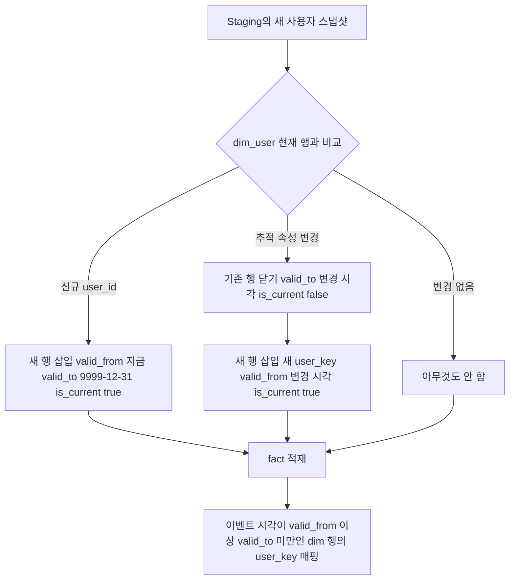

# Dim · Fact · SCD

## 한 줄 정의 {#definition}

차원 모델링(Dimensional Modeling)은 측정값을 담는 Fact 테이블과 그 측정값을 설명하는 Dim(차원) 테이블로 분석용 스키마를 짜는 방법이고, SCD(Slowly Changing Dimension)는 차원 속성이 시간에 따라 바뀔 때 이력을 어떻게 남길지 정하는 규칙이다.

**언제 쓰나**

- "요금제별 매출", "국가별 일 활성 사용자"처럼 측정값을 여러 관점으로 잘라 보는 분석 테이블을 만들 때
- 사용자 등급, 소속, 주소처럼 바뀌는 속성을 "그 당시 값" 기준으로 집계해야 할 때
- 배치를 다시 돌려도 결과가 같아야 하는 적재(멱등 적재)를 설계할 때

## 핵심 개념 {#concepts}

| 용어 | 설명 |
|------|------|
| Grain (입도) | Fact 한 행이 무엇을 뜻하는지. "이벤트 1건", "사용자별 하루 1행"처럼 먼저 정하고 나머지를 맞춘다. |
| Fact 테이블 | 측정값(매출, 수량, 건수)과 차원 키를 가진 테이블. 행이 많고 계속 늘어난다. |
| Dim 테이블 | 누가·무엇을·어디서를 설명하는 속성 테이블(사용자, 상품, 날짜). 행이 적고 넓다. |
| Natural key | 소스 시스템이 쓰는 식별자(`user_id`). 같은 사용자의 여러 이력 행이 같은 값을 가진다. |
| Surrogate key | 웨어하우스가 붙이는 대리 키(`user_key`). 이력 행마다 다르며 Fact는 이 키를 참조한다. |
| Star schema | Fact를 가운데 두고 Dim들이 한 단계로 붙는 구조. 조인이 단순해 집계가 빠르다. |
| SCD Type 1 / 2 / 3 | 차원 속성 변경을 덮어쓰기(1), 새 행 추가(2), 이전 값 컬럼 추가(3)로 다루는 방식. |
| 유효기간 컬럼 | SCD Type 2에서 행이 유효했던 구간 `valid_from`, `valid_to`와 현재 행 표시 `is_current`. |
| 시점 조인 (point-in-time join) | 이벤트 시각이 Dim 행의 유효기간 안에 드는 행과 조인해 그 당시 속성을 붙이는 방법. |
| Late-arriving data | 늦게 도착한 이벤트나 차원 변경. 이미 적재된 Fact의 키 매핑이 달라질 수 있다. |

## 동작 원리 {#how-it-works}

SCD Type 2는 속성이 바뀌면 기존 행을 닫고 새 행을 연다. Fact는 이벤트 시각에 유효했던 행의 surrogate key를 가진다.



**예시: 사용자 u1이 1월 10일 Free에서 Premium으로 변경**

| user_key | user_id | plan | valid_from | valid_to | is_current |
|----------|---------|------|------------|----------|------------|
| 1 | u1 | Free | 2025-01-01 | 2025-01-10 | false |
| 2 | u1 | Premium | 2025-01-10 | 9999-12-31 | true |

1월 5일 구매 이벤트는 `user_key = 1`(Free), 1월 15일 구매는 `user_key = 2`(Premium)로 적재된다. 그래서 "요금제별 매출"이 구매 당시 요금제 기준으로 정확히 나뉜다.

**SCD Type 2 처리 SQL (PostgreSQL)**

```sql
-- 1) 추적 속성이 바뀐 현재 행을 닫는다
UPDATE marts.dim_user d
SET valid_to = s.changed_at, is_current = false
FROM staging.users s
WHERE d.user_id = s.user_id AND d.is_current
  AND (d.plan, d.country) IS DISTINCT FROM (s.plan, s.country);

-- 2) 현재 행이 없는 사용자(신규 + 방금 닫힌 사용자)에 새 행을 연다
INSERT INTO marts.dim_user (user_id, plan, country, valid_from, valid_to, is_current)
SELECT s.user_id, s.plan, s.country, s.changed_at, '9999-12-31', true
FROM staging.users s
LEFT JOIN marts.dim_user d ON d.user_id = s.user_id AND d.is_current
WHERE d.user_id IS NULL;
```

**시점 조인으로 Fact 적재 (멱등)**

```sql
INSERT INTO marts.fact_events (event_id, event_time, user_key, revenue)
SELECT e.event_id, e.event_time, d.user_key, e.revenue
FROM staging.events e
JOIN marts.dim_user d
  ON d.user_id = e.user_id
 AND e.event_time >= d.valid_from AND e.event_time < d.valid_to
ON CONFLICT (event_id) DO NOTHING;   -- 재실행해도 중복 행이 생기지 않음
```

**멱등 적재 패턴**

| 패턴 | 동작 | 장점 | 주의 |
|------|------|------|------|
| Delete-insert | 이번 배치 구간(예: 날짜 파티션)을 지우고 다시 넣는다 | 단순, 구간 전체가 항상 최신 로직 결과 | 삭제와 삽입을 한 트랜잭션으로 묶어야 중간 빈 상태가 안 보임 |
| Upsert / Merge | 키가 있으면 갱신, 없으면 삽입 (`ON CONFLICT`, `MERGE`) | 행 단위로 정확, 일부만 바뀐 데이터에 적합 | 고유 키 제약이 필요, 소스에서 사라진 행은 지워지지 않음 |
| Insert ignore | 키가 있으면 건너뛴다 (`DO NOTHING`) | 이벤트처럼 한 번 쓰면 안 바뀌는 데이터에 가장 단순 | 원본이 정정되어도 반영되지 않음 |

**데이터 품질 검사 예**

- 필수 컬럼 null 건수 0
- Fact의 중복 `event_id` 0건
- Staging 대비 Fact 적재 비율이 기준 이상(시점 조인에서 Dim 행을 못 찾으면 Fact가 빠진다)
- Dim에서 `user_id`별 `is_current = true` 행이 정확히 1개

## 내가 썼던 방식 {#my-usage}

- DW 기반 이벤트 로그 ELT Pipeline: `dim_user`에 SCD Type 2(`valid_from`, `valid_to`, `is_current`)를 적용해 회원 멤버십 등급(Free/Premium 등)이 바뀌어도 덮어쓰지 않고 과거 상태 이력을 남겼다. `fact_events`는 이벤트 발생 시점(`created_at`) 기준으로 그 당시 회원 상태 키(`user_sk`)를 조인해 적재했다. 완성된 모델로 요금제별 총 수익과 이벤트 타입 분포를 분석했다.
- User Behavior Data Warehouse: `marts.fact_user_events`(event_id PK, `user_key`·`product_key` FK, quantity, revenue, 원시 필드 보존용 jsonb)와 `marts.dim_user`(SCD Type 2), `marts.dim_product`로 Fact와 Dim을 구성했다. 사용자의 device 또는 country가 바뀌면 기존 행의 `valid_to`를 종료하고 새 행을 추가해 `is_current`를 갱신했다. `dim_product`는 upsert, Fact는 `event_id` 기준 중복 방지로 멱등하게 적재했다. 품질 검사로 필수 컬럼 null, staging 대비 fact 적재 비율 90% 이상, 중복 event_id를 확인하고 실패 시 DAG를 중단했다.

## 장단점과 함정 {#pros-cons}

**장점**

- 분석 쿼리가 "Fact + Dim 몇 개 조인 + GROUP BY"로 단순해진다.
- SCD Type 2로 "그 당시 기준" 집계와 "현재 기준" 집계를 둘 다 할 수 있다.
- Surrogate key 덕분에 소스 시스템 키가 바뀌거나 여러 소스가 섞여도 웨어하우스 키는 안정적이다.

**단점**

- SCD Type 2는 Dim 행이 계속 늘고, 조인 조건이 범위 조건이라 느려질 수 있다.
- 적재 순서가 중요하다. Dim을 먼저 갱신해야 Fact가 올바른 키를 찾는다.
- 모든 속성을 Type 2로 추적하면 의미 없는 변경까지 이력이 쌓인다. 추적 대상 속성을 골라야 한다.

!!! tip "함정"
    - Grain을 안 정하고 Fact를 만들면 같은 이벤트가 조인 과정에서 여러 행으로 불어난다(fan-out). 합계가 부풀면 Grain부터 의심한다.
    - 유효기간 경계를 `BETWEEN`으로 조인하면 경계 시각의 이벤트가 두 행에 매칭된다. `>= valid_from AND < valid_to`처럼 반열린 구간으로 쓴다.
    - `valid_to`를 NULL로 두면 범위 조건이 매번 `COALESCE`를 타야 한다. 먼 미래 날짜(9999-12-31)가 다루기 쉽다.
    - Dim보다 이벤트가 먼저 도착하면 매칭할 Dim 행이 없다. "unknown" 기본 행(key = -1)에 붙였다가 나중에 보정하는 방법이 흔하다.
    - Upsert만으로는 소스에서 삭제된 행이 웨어하우스에 남는다. 삭제를 반영해야 하면 delete-insert나 soft delete 플래그가 필요하다.

## 비교 {#comparison}

**SCD 유형**

| 유형 | 변경 처리 | 이력 | 테이블 변화 | 잘 맞는 속성 |
|------|-----------|------|-------------|--------------|
| Type 0 | 바꾸지 않음 | 최초 값만 | 없음 | 가입일, 최초 유입 채널 |
| Type 1 | 기존 값을 덮어씀 | 없음 | 행 수 그대로 | 오타 수정, 이력이 필요 없는 속성 |
| Type 2 | 기존 행을 닫고 새 행 추가 | 전체 이력 | 행 증가, 유효기간 컬럼 | 요금제, 등급, 국가, 소속 |
| Type 3 | `previous_x` 컬럼에 직전 값 보관 | 직전 1개 | 컬럼 증가 | 직전 값과 비교만 필요할 때 |

**Star schema vs Snowflake schema**

| 항목 | Star | Snowflake |
|------|------|-----------|
| Dim 구조 | 한 테이블에 속성을 펼쳐 둠(비정규화) | Dim을 다시 정규화(상품 → 카테고리 → 대분류) |
| 조인 수 | 적음 | 많음 |
| 저장 공간 | 중복이 있어 큼 | 작음 |
| 쓰는 곳 | 대부분의 분석 마트 | 차원 계층이 크고 자주 바뀔 때 |

## 예상 질문 {#interview}

[예상질문 보기](../../interview/modeling.md#dim-fact-scd)

## 더 보기 {#links}

- [Kimball Group: Dimensional Modeling Techniques](https://www.kimballgroup.com/data-warehouse-business-intelligence-resources/kimball-techniques/dimensional-modeling-techniques/)
- [Kimball Group: Type 2 Slowly Changing Dimension](https://www.kimballgroup.com/data-warehouse-business-intelligence-resources/kimball-techniques/dimensional-modeling-techniques/type-2/)
- [dbt: Snapshots (SCD Type 2)](https://docs.getdbt.com/docs/build/snapshots)
- [PostgreSQL: MERGE](https://www.postgresql.org/docs/current/sql-merge.html)
