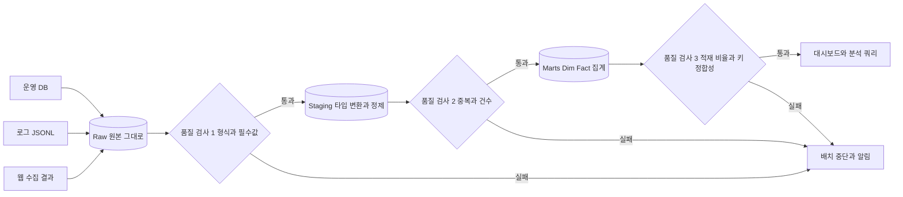

# ETL · ELT와 Raw / Staging / Marts 계층

## 한 줄 정의 {#definition}

ETL은 데이터를 꺼내(Extract) 변환(Transform)한 뒤 적재(Load)하는 방식이고, ELT는 원본을 먼저 적재한 뒤 웨어하우스 안에서 SQL로 변환하는 방식이다. Raw / Staging / Marts는 ELT에서 변환 단계를 나누는 대표적인 계층 구조다.

**언제 쓰나**

- 여러 소스의 데이터를 분석용 테이블로 모을 때 어디서 변환할지 정해야 할 때
- 원본을 보존해 두고, 변환 로직이 바뀌면 다시 돌릴 수 있게 하고 싶을 때
- 정제·검증·집계 책임을 단계별로 나눠 장애 지점을 좁히고 싶을 때
- 웹 수집처럼 원본 형태가 지저분해서 적재 전에 반드시 정리가 필요할 때(ETL)

## 핵심 개념 {#concepts}

| 용어 | 설명 |
|------|------|
| Extract | 소스(DB, API, 파일, 웹 페이지)에서 데이터를 읽어 오는 단계. 증분 추출이면 마지막 적재 시점(watermark) 이후만 읽는다. |
| Transform | 타입 변환, 정제, 조인, 집계, 코드 매핑. ETL은 적재 전 애플리케이션 코드에서, ELT는 적재 후 SQL로 한다. |
| Load | 결과를 대상 저장소에 쓰는 단계. 전체 교체(full refresh), 추가(append), 병합(merge) 방식이 있다. |
| Raw 계층 | 소스 그대로의 사본. 형태를 바꾸지 않고 저장해 재처리의 출발점이 된다. JSON이면 jsonb나 파일 그대로 둔다. |
| Staging 계층 | Raw를 컬럼으로 펼치고 타입을 맞추고 null·중복·형식을 걸러 낸 정제본. 업무 로직은 아직 넣지 않는다. |
| Marts 계층 | 분석·리포트용 최종 테이블. Dim/Fact 모델이나 집계 테이블이 여기 있다. 사용자가 직접 조회하는 곳이다. |
| 증분 적재 | 매번 전체를 다시 읽지 않고 새로 생기거나 바뀐 데이터만 처리. 날짜 파티션이나 updated_at 기준이 흔하다. |
| 멱등성 (Idempotency) | 같은 배치를 여러 번 돌려도 결과가 한 번 돌린 것과 같은 성질. 재시도·재처리가 안전해진다. |
| 데이터 품질 검사 | 단계 사이에 null, 중복, 건수 비율, 값 범위를 확인하고 실패하면 다음 단계를 막는 검사. |

## 동작 원리 {#how-it-works}



1. **Raw**: 소스에서 받은 그대로 저장한다. 변환에 버그가 있어도 Raw가 남아 있으면 다시 돌릴 수 있다. 파일 덤프(JSONL)나 jsonb 컬럼 하나에 통째로 넣는 방식이 흔하다.
2. **Staging**: Raw를 컬럼으로 펼치고 타입을 맞춘다. 문자열 날짜를 timestamp로, 금액 문자열을 숫자로 바꾸고, 필수값이 비어 있는 행을 걸러 낸다. 소스 하나당 staging 테이블 하나가 기본이다.
3. **Marts**: 여러 staging을 조인해 업무 관점의 테이블을 만든다. 차원(Dim)과 사실(Fact), 일별 KPI 집계가 여기 있다.
4. **품질 검사 위치**: 단계 경계마다 둔다. 앞 단계에서 걸러야 뒤 단계 테이블이 오염되지 않는다. 검사 실패 시 다음 단계를 실행하지 않는 것이 핵심이다.

**계층별 책임**

| 계층 | 책임 | 하지 않는 것 | 주 사용자 | 검사 예 |
|------|------|--------------|-----------|---------|
| Raw | 원본 보존, 수집 시각 기록, 재처리 출발점 | 형태 변경, 필터링 | 파이프라인 자체 | 파일 수, 파싱 가능 여부 |
| Staging | 컬럼 펼치기, 타입 변환, 표준화(코드·단위), 중복 제거 | 업무 지표 계산, 여러 소스 조인 | 데이터 엔지니어 | 필수 컬럼 null, 형식 오류, 키 중복 |
| Marts | Dim/Fact 모델, 조인, 집계, 업무 용어로 이름 정리 | 원본 형태 유지 | 분석가, 대시보드, API | 적재 비율, FK 매칭률, 합계 대조 |

**ELT 변환 예시 (Raw jsonb → Staging)**

```sql
-- Raw: payload jsonb 한 컬럼에 원본 그대로
INSERT INTO staging.user_events (event_id, event_time, event_type, user_id, revenue)
SELECT
    payload->>'event_id',
    (payload->>'event_time')::timestamptz,
    payload->>'event_type',
    payload->>'user_id',
    COALESCE((payload->>'revenue')::numeric, 0)
FROM raw.user_events
WHERE loaded_at >= :batch_start                -- 이번 배치분만
  AND payload->>'event_time' IS NOT NULL;     -- 필수값 없는 행은 staging에 올리지 않음
```

**품질 검사 예시**

```sql
-- 1) 필수 컬럼 null 건수: 0이어야 통과
SELECT COUNT(*) FROM staging.user_events WHERE event_type IS NULL;

-- 2) staging 대비 fact 적재 비율: 기준(예: 0.9) 미만이면 실패
SELECT f.cnt::float / NULLIF(s.cnt, 0)
FROM (SELECT COUNT(*) cnt FROM staging.user_events) s,
     (SELECT COUNT(*) cnt FROM marts.fact_user_events) f;
```

오케스트레이터(Airflow 등)에서는 검사 task가 기준을 넘지 못하면 예외를 던지게 해 하위 task가 실행되지 않게 한다.

## 내가 썼던 방식 {#my-usage}

- DW 기반 이벤트 로그 ELT Pipeline: 가상 사용자·이벤트 생성기가 데이터를 DB에 바로 넣지 않고 `data/raw/`에 JSONL(`users_{시각}.jsonl`, `events_{시각}.jsonl`)로 먼저 덤프하게 해 Raw를 보존했다. Python 스크립트가 이 파일을 Staging 테이블(`stg_users_raw`, `stg_events_raw`)로 로드하고, Marts에서 SCD Type 2 `dim_user`와 `fact_events`로 변환했다. Docker Compose로 띄우면 과거 5일 치 시뮬레이션 데이터를 만들어 ELT를 돌리고, 이후 10분 간격으로 새 배치마다 파이프라인을 다시 실행한다.
- User Behavior Data Warehouse: Airflow DAG `dwh_raw_to_marts`를 7단계로 구성했다. 로그 생성 → JSONL을 `raw.user_events`에 jsonb로 적재 → Staging(타입 변환, null·정합성 체크) → `dim_user` SCD Type 2 → `dim_product` upsert → `fact_user_events` 적재(staging 대비 비율 체크) → 데이터 품질 검사(실패 시 DAG 중단). SQL을 단계별 파일(`10_staging.sql`, `20_dim_user_scd2.sql`, `21_dim_product.sql`, `30_fact.sql`, `90_quality_checks.sql`)로 나눴다.
- 데이터 수집 API · ETL 파이프라인: 스크래핑 수집 → Airflow 일 증분 적재 → REST API 조회 흐름을 만들었다. LangChain·OpenAI로 초기 데이터와 파일에서 통합 데이터를 추출했고, 매핑·정제·분류 단계를 추가해 데이터 정합성과 LLM 추출 정확도를 개선했다.
- 외부 소스 수집 워크플로우 (서브 프로젝트): 뉴스·의약품 등 외부 소스를 Airflow로 증분 적재하고 알림톡 알림을 붙였으며, 소스별 수집 DB를 설계·정제했다.

Dim/Fact와 SCD Type 2 설계는 Dim · Fact · SCD 노트 참고.

## 장단점과 함정 {#pros-cons}

**ELT의 장점**

- 원본이 웨어하우스에 남아 변환 로직을 고친 뒤 과거 데이터를 다시 만들 수 있다.
- 변환이 SQL이라 분석가도 읽고 고칠 수 있고, 웨어하우스의 연산 자원을 그대로 쓴다.
- 계층이 나뉘어 있어 문제가 생기면 어느 계층에서 값이 틀어졌는지 바로 좁힐 수 있다.

**ELT의 단점**

- 원본을 다 저장하므로 저장 공간이 더 든다.
- 웨어하우스 SQL로 표현하기 어려운 변환(HTML 파싱, LLM 추출, 이미지 처리)은 결국 앞단 코드가 필요하다.
- 계층이 늘수록 테이블과 SQL 파일이 늘어 의존 관계 관리가 필요하다(dbt 같은 도구가 이 문제를 푼다).

!!! tip "함정"
    - Staging에 업무 로직을 넣기 시작하면 계층 구분이 무너진다. Staging은 "타입과 형식"까지만.
    - Raw를 "정리해서" 저장하면 Raw가 아니다. 원본 그대로 두고 수집 시각만 붙인다.
    - 품질 검사를 로그로만 남기고 배치를 계속 진행하면 오염된 데이터가 Marts까지 간다. 실패는 중단으로 연결한다.
    - 증분 적재에서 watermark를 "현재 시각"으로 잡으면 늦게 도착한 데이터를 놓친다. 이전 구간을 겹쳐 읽고 멱등하게 쓰는 편이 안전하다.
    - 재실행하면 행이 두 배가 되는 append 적재는 멱등하지 않다. delete-insert나 upsert로 바꾼다.

## 비교 {#comparison}

**ETL vs ELT**

| 항목 | ETL | ELT |
|------|-----|-----|
| 변환 위치 | 적재 전, 애플리케이션 코드(Python, Spark) | 적재 후, 웨어하우스 안의 SQL |
| 원본 보존 | 보통 변환 결과만 저장 | Raw 계층에 원본 저장 |
| 재처리 | 소스에서 다시 읽어야 함 | Raw에서 SQL만 다시 실행 |
| 잘 맞는 변환 | 파싱, 외부 API 호출, LLM 추출, 복잡한 정제 | 조인, 집계, 타입 변환, Dim/Fact 구성 |
| 필요 자원 | 별도 처리 서버·클러스터 | 웨어하우스 연산 자원 |
| 대표 도구 | Python 스크립트, Spark, Airflow task | SQL, dbt, Airflow SQL task |

실무에서는 섞어 쓴다. 웹 수집처럼 형태가 불규칙한 소스는 앞단에서 ETL로 정리해 넣고, 웨어하우스 안에서는 ELT로 계층을 쌓는 식이다.

**적재 방식**

| 방식 | 동작 | 멱등성 | 쓰는 곳 |
|------|------|--------|---------|
| Full refresh | 대상 비우고 전체 다시 적재 | 있음 | 작은 차원 테이블, 집계 테이블 |
| Append | 새 행만 추가 | 없음 (재실행 시 중복) | 중복 제거 키가 따로 있을 때만 |
| Delete-insert | 배치 구간 삭제 후 다시 삽입 | 있음 | 날짜 파티션 단위 fact |
| Upsert / Merge | 키가 있으면 갱신, 없으면 삽입 | 있음 | 키가 분명한 차원, 이벤트 |

## 예상 질문 {#interview}

[예상질문 보기](../../interview/modeling.md#etl-elt)

## 더 보기 {#links}

- [dbt: How we structure our dbt projects](https://docs.getdbt.com/best-practices/how-we-structure/1-guide-overview)
- [Databricks: Medallion Architecture](https://www.databricks.com/glossary/medallion-architecture)
- [Airflow: Best Practices](https://airflow.apache.org/docs/apache-airflow/stable/best-practices.html)
- [PostgreSQL: JSON Functions and Operators](https://www.postgresql.org/docs/current/functions-json.html)
