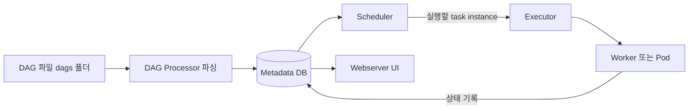

# Airflow

## 한 줄 정의 {#definition}

Apache Airflow는 작업 사이의 순서와 의존성을 Python 코드(DAG)로 정의하고, 정해진 주기에 맞춰 실행·재시도·모니터링하는 워크플로우 오케스트레이터다.

**언제 쓰나**

- 매일·매시간 도는 배치(수집 → 적재 → 변환 → 품질 검사)를 순서대로 묶어야 할 때
- 실패한 단계만 다시 돌리고, 과거 날짜를 다시 채워야(backfill) 할 때
- 여러 시스템(DB, Spark, 외부 API)을 한 곳에서 스케줄링하고 실행 이력을 보고 싶을 때

Airflow는 데이터를 직접 처리하는 엔진이 아니다. "무엇을 언제 어떤 순서로 실행할지"를 관리하고, 실제 무거운 처리는 Spark·DB·컨테이너에 맡기는 것이 기본 사용법이다.

## 핵심 개념 {#concepts}

| 용어 | 설명 |
|------|------|
| DAG | Directed Acyclic Graph. 작업(task)과 그 사이의 화살표(의존성)로 이루어진 그래프. 순환이 없어야 한다. 파일 하나에 보통 DAG 하나를 정의한다. |
| Task | DAG 안의 실행 단위 하나. Operator를 인스턴스화한 것. |
| Operator | task가 "무엇을 하는지"의 틀. `PythonOperator`, `BashOperator`, `PostgresOperator`, `KubernetesPodOperator` 등. |
| Sensor | 조건(파일 도착, 다른 DAG 완료 등)이 충족될 때까지 기다리는 특수 Operator. |
| DAG Run | 특정 논리 날짜(logical date)에 대한 DAG 한 번의 실행. |
| Task Instance | DAG Run 안에서 task 하나의 실행. 상태(queued, running, success, failed, up_for_retry)를 가진다. |
| Scheduler | DAG 파일을 읽고, 실행할 때가 된 task instance를 만들어 executor에 넘기는 프로세스. |
| Executor | task를 실제로 어디서 어떻게 실행할지 결정하는 구성요소. Local, Celery, Kubernetes 등. |
| XCom | task 사이에 작은 값(id, 경로, 건수)을 주고받는 장치. 큰 데이터를 넣으면 안 된다. |
| Connection / Variable | DB 접속 정보, 설정 값을 코드 밖(메타DB, 환경변수, secret backend)에 두는 장치. |

**logical date와 data interval**: `schedule="@daily"`인 DAG에서 2026-11-05 날짜의 DAG Run은 2026-11-05 00:00 ~ 11-06 00:00 구간의 데이터를 처리하며, 그 구간이 끝난 **11-06 00:00 이후에** 실행된다. 처음 쓸 때 가장 많이 헷갈리는 부분이다.

**catchup과 backfill**: `catchup=True`이면 `start_date`부터 지금까지 실행되지 않은 구간의 DAG Run을 스케줄러가 자동으로 만든다. backfill은 특정 기간을 명령어로 다시 실행하는 것이다. 둘 다 task가 **멱등(idempotent)** 해야 안전하다.

**멱등 task**: 같은 날짜로 몇 번을 다시 돌려도 결과가 같아야 한다. 예를 들어 "INSERT로 추가"가 아니라 "해당 날짜 파티션을 지우고 다시 쓰기" 또는 "고유 키 기준 upsert"로 적재한다.

## 동작 원리 {#how-it-works}



1. **파싱**: DAG 파일을 주기적으로 읽어 DAG 구조를 메타데이터 DB에 저장한다. DAG 파일의 최상위 코드는 파싱 때마다 실행되므로, 거기서 DB 조회나 API 호출을 하면 스케줄러 전체가 느려진다.
2. **스케줄링**: Scheduler가 시간이 된 DAG Run을 만들고, 의존성이 충족된 task instance를 `queued`로 바꿔 Executor에 넘긴다.
3. **실행**: Executor가 task를 worker에서 실행한다. 결과 상태와 로그 위치가 메타DB에 기록된다.
4. **재시도**: 실패하면 `retries`, `retry_delay` 설정에 따라 다시 실행한다. 최종 실패 시 하위 task는 `upstream_failed`가 된다.

**Executor 비교**

| Executor | 실행 위치 | 장점 | 단점 |
|----------|-----------|------|------|
| LocalExecutor | 스케줄러와 같은 머신의 프로세스 | 설정이 단순, 개발·소규모에 적합 | 머신 하나의 자원이 한계 |
| CeleryExecutor | 상시 떠 있는 Celery worker들 (broker로 Redis·RabbitMQ 필요) | task 시작이 빠름, worker 수평 확장 | worker를 항상 띄워 둬야 하고 의존성을 모든 worker에 맞춰야 함 |
| KubernetesExecutor | task마다 새 Pod 생성 | task별로 이미지·CPU·메모리를 다르게 지정, 끝나면 자원 반환, 격리 | Pod 생성 시간만큼 시작이 느림, K8s 운영 지식 필요 |

짧고 많은 task가 계속 도는 환경이면 Celery, 무겁고 드문 배치나 task마다 환경이 다른 경우는 KubernetesExecutor가 맞는 편이다.

```python
from airflow import DAG
from airflow.operators.python import PythonOperator
from datetime import datetime

def load(ds, **_):
    # ds = logical date 문자열. 같은 날짜로 다시 돌려도 결과가 같게 작성한다.
    print(f"load partition {ds}")

with DAG(
    dag_id="daily_load",
    start_date=datetime(2026, 11, 1),
    schedule="@daily",
    catchup=False,
    default_args={"retries": 2},
) as dag:
    extract = PythonOperator(task_id="extract", python_callable=lambda: None)
    load_task = PythonOperator(task_id="load", python_callable=load)
    extract >> load_task
```

## 내가 썼던 방식 {#my-usage}

- 지식기반 검색 RAG 파이프라인: Airflow(KubernetesExecutor) 기반 데이터 적재 배치를 설계했다.
- 데이터 수집 API · ETL 파이프라인: 스크래핑 수집 결과를 Airflow DAG로 일 단위 증분 수집·적재하도록 자동화했다.
- 데이터 수집 · 감성 분석 대시보드 운영: Airflow·Spark·Kafka·ES로 이어진 일 배치 파이프라인을 점검하고 장애를 조치했다.
- 외부 소스 수집 워크플로우 (서브 프로젝트): 뉴스·의약품 등 외부 소스를 Airflow로 증분 적재하고 알림톡 알림을 붙였다.
- User Behavior Data Warehouse: Airflow DAG(`dwh_raw_to_marts`) 하나로 로그 생성 → Raw 적재 → Staging → SCD Type 2 dim_user → dim_product upsert → fact 적재 → 품질 검사 순서를 오케스트레이션했다. 품질 검사가 실패하면 DAG가 중단되고, event_id 기준 중복 방지로 멱등성을 지켰다. Docker Compose로 Airflow와 Postgres를 함께 띄웠다.
- NLP 기반 한국어 텍스트 처리 Pipeline: Airflow로 Scrapy 수집과 Spark 처리 워크플로우를 오케스트레이션했다.

## 장단점과 함정 {#pros-cons}

**장점**

- 파이프라인을 Python 코드로 정의하므로 버전 관리, 리뷰, 테스트가 가능하다.
- 재시도, 실행 이력, task별 로그, UI에서의 부분 재실행이 기본 제공된다.
- Operator·Provider 생태계가 넓어 대부분의 DB·클라우드와 바로 연결된다.

**단점**

- 스케줄러, 웹서버, 메타DB, (Celery라면 broker와 worker)까지 운영할 구성요소가 많다.
- 초 단위 실시간 처리나 이벤트마다 즉시 반응하는 용도에는 맞지 않는다. 배치 오케스트레이터다.
- task 간 대용량 데이터 전달 수단이 없다. 중간 결과는 외부 저장소(S3, DB)에 두고 경로만 넘겨야 한다.

!!! tip "함정"
    - DAG 파일 최상위에서 무거운 코드를 실행하면 파싱 때마다 돌아 스케줄러가 느려진다. 무거운 코드는 task 함수 안에 둔다.
    - `start_date`를 `datetime.now()`처럼 동적으로 주면 스케줄이 예측 불가능해진다. 고정 날짜를 쓴다.
    - `catchup` 기본값을 모르고 과거 `start_date`로 배포하면 밀린 DAG Run이 한꺼번에 생긴다.
    - 멱등하지 않은 적재 task는 재시도나 backfill 때 중복 데이터를 만든다.
    - XCom에 데이터프레임 같은 큰 값을 넣으면 메타DB가 커지고 느려진다.

## 비교 {#comparison}

| 항목 | cron | Airflow | Prefect / Dagster |
|------|------|---------|-------------------|
| 정의 방식 | 한 줄 시간 표현식 + 스크립트 | Python DAG 파일 | Python 함수·데코레이터 (Dagster는 asset 중심) |
| 의존성 | 없음 (스크립트 안에서 직접 처리) | task 간 의존성 그래프 | flow·task 또는 asset 간 의존성 |
| 재시도·이력 | 직접 구현, 로그는 파일 | 기본 제공, UI에서 확인 | 기본 제공, UI에서 확인 |
| backfill | 직접 반복 실행 | 기간 지정 backfill, catchup | 지원 (Dagster는 파티션 단위 materialize) |
| 운영 부담 | 거의 없음 | 큼 (스케줄러, 메타DB, executor) | 중간 (클라우드 관리형 선택지 있음) |
| 잘 맞는 경우 | 의존성 없는 단일 작업 | 여러 단계 배치, 팀 표준 오케스트레이션 | 동적 워크플로우(Prefect), 데이터 자산 계보 관리(Dagster) |

선택 기준은 단순하다. 단계가 하나뿐이고 실패해도 다음 주기에 다시 돌면 되는 작업이면 cron으로 충분하다. 단계 간 의존성, 재시도, 과거 구간 재처리가 필요해지면 오케스트레이터가 필요하고, 그중 Airflow는 자료와 사용 사례가 가장 많은 사실상 표준이다.

## 예상 질문 {#interview}

[예상질문 보기](../../interview/orchestration.md#airflow)

## 더 보기 {#links}

- [Airflow 공식 문서: Core Concepts](https://airflow.apache.org/docs/apache-airflow/stable/core-concepts/index.html)
- [Airflow Executor](https://airflow.apache.org/docs/apache-airflow/stable/core-concepts/executor/index.html)
- [KubernetesExecutor](https://airflow.apache.org/docs/apache-airflow-providers-cncf-kubernetes/stable/kubernetes_executor.html)
- [Best Practices](https://airflow.apache.org/docs/apache-airflow/stable/best-practices.html)
