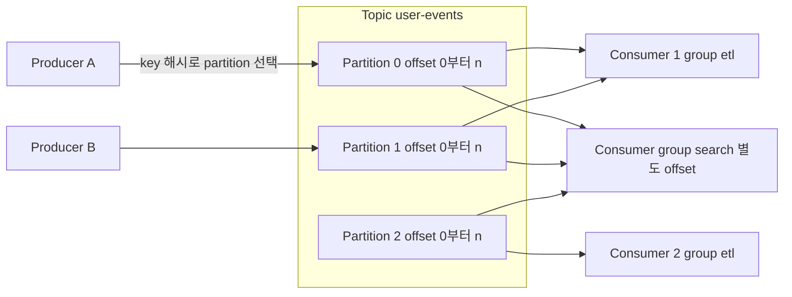

# Kafka

## 한 줄 정의 {#definition}

Apache Kafka는 이벤트를 디스크의 추가 전용 로그(append-only log)에 순서대로 기록하고, 여러 소비자가 각자 원하는 위치부터 읽어 가게 하는 분산 이벤트 스트리밍 플랫폼이다.

**언제 쓰나**

- 초당 수만 건 이상의 이벤트(클릭 로그, 센서 데이터, DB 변경 이력)를 안정적으로 받아야 할 때
- 같은 데이터를 여러 시스템(검색 색인, DW 적재, 실시간 집계)이 각자 소비해야 할 때
- 생산자와 소비자의 속도 차이를 흡수하는 버퍼가 필요할 때
- 장애 후 과거 시점부터 데이터를 다시 읽어 재처리해야 할 때

메시지를 한 번 처리하고 버리는 작업 큐가 목적이면 RabbitMQ 같은 메시지 브로커가 더 단순하다(아래 비교 참고).

## 핵심 개념 {#concepts}

| 용어 | 설명 |
|------|------|
| Broker | Kafka 서버 한 대. 여러 broker가 모여 cluster를 이룬다. |
| Topic | 이벤트를 분류하는 이름. 예: `user-events`. DB의 테이블에 해당한다. |
| Partition | topic을 나눈 순서 있는 로그. 순서 보장은 **partition 안에서만** 된다. partition 수가 병렬 소비의 상한이다. |
| Offset | partition 안에서 각 메시지의 위치 번호. 0부터 증가한다. 소비자는 "어디까지 읽었는지"를 offset으로 기억한다. |
| Producer | topic에 메시지를 쓰는 쪽. key가 있으면 key의 해시로 partition을 정해 같은 key는 같은 partition에 들어간다. |
| Consumer | topic에서 메시지를 읽는 쪽. 읽고 나서 offset을 commit한다. |
| Consumer Group | 같은 group id를 가진 consumer들. 한 partition은 group 안의 consumer 하나에만 배정된다. group이 다르면 같은 메시지를 각자 따로 읽는다. |
| Replication | partition마다 leader 1개와 follower 복제본을 둔다. leader가 죽으면 in-sync replica 중 하나가 leader가 된다. |
| Retention | 메시지는 소비돼도 지워지지 않고, 보존 기간(`retention.ms`)이나 크기 한도까지 남는다. |
| Rebalance | consumer가 group에 들어오거나 나가면 partition 배정을 다시 나누는 과정. 그동안 소비가 잠시 멈춘다. |

**전달 보장(delivery semantics)**

- **at-most-once**: offset을 먼저 commit하고 처리한다. 처리 중 죽으면 메시지를 잃는다.
- **at-least-once**: 처리를 끝낸 뒤 offset을 commit한다. commit 전에 죽으면 같은 메시지를 다시 받는다. 가장 흔한 기본 선택이고, 소비자 쪽 처리를 멱등하게(고유 키 upsert 등) 만들어 중복을 흡수한다.
- **exactly-once**: idempotent producer와 transaction을 써서 Kafka 안에서의 읽기-처리-쓰기를 한 번으로 만든다. 외부 DB까지 포함하면 결국 멱등 적재가 필요하다.

## 동작 원리 {#how-it-works}



1. Producer가 메시지를 보내면 leader partition의 로그 끝에 추가되고, follower가 복제한다. `acks=all`이면 in-sync replica 모두가 받은 뒤 성공 응답을 준다.
2. Consumer group `etl`의 consumer 2개는 partition 3개를 나눠 갖는다. 한 consumer가 두 partition을 맡을 수도 있지만, 한 partition을 두 consumer가 나눠 읽지는 않는다.
3. group `search`는 같은 데이터를 독립적으로 처음부터 읽을 수 있다. offset이 group별로 따로 저장되기 때문이다.
4. consumer는 처리 후 offset을 내부 topic(`__consumer_offsets`)에 commit한다. 재시작하면 마지막 commit 위치부터 이어 읽는다.
5. 보존 기간 안이라면 offset을 과거로 되돌려(reset) 재처리할 수 있다.

```python
from kafka import KafkaConsumer  # kafka-python 예시

consumer = KafkaConsumer(
    "user-events",
    group_id="etl",
    enable_auto_commit=False,      # 처리 후 직접 commit → at-least-once
    auto_offset_reset="earliest",
)
for msg in consumer:
    upsert(msg.key, msg.value)     # 멱등 처리로 중복 수신을 흡수
    consumer.commit()
```

## 내가 썼던 방식 {#my-usage}

- 데이터 수집 · 감성 분석 대시보드 운영: Kafka가 포함된 Airflow·Spark·Kafka·ES 파이프라인을 점검하고 장애를 조치했으며, 장애 구간 코드를 리팩토링해 운영 안정성을 유지했다. (프로젝트 스택에 Kafka가 있고 역할은 운영·점검이다. Kafka 클러스터 설계 기록은 없다.)

## 장단점과 함정 {#pros-cons}

**장점**

- 디스크 순차 쓰기와 배치 전송으로 처리량이 매우 높다.
- 메시지를 보존하므로 여러 소비자가 독립적으로 읽고, 과거부터 다시 읽을 수 있다.
- partition 단위로 수평 확장되고, 복제로 broker 장애를 견딘다.

**단점**

- 운영 구성요소가 많다(broker, 메타데이터 관리용 KRaft 또는 과거의 ZooKeeper, 모니터링).
- 메시지별 라우팅, 우선순위, 지연 전송 같은 브로커 기능은 약하다.
- 전체 순서 보장이 필요하면 partition을 1개로 줄여야 해 병렬성을 잃는다.

!!! tip "함정"
    - partition 수는 늘릴 수는 있어도 줄일 수 없다. 늘리면 key → partition 배정이 바뀌어 같은 key의 순서가 깨질 수 있다.
    - consumer 수가 partition 수보다 많으면 남는 consumer는 놀게 된다.
    - auto commit을 켜 두면 처리 전에 offset이 commit되어 메시지를 잃을 수 있다.
    - 처리 시간이 `max.poll.interval.ms`를 넘으면 consumer가 죽은 것으로 간주되어 rebalance가 반복된다. 무거운 처리는 배치 크기(`max.poll.records`)를 줄인다.
    - consumer lag(최신 offset과 commit offset의 차이)을 모니터링하지 않으면 소비 지연을 늦게 발견한다.

## 비교 {#comparison}

| 항목 | Kafka | RabbitMQ |
|------|-------|----------|
| 모델 | 분산 로그 (pull 방식, consumer가 offset 관리) | 메시지 브로커 (push 방식, broker가 전달 상태 관리) |
| 메시지 수명 | 소비와 무관하게 보존 기간까지 유지 | consumer가 ack하면 큐에서 삭제 |
| 재처리 | offset을 되돌려 과거부터 다시 읽기 가능 | 기본적으로 불가 (이미 삭제됨) |
| 순서 | partition 안에서 보장 | 큐 하나, consumer 하나일 때 보장 |
| 라우팅 | topic과 key 기반으로 단순 | exchange 종류(direct, topic, fanout, headers)로 유연 |
| 처리량 | 매우 높음 | 높음, 대신 메시지 단위 제어가 세밀 |
| 잘 맞는 경우 | 이벤트 스트리밍, 로그 수집, 여러 시스템으로 데이터 분배, CDC | 작업 큐, 요청별 비동기 처리, 복잡한 라우팅, 재시도·DLQ |

한 문장으로: 데이터를 **흘려 보내고 여러 곳이 다시 읽어야** 하면 Kafka, 일을 **나눠 맡기고 끝나면 지우면** 되면 RabbitMQ다. RabbitMQ 자체는 [RabbitMQ·Redis 노트](../messaging/rabbitmq-redis.md)에 정리했다.

## 예상 질문 {#interview}

[예상질문 보기](../../interview/processing-streaming.md#kafka)

## 더 보기 {#links}

- [Apache Kafka Documentation](https://kafka.apache.org/documentation/)
- [Kafka Design: Message Delivery Semantics](https://kafka.apache.org/documentation/#semantics)
- [Consumer Configs](https://kafka.apache.org/documentation/#consumerconfigs)
