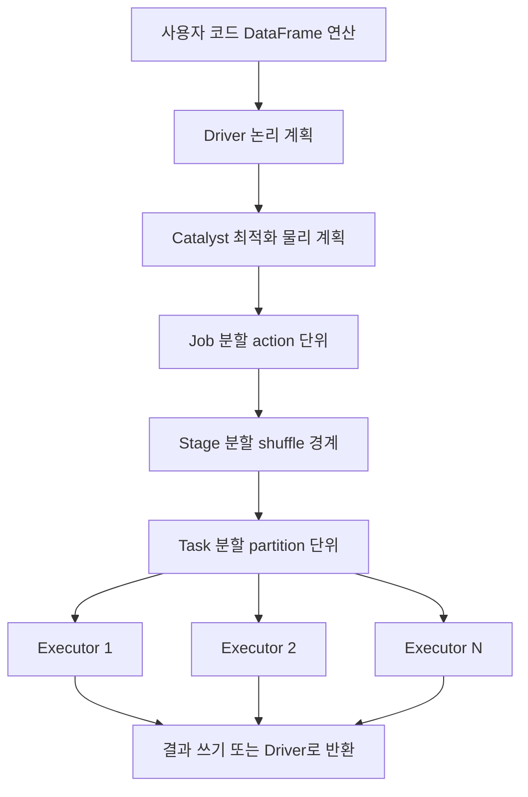

# Spark

## 한 줄 정의 {#definition}

Apache Spark는 큰 데이터를 여러 머신(또는 여러 코어)에 나눠 메모리 위에서 병렬 처리하는 분산 처리 엔진이다. SQL, DataFrame API, 스트리밍, 머신러닝을 같은 엔진으로 다룬다.

**언제 쓰나**

- 한 대의 Pandas로는 메모리에 안 들어가는 수억 행 이상의 데이터를 변환·집계할 때
- CSV·JSON 원천을 Parquet로 바꾸고 날짜별로 파티셔닝해 레이크에 쌓을 때
- 윈도우 함수, 조인, 집계를 SQL처럼 쓰되 대규모로 돌려야 할 때

데이터가 수 GB 이하로 한 머신에서 충분히 처리되면 Pandas, DuckDB, 또는 DB 안의 SQL이 더 단순하고 빠를 때가 많다.

## 핵심 개념 {#concepts}

| 용어 | 설명 |
|------|------|
| Driver | 사용자 코드(main)가 실행되는 프로세스. 실행 계획을 만들고 작업을 나눠 executor에 보낸다. |
| Executor | 클러스터 노드에서 실제로 task를 실행하고 데이터를 메모리·디스크에 보관하는 프로세스. |
| SparkSession | Spark 기능의 진입점. `spark.read`, `spark.sql`이 여기서 시작한다. |
| DataFrame | 이름과 타입이 있는 컬럼으로 이루어진 분산 테이블. 내부적으로 Catalyst 옵티마이저가 실행 계획을 최적화한다. |
| Partition | DataFrame을 나눈 조각. task 하나가 partition 하나를 처리한다. partition 수가 곧 병렬도다. |
| Transformation | `select`, `filter`, `withColumn`, `join`처럼 새 DataFrame을 만드는 연산. 바로 실행되지 않는다. |
| Action | `count`, `collect`, `write`, `show`처럼 결과를 요구하는 연산. 이때 실제 계산이 시작된다. |
| Lazy evaluation | action이 호출될 때까지 transformation을 모아 두었다가 한꺼번에 최적화해 실행하는 방식. |
| Shuffle | `groupBy`, `join`, 윈도우 함수처럼 같은 키의 데이터를 한 곳에 모으기 위해 노드 사이로 데이터를 재분배하는 단계. 가장 비싼 연산이다. |
| Narrow / Wide | partition 하나가 다른 partition 하나에만 의존하면 narrow(셔플 없음), 여러 partition에 의존하면 wide(셔플 발생). |

## 동작 원리 {#how-it-works}



1. 코드에서 transformation을 이어 붙이면 Driver는 실행하지 않고 **논리 계획**만 쌓는다.
2. action이 호출되면 Catalyst가 계획을 최적화한다. 필요한 컬럼만 읽기(column pruning), 필터를 소스 쪽으로 내리기(predicate pushdown) 등이 여기서 일어난다.
3. action 하나가 **Job** 하나가 되고, Job은 shuffle 경계마다 **Stage**로 나뉜다.
4. Stage 안에서는 partition마다 **Task** 하나가 만들어져 Executor에 배분된다.
5. Stage 사이에서는 shuffle 파일을 쓰고 읽으며 데이터가 재분배된다. Spark UI(기본 4040 포트)에서 Job·Stage·Task별 시간과 shuffle 크기를 볼 수 있다.

```python
from pyspark.sql import SparkSession, functions as F

spark = SparkSession.builder.appName("daily").getOrCreate()
df = spark.read.option("header", True).csv("s3a://bucket/raw/events/")   # 아직 실행 안 됨
daily = (df.filter(F.col("event_type") == "purchase")
           .withColumn("event_date", F.to_date("event_time"))
           .groupBy("event_date").agg(F.countDistinct("user_id").alias("buyers")))  # shuffle 발생
daily.write.mode("overwrite").partitionBy("event_date").parquet("s3a://bucket/marts/buyers/")  # action
```

**partition 수 조절**

- `spark.sql.shuffle.partitions`: shuffle 이후 partition 수. 기본 200. 데이터가 크면 늘리고, 작으면 줄인다. Spark 3 이상에서는 AQE(Adaptive Query Execution)가 실행 중에 작은 partition을 합쳐 준다.
- `repartition(n)`: shuffle을 일으켜 n개로 고르게 나눈다. `coalesce(n)`: shuffle 없이 줄이기만 한다. 출력 파일 수를 줄일 때 쓴다.

## 내가 썼던 방식 {#my-usage}

- Backpacker (개인, Spark 배치): Scala로 Spark 배치 애플리케이션을 작성해 이커머스 이벤트 CSV를 처리했다. UTC → KST 변환(`from_utc_timestamp`), `user_id` 기준 Window + `lag`로 5분(300초) 간격 세션 ID 생성, `event_date` 파티션 + Snappy 압축 Parquet 저장, Hive 외부 테이블 등록 후 WAU(주간 활성 사용자)를 계산해 CSV로 내보냈다. 날짜 파티션마다 `_SUCCESS` 마커가 있으면 건너뛰어 재실행 시 완료분을 다시 처리하지 않게 했고, `spark.sql.shuffle.partitions`를 400으로 조정했으며, OOM 방지를 위해 `count()`와 `.cache()`를 제거했다. SBT로 Fat JAR를 만들고 Docker 멀티스테이지 빌드로 `spark-submit` 실행했다.
- NLP 기반 한국어 텍스트 처리 Pipeline: Scrapy로 수집한 한국어 텍스트를 Spark로 처리해 분석 데이터를 만들고, Airflow로 수집·처리를 오케스트레이션했다.
- 데이터 수집 · 감성 분석 대시보드 운영: Airflow·Spark·Kafka·ES 파이프라인을 점검하고 장애를 조치했으며, 장애 구간 코드를 리팩토링해 운영 안정성을 유지했다.

## 장단점과 함정 {#pros-cons}

**장점**

- 노드를 늘리면 처리량이 늘어나는 수평 확장 구조다.
- SQL과 DataFrame API로 대부분의 변환을 표현할 수 있고, 옵티마이저가 실행 계획을 알아서 개선한다.
- 배치와 스트리밍(Structured Streaming)을 같은 API로 다룬다.
- Parquet, Hive 메타스토어, S3, Kafka 등과 연결이 기본 지원된다.

**단점**

- 작은 데이터에는 클러스터 기동·스케줄링 오버헤드가 처리 시간보다 크다.
- 메모리, partition 수, shuffle 튜닝을 모르면 OOM이나 느린 Job이 쉽게 생긴다.
- JVM 기반이라 PySpark에서 Python UDF를 쓰면 직렬화 비용이 붙는다.

!!! tip "함정"
    - `collect()`는 전체 결과를 Driver 메모리로 가져온다. 큰 DataFrame에 쓰면 Driver가 OOM으로 죽는다.
    - 한 키에 데이터가 몰리면(data skew) 특정 task 하나만 오래 걸린다. Spark UI에서 task 시간 분포를 먼저 본다.
    - `.cache()`는 재사용할 때만 이득이다. 한 번 쓰고 마는 DataFrame을 캐시하면 메모리만 차지한다.
    - Python UDF보다 `pyspark.sql.functions`의 내장 함수가 훨씬 빠르다. 내장 함수로 안 될 때만 UDF를 쓴다.
    - `overwrite` 모드는 기본적으로 출력 경로 전체를 지운다. 특정 파티션만 바꾸려면 `spark.sql.sources.partitionOverwriteMode=dynamic`을 설정한다.

## 비교 {#comparison}

**PySpark vs Scala Spark**

| 항목 | PySpark | Scala |
|------|---------|-------|
| 진입 장벽 | 낮음, Pandas·데이터과학 생태계와 연결 | 높음, 함수형·타입 시스템 학습 필요 |
| DataFrame 내장 함수 성능 | Scala와 거의 같음 (둘 다 JVM의 같은 실행 계획) | 기준 |
| UDF 성능 | Python 프로세스와 데이터를 주고받아 느림 (Pandas UDF로 완화) | JVM 안에서 실행되어 빠름 |
| 타입 안정성 | 런타임에 에러 발견 | 컴파일 시점에 일부 에러 발견, Dataset API 사용 가능 |
| 배포 | `.py` 파일과 의존성 패키징 | Fat JAR 하나로 배포 |

Backpacker README에서는 Scala를 고른 이유로 Spark 기본 언어라는 점, 정적 타입으로 런타임 에러를 미리 막는 점, 함수형 변환, Java 라이브러리(Hadoop FileSystem 등) 직접 사용을 들었다. 일반적으로 내장 함수만 쓰는 DataFrame 코드라면 두 언어의 성능 차이는 작고, 차이는 UDF와 RDD 연산에서 크게 난다.

**배치 vs Structured Streaming**

| 항목 | 배치 | Structured Streaming |
|------|------|----------------------|
| 입력 | 고정된 데이터 (파일, 테이블) | 계속 들어오는 데이터 (Kafka, 파일 도착) |
| 실행 | 한 번 돌고 끝남, Airflow 등이 주기 실행 | 계속 실행되며 micro-batch 단위로 처리 |
| 상태 | 매번 처음부터 계산 | checkpoint에 offset과 집계 상태 저장 |
| 지연 | 분~시간 | 초 단위 |
| 주의점 | 재실행 시 멱등성 | late data 처리를 위한 watermark, checkpoint 관리 |

## 예상 질문 {#interview}

[예상질문 보기](../../interview/processing-streaming.md#spark)

## 더 보기 {#links}

- [Spark SQL, DataFrames Guide](https://spark.apache.org/docs/latest/sql-programming-guide.html)
- [Cluster Mode Overview](https://spark.apache.org/docs/latest/cluster-overview.html)
- [Performance Tuning](https://spark.apache.org/docs/latest/sql-performance-tuning.html)
- [Structured Streaming Programming Guide](https://spark.apache.org/docs/latest/structured-streaming-programming-guide.html)
