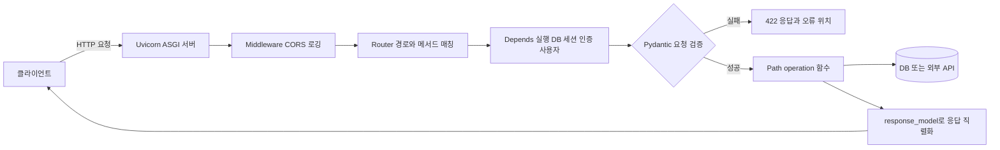

# FastAPI · Django

## 한 줄 정의 {#definition}

FastAPI는 타입 힌트와 Pydantic으로 요청·응답을 검증하고 OpenAPI 문서를 자동으로 만드는 ASGI 기반 Python API 프레임워크이고, Django는 ORM·관리자 화면·인증·템플릿을 모두 갖춘 풀스택 Python 웹 프레임워크다.

**언제 쓰나**

- FastAPI: 데이터 조회 API, 수집 모듈을 호출하는 API, 모델·LLM 추론 API처럼 JSON을 주고받는 백엔드를 빠르게 만들 때
- FastAPI: 외부 API·DB 호출 대기가 많은 I/O 위주 서비스에서 async로 동시 요청을 처리할 때
- Django: 데이터 모델, 관리자 화면, 로그인, 권한이 한 번에 필요한 업무용 웹 애플리케이션을 만들 때

## 핵심 개념 {#concepts}

| 용어 | 설명 |
|------|------|
| WSGI / ASGI | Python 웹 서버와 앱 사이의 규약. WSGI는 동기 요청 하나씩, ASGI는 async와 WebSocket을 지원한다. FastAPI는 ASGI, Django는 둘 다 지원한다. |
| Uvicorn | ASGI 서버. `uvicorn main:app --port 8000`으로 FastAPI 앱을 띄운다. |
| Path operation | FastAPI에서 `@app.get("/items/{id}")`처럼 HTTP 메서드와 경로에 붙인 함수. |
| Pydantic model | 타입이 선언된 클래스. 요청 body를 이 모델로 받으면 타입 변환과 검증이 자동으로 되고, 틀리면 422 응답이 나간다. |
| Dependency Injection | `Depends()`로 DB 세션, 현재 사용자, 설정 같은 공통 준비물을 함수 인자로 주입하는 기능. 테스트에서 바꿔 끼우기 쉽다. |
| OpenAPI / Swagger UI | FastAPI가 코드에서 API 명세를 만들어 `/docs`(Swagger UI)와 `/redoc`에 띄운다. |
| APIRouter | 엔드포인트를 기능별 파일(`auth.py`, `items.py`)로 나누고 `include_router`로 합치는 단위. |
| Django ORM | Python 클래스(Model)로 테이블을 정의하고 쿼리를 메서드로 쓴다. `makemigrations`·`migrate`로 스키마 변경을 관리한다. |
| Django Admin | Model을 등록하면 데이터 조회·수정 화면이 자동으로 생기는 관리자 페이지. |

## 동작 원리 {#how-it-works}



1. Uvicorn이 요청을 받아 ASGI 이벤트로 앱에 넘긴다.
2. Router가 경로와 메서드로 처리 함수를 찾는다.
3. `Depends`로 선언된 의존성(DB 세션 열기, 토큰에서 사용자 꺼내기)을 먼저 실행한다. `yield`를 쓴 의존성은 응답 뒤에 정리 코드(세션 닫기)가 실행된다.
4. 경로·쿼리·body 값을 타입 힌트와 Pydantic 모델로 검증한다. 실패하면 함수가 실행되지 않고 422가 나간다.
5. 반환값은 `response_model`로 걸러져(비밀번호 같은 필드 제외) JSON으로 직렬화된다.

**FastAPI 예시**

```python
from fastapi import FastAPI, Depends, HTTPException
from pydantic import BaseModel, Field
from sqlalchemy.orm import Session

app = FastAPI()

class ItemCreate(BaseModel):
    name: str = Field(min_length=1)
    price: int = Field(ge=0)

class ItemOut(BaseModel):
    id: int
    name: str

def get_db():
    db = SessionLocal()          # 요청마다 세션 하나
    try:
        yield db
    finally:
        db.close()               # 응답 뒤 정리

@app.post("/items", response_model=ItemOut, status_code=201)
def create_item(body: ItemCreate, db: Session = Depends(get_db)):
    item = Item(**body.model_dump())
    db.add(item); db.commit(); db.refresh(item)
    return item

@app.get("/health")
def health():
    return {"status": "ok"}      # 로드밸런서 헬스 체크용
```

**sync와 async 함수**: `def`로 선언한 엔드포인트는 스레드 풀에서, `async def`는 이벤트 루프에서 실행된다. `async def` 안에서 동기 DB 드라이버나 `requests`처럼 막히는(blocking) 호출을 하면 이벤트 루프 전체가 멈춘다. 동기 라이브러리를 쓰면 `def`로 두는 편이 안전하다.

**Django 요청 흐름**: URLconf가 경로를 View에 연결하고, View가 ORM으로 Model을 조회해 템플릿이나 JSON(Django REST Framework)으로 응답한다. 인증·세션·CSRF는 Middleware가 처리한다.

## 내가 썼던 방식 {#my-usage}

- 데이터 수집 API · ETL 파이프라인: 프로젝트 스택에 FastAPI가 포함되어 있다. Selenium·BeautifulSoup 스크래핑 모듈을 API로 제공해 재사용하게 했고, 수집 요청은 RabbitMQ 비동기 요청과 Redis 캐싱으로 구조화했으며, 적재된 데이터를 REST API로 조회하는 흐름을 자동화했다.
- 외부 소스 수집 워크플로우 (서브 프로젝트): Django·Airflow·PostgreSQL·MongoDB 스택으로 뉴스·의약품 등 외부 소스 수집 워크플로우를 개발했다.
- Smart Factory Data Agent: FastAPI 백엔드(`uvicorn backend.main:app --port 8000`)에서 사용자 질문을 받아 LLM으로 SQL을 생성하고 PostgreSQL을 조회해 KPI를 계산했다. 질문은 안전한 SELECT 전용 SQL로만 변환했고, 백엔드는 Pandas·SQLAlchemy·OpenAI API를 썼다. 프론트엔드는 Streamlit + Plotly다.
- 올리브영 클론 프로젝트 (부트캠프 실습): FastAPI 백엔드를 `main.py`, `config.py`, `database.py`, `models.py`, `schemas.py`, `crud.py`와 `routers/`(auth, items, chat)로 나눈 구조로 다뤘다. 회원가입·로그인(JWT 발급), 상품 목록·상세, 로그인이 필요한 장바구니·주문, 챗봇 메시지 API가 있고, Swagger 문서는 `:8000/docs`에 뜬다. 백엔드를 ECS(Fargate)에 배포하는 구성에서는 ALB Target Group 헬스 체크 경로를 `/health`로 둔다.

## 장단점과 함정 {#pros-cons}

**FastAPI 장점**

- 타입 힌트 하나로 검증·문서·에디터 자동완성이 같이 해결된다.
- async 지원으로 I/O 대기가 많은 API에서 적은 프로세스로 많은 요청을 처리한다.
- 구조가 가벼워 작은 서비스나 ML·LLM 서빙에 빨리 붙일 수 있다.

**FastAPI 단점**

- ORM, 마이그레이션, 관리자 화면, 인증이 기본 제공되지 않아 SQLAlchemy·Alembic 등을 직접 고른다.
- 자유도가 높아 프로젝트마다 폴더 구조가 제각각이 되기 쉽다.

**Django 장단점**

- ORM·Admin·인증·마이그레이션이 다 들어 있어 업무용 화면과 데이터 관리가 빠르다.
- 기능이 많은 만큼 무겁고, async 지원은 ORM 일부가 아직 동기 중심이라 제약이 있다.

!!! tip "함정"
    - `async def` 안에서 동기 DB 호출을 하면 동시 처리가 오히려 망가진다.
    - DB 세션을 전역 하나로 쓰면 요청끼리 트랜잭션이 섞인다. 요청마다 `Depends`로 열고 닫는다.
    - `response_model`을 지정하지 않고 ORM 객체를 그대로 반환하면 비밀번호 해시 같은 필드가 응답에 섞일 수 있다.
    - Uvicorn `--reload`는 개발용이다. 운영은 여러 worker(`--workers` 또는 Gunicorn + Uvicorn worker)로 띄운다.
    - CORS 설정을 빠뜨리면 브라우저 프론트에서만 요청이 막힌다(curl은 된다).

## 비교 {#comparison}

| 항목 | FastAPI | Django | Flask |
|------|---------|--------|-------|
| 성격 | API 중심 경량 프레임워크 | 풀스택 프레임워크 | 마이크로 프레임워크 |
| 서버 규약 | ASGI | WSGI·ASGI | WSGI |
| async | 기본 | 지원 (ORM 일부 제약) | 제한적 |
| 요청 검증 | Pydantic 자동 | Form / DRF Serializer | 직접 또는 확장 |
| API 문서 | OpenAPI 자동 생성 | DRF + 확장 패키지 | 확장 패키지 |
| ORM·마이그레이션 | 없음 (SQLAlchemy·Alembic) | 내장 | 없음 (확장) |
| 관리자 화면 | 없음 | 내장 Admin | 없음 |
| 잘 맞는 곳 | JSON API, 데이터·ML 서빙, 내부 도구 API | 관리 화면이 있는 업무 웹, CMS | 작은 웹, 단순 API, 학습용 |

## 예상 질문 {#interview}

[예상질문 보기](../../interview/serving-infra.md#fastapi)

## 더 보기 {#links}

- [FastAPI: Tutorial - User Guide](https://fastapi.tiangolo.com/tutorial/)
- [FastAPI: Dependencies](https://fastapi.tiangolo.com/tutorial/dependencies/)
- [FastAPI: Concurrency and async / await](https://fastapi.tiangolo.com/async/)
- [Django Documentation](https://docs.djangoproject.com/en/stable/)
- [Uvicorn: Deployment](https://www.uvicorn.org/deployment/)
