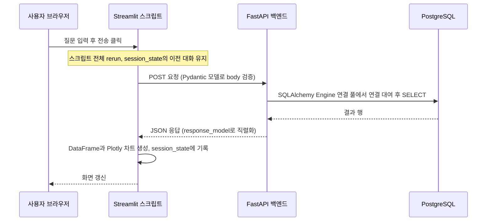

# Streamlit · SQLAlchemy · Pydantic

## 한 줄 정의 {#definition}

Streamlit은 Python 스크립트만으로 데이터 대시보드·데모 화면을 만드는 웹 UI 프레임워크이고, SQLAlchemy는 Python에서 SQL을 다루는 DB 툴킷(Core)과 ORM이며, Pydantic은 타입 힌트로 데이터 구조를 선언하고 검증·변환하는 라이브러리다. 셋은 "작은 데이터 앱"을 만들 때 자주 같이 쓰인다.

**언제 쓰나**

- Streamlit: 분석 결과, KPI, 챗봇 같은 내부 도구·데모 화면을 프론트엔드 코드 없이 빠르게 만들 때
- SQLAlchemy: 여러 DB(PostgreSQL, MySQL, SQLite)에 같은 코드로 연결하고, 연결 풀·트랜잭션을 관리할 때
- Pydantic: API 요청·응답, 설정값(.env), LLM 출력처럼 바깥에서 들어온 데이터를 타입대로 검증할 때

## 핵심 개념 {#concepts}

| 용어 | 설명 |
|------|------|
| Streamlit rerun | 위젯 값이 바뀌거나 버튼을 누르면 스크립트 전체가 위에서부터 다시 실행된다. Streamlit의 기본 실행 모델이다. |
| `st.session_state` | rerun 사이에 값을 유지하는 사용자 세션별 저장소. 채팅 기록, 선택 상태를 여기에 둔다. |
| `st.cache_data` / `st.cache_resource` | 함수 결과 캐시. `cache_data`는 DataFrame 같은 데이터, `cache_resource`는 DB 엔진·모델처럼 공유 객체에 쓴다. |
| Engine | SQLAlchemy에서 DB 연결 정보와 연결 풀을 가진 객체. `create_engine(DATABASE_URL)`로 앱당 하나 만든다. |
| Core | 테이블·SQL 표현식을 Python으로 쓰는 계층. `text()`로 원시 SQL도 바인딩 파라미터와 함께 실행한다. |
| ORM / Session | 클래스와 테이블을 매핑하고, Session이 객체 변경을 모아 트랜잭션으로 반영(`commit`)한다. |
| BaseModel | Pydantic의 기본 클래스. 필드 타입을 선언하면 생성 시 검증·변환된다(`"3"` → `3`). |
| `model_validate` / `model_dump` | dict·JSON을 모델로 검증해 만들고(`validate`), 모델을 dict로 내보낸다(`dump`). Pydantic v2 이름이다. |
| BaseSettings | 환경 변수·`.env` 파일에서 설정을 읽어 타입 검증하는 클래스(`pydantic-settings` 패키지). |

## 동작 원리 {#how-it-works}



1. **Streamlit rerun**: 사용자가 위젯을 건드리면 스크립트가 처음부터 다시 돈다. 그래서 무거운 조회는 `st.cache_data`로 감싸고, 대화 기록처럼 유지할 값은 `st.session_state`에 둔다.
2. **SQLAlchemy 연결 풀**: Engine은 연결을 미리 열어 두고 빌려준다. 요청마다 새 연결을 맺지 않으므로 빠르다. 연결은 `with engine.connect()`나 Session 블록이 끝나면 풀로 돌아간다.
3. **Pydantic 검증**: API 경계(요청 body, 외부 응답, 설정)에서 한 번 검증하면 안쪽 코드는 타입을 믿고 쓸 수 있다.

**Streamlit 예시**

```python
import streamlit as st
import requests, os

BACKEND_URL = os.getenv("BACKEND_URL", "http://localhost:8000")

if "messages" not in st.session_state:
    st.session_state.messages = []           # 첫 실행에만 초기화

for m in st.session_state.messages:          # rerun마다 이전 대화를 다시 그림
    st.chat_message(m["role"]).write(m["content"])

if q := st.chat_input("질문을 입력하세요"):
    st.session_state.messages.append({"role": "user", "content": q})
    answer = requests.post(f"{BACKEND_URL}/api/chat", json={"message": q}, timeout=30).json()
    st.session_state.messages.append({"role": "assistant", "content": answer["reply"]})
    st.rerun()
```

**SQLAlchemy Core와 ORM**

```python
from sqlalchemy import create_engine, text
from sqlalchemy.orm import Session

engine = create_engine(DATABASE_URL, pool_size=5, pool_pre_ping=True)

# Core: SQL을 직접, 값은 바인딩 파라미터로
with engine.connect() as conn:
    rows = conn.execute(text("SELECT line, oee FROM kpi WHERE day = :d"), {"d": day}).all()

# ORM: 객체로 다루고 Session이 트랜잭션 관리
with Session(engine) as s:
    s.add(Order(user_id=1, total=29000))
    s.commit()
```

**Pydantic 설정과 LLM 출력 검증**

```python
from pydantic import BaseModel
from pydantic_settings import BaseSettings

class Settings(BaseSettings):
    database_url: str
    openai_api_key: str
    model_config = {"env_file": ".env"}      # 값이 없으면 앱 시작 시점에 바로 실패

class SqlPlan(BaseModel):
    sql: str
    explanation: str

plan = SqlPlan.model_validate_json(llm_output)  # 형식이 틀리면 ValidationError
```

## 내가 썼던 방식 {#my-usage}

- Smart Factory Data Agent: 프론트엔드를 Streamlit + Plotly(`streamlit run frontend/app.py`)로, 백엔드를 FastAPI + Pandas·SQLAlchemy·OpenAI API로 나눴다. SQLAlchemy로 PostgreSQL에 접근해 자연어 질문을 변환한 SELECT 전용 SQL을 실행하고, OEE·납기 지연·피킹 생산성·불량률 KPI를 계산해 Plotly 차트로 보여 줬다. 연결 정보(`DATABASE_URL`)와 `OPENAI_API_KEY`는 `.env`에서 읽었다.
- 올리브영 클론 프로젝트 (부트캠프 실습): AI 챗봇 UI를 Streamlit(`:8501`)으로 두고, `BACKEND_URL` 환경 변수로 FastAPI 백엔드를 호출하게 했다. 챗봇 흐름은 Streamlit → FastAPI → DB 상품 조회 → 상품 정보를 프롬프트에 포함 → AWS Bedrock 답변이다. Streamlit도 별도 Dockerfile로 이미지를 만들어 ECS Service로 배포하는 구성이다.

## 장단점과 함정 {#pros-cons}

**Streamlit 장점과 단점**

- Python만으로 화면이 나와 데이터 엔지니어·분석가가 결과를 바로 보여 줄 수 있다.
- 매 상호작용마다 전체 rerun이라 화면이 복잡해지면 느려지고, 세밀한 레이아웃·라우팅·권한 관리는 약하다. 고객용 서비스 프론트엔드에는 맞지 않는다.

**SQLAlchemy 장점과 단점**

- DB 종류를 URL로 바꾸고, 연결 풀·트랜잭션·바인딩 파라미터를 일관되게 쓴다.
- ORM은 N+1 쿼리, 지연 로딩 같은 함정이 있어 실제 실행 SQL을 확인해야 한다. 분석 쿼리는 Core나 `text()`가 더 읽기 쉽다.

**Pydantic 장점과 단점**

- 검증 오류 메시지가 필드 위치까지 알려 줘 디버깅이 쉽다. v2는 핵심이 Rust로 작성되어 빠르다.
- v1과 v2 API 이름이 달라(`dict()` → `model_dump()`) 예제 코드를 섞으면 오류가 난다.

!!! tip "함정"
    - Streamlit에서 `st.session_state` 없이 일반 변수에 대화를 담으면 rerun마다 사라진다.
    - `st.cache_data`에 DB 연결 객체를 넣으면 직렬화 오류가 난다. 연결·엔진은 `st.cache_resource`.
    - SQL에 사용자 입력을 f-string으로 넣지 않는다. `text()`의 `:param` 바인딩을 쓴다. LLM이 만든 SQL은 SELECT 전용으로 제한하고 읽기 전용 계정으로 실행한다.
    - Engine을 요청마다 만들면 연결 풀이 의미가 없고 DB 연결 수가 폭증한다. 앱당 하나.
    - 오래 놀던 연결은 DB가 끊는다. `pool_pre_ping=True`로 사용 전 확인한다.

## 비교 {#comparison}

| 항목 | Streamlit | Gradio | Dash | React 등 별도 프론트 |
|------|-----------|--------|------|----------------------|
| 작성 언어 | Python | Python | Python | JavaScript / TypeScript |
| 실행 모델 | 스크립트 전체 rerun | 함수 입출력 단위 | 콜백 단위 | 컴포넌트 상태 |
| 잘 맞는 곳 | 대시보드, 내부 도구, 챗봇 데모 | ML 모델 데모 | 복잡한 상호작용 대시보드 | 고객용 서비스 |
| 학습 곡선 | 낮음 | 낮음 | 중간 | 높음 |

| 항목 | SQLAlchemy Core | SQLAlchemy ORM |
|------|-----------------|----------------|
| 다루는 대상 | 테이블, SQL 표현식, 행 | 클래스, 객체, 관계 |
| 잘 맞는 곳 | 분석·집계 쿼리, 대량 적재 | CRUD 위주 애플리케이션 |
| 실행 SQL 예측 | 쉬움 | 지연 로딩 때문에 확인 필요 |

## 예상 질문 {#interview}

[예상질문 보기](../../interview/serving-infra.md#streamlit)

## 더 보기 {#links}

- [Streamlit: Architecture and execution](https://docs.streamlit.io/develop/concepts/architecture)
- [Streamlit: Session State](https://docs.streamlit.io/develop/api-reference/caching-and-state/st.session_state)
- [SQLAlchemy Unified Tutorial](https://docs.sqlalchemy.org/en/20/tutorial/index.html)
- [Pydantic Documentation](https://docs.pydantic.dev/latest/)
- [Pydantic Settings](https://docs.pydantic.dev/latest/concepts/pydantic_settings/)
