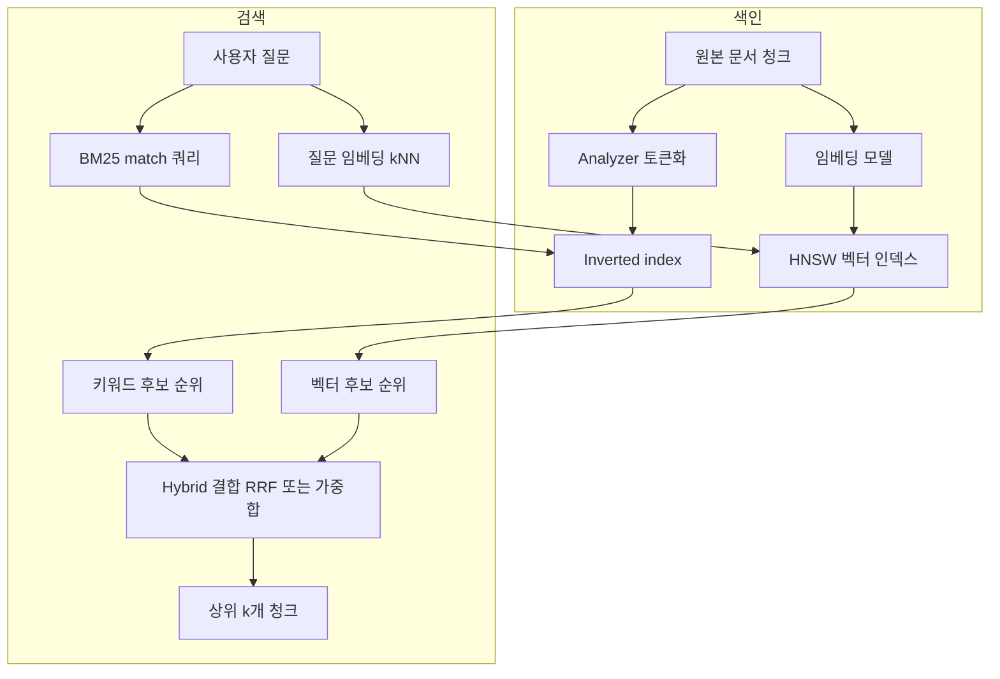

# Elasticsearch

## 한 줄 정의 {#definition}

Elasticsearch(ES)는 문서를 역색인(inverted index)과 벡터 인덱스로 저장해, 키워드 검색·벡터 유사도 검색·집계를 빠르게 하는 분산 검색 엔진이다. 데이터 시각화 도구 Kibana와 함께 쓴다.

**언제 쓰나**

- 문서·로그에서 단어로 찾는 전문 검색(full-text search)과 관련도 순 정렬이 필요할 때
- RAG에서 질문과 비슷한 청크를 키워드(BM25)와 의미(벡터)로 함께 찾을 때
- 로그·이벤트를 시간대별로 집계하고 Kibana 대시보드로 볼 때

정합성이 중요한 원본 데이터의 주 저장소로 쓰기보다는, 원본(DB, 파일)에서 만든 **검색용 사본**으로 두는 것이 일반적이다.

## 핵심 개념 {#concepts}

| 용어 | 설명 |
|------|------|
| Index | 문서 묶음. RDB의 테이블에 해당. 문서 종류(스키마)마다 따로 두는 경우가 많다. |
| Document | JSON 하나. RAG에서는 보통 청크 하나가 문서 하나다. |
| Mapping | 각 필드의 타입과 색인 방식을 정한 스키마. 한 번 정한 필드 타입은 바꿀 수 없어 재색인이 필요하다. |
| Inverted index | "단어 → 그 단어가 나온 문서 목록". 책 뒤의 찾아보기와 같다. `text` 필드 검색의 기본 구조. |
| Analyzer | 문자열을 검색 단위(token)로 바꾸는 과정. char filter(문자 정리) → tokenizer(쪼개기) → token filter(소문자화, 불용어 제거). 한국어는 형태소 분석기 `nori`를 많이 쓴다. |
| BM25 | 기본 관련도 점수. 질문 단어가 문서에 많이 나올수록(TF), 전체 문서에서 드물수록(IDF) 높고, 문서 길이로 보정한다. |
| dense_vector / kNN | 임베딩 벡터를 저장하고, 질문 벡터와 가까운 k개를 근사 탐색(HNSW 그래프)으로 찾는다. |
| Hybrid search | BM25 결과와 kNN 결과를 합쳐 순위를 매긴다. 점수 가중합 또는 순위 기반 RRF(Reciprocal Rank Fusion). |
| Shard / Replica | 인덱스를 나눈 조각(primary shard)과 그 복제본. shard 단위로 노드에 분산된다. |
| Refresh | 새로 색인한 문서가 검색에 보이게 되는 주기(기본 1초). 그래서 near real-time이다. |
| Quantization | 벡터를 float32보다 작은 형식으로 압축해 메모리를 줄이는 것. `int8_hnsw`(약 1/4), `bbq_hnsw`(차원당 1비트, 원본 벡터로 재채점) 등. |

## 동작 원리 {#how-it-works}



1. 색인 시 `text` 필드는 analyzer를 거쳐 역색인에, `dense_vector` 필드는 HNSW 그래프에 들어간다. `keyword` 필드는 분석 없이 값 그대로 색인되어 필터·집계에 쓰인다.
2. 검색 요청은 모든 shard로 퍼지고(query phase), 각 shard의 상위 결과를 조정 노드가 합친 뒤 실제 문서를 가져온다(fetch phase).
3. 하이브리드 검색은 두 후보 목록을 합친다. BM25 점수와 벡터 유사도는 크기가 달라 그대로 더하기 어렵기 때문에, 순위만 쓰는 RRF가 조정 없이 쓰기 쉽다.

**배포와 운영**: Kubernetes에서는 ECK(Elastic Cloud on Kubernetes) operator가 ES 클러스터와 Kibana를 커스텀 리소스로 선언해 배포·업그레이드·인증서를 관리한다. Kibana는 인덱스 내용 확인(Discover), 쿼리 실행(Dev Tools), 대시보드 시각화에 쓴다.

**RAG 청크용 매핑 예시**

```json
PUT rag_chunks
{
  "mappings": {
    "properties": {
      "doc_id":      { "type": "keyword" },
      "doc_type":    { "type": "keyword" },
      "title":       { "type": "text", "analyzer": "nori" },
      "content":     { "type": "text", "analyzer": "nori" },
      "summary":     { "type": "text", "analyzer": "nori" },
      "page":        { "type": "integer" },
      "updated_at":  { "type": "date" },
      "content_vec": { "type": "dense_vector", "dims": 1024, "similarity": "cosine",
                       "index_options": { "type": "bbq_hnsw" } }
    }
  }
}
```

- 필터용 값(`doc_id`, `doc_type`)은 `keyword`, 검색할 본문은 `text`, 의미 검색은 `dense_vector`로 나눈다.
- 본문 외에 요약·예상질문 같은 메타데이터 필드를 따로 두면, 같은 청크를 여러 표현으로 찾을 수 있다.
- `dims`는 임베딩 모델 출력 차원과 같아야 한다(bge-m3는 1024).

## 내가 썼던 방식 {#my-usage}

- 지식기반 검색 RAG 파이프라인:
    - 문서 스키마 7종을 ES 인덱스 매핑으로 설계했다.
    - 설명요약·예상질문 메타데이터 필드로 RAG 검색을 확장하는 구조를 설계했고, 요약·예상질문 벡터를 추가한 하이브리드 검색을 적용해 바꿔말한 질문 검색을 16/20 → 18/20으로 올렸다.
    - 검색 평가셋 22문항을 만들어 BM25·벡터·하이브리드의 Hit@5 비교를 자동화했다.
    - bge-m3 벡터의 양자화 방식을 비교 평가해, bbq 적용으로 정확도 손실 없이 메모리를 1/7로 줄였다.
    - Airflow(KubernetesExecutor) 기반 데이터 적재 배치를 설계했다.
    - 표 구조 보존 청커(행 단위 분할·머리글 반복)로 HTML 234건을 15,458청크로 나눴고 크기 초과 청크는 0건이었다.
    - 표 열 이름이 '----'로 잘못 적재된 7청크를 발견해, PDF 파서의 구분선 오인을 확인하고 구분선 행을 제거한 뒤 재적재했다. 오류 청크 7 → 0, 표 질의 벡터 MRR 0.85 → 0.92.
    - 프로젝트 스택: Elasticsearch, Kibana, Kubernetes(ECK), Docker Compose.
- 데이터 수집 · 감성 분석 대시보드 운영: 일 배치 적재·감성 분석 결과를 Kibana 대시보드로 시각화했고, Airflow·Spark·Kafka·ES 파이프라인을 점검하고 장애를 조치했다.

## 장단점과 함정 {#pros-cons}

**장점**

- 키워드 검색, 벡터 검색, 필터, 집계를 한 엔진과 한 쿼리에서 처리한다.
- shard 단위로 수평 확장되고, Kibana로 바로 시각화·운영 확인이 된다.
- analyzer를 바꿔 언어별 검색 품질을 조절할 수 있다.

**단점**

- 매핑을 바꾸려면 새 인덱스를 만들고 재색인해야 한다.
- 메모리를 많이 쓴다. 특히 HNSW 벡터 인덱스는 메모리에 올라가야 빠르다.
- 트랜잭션이 없고 near real-time이라 원본 저장소로는 부적합하다.

!!! tip "함정"
    - 매핑 없이 문서를 넣으면 dynamic mapping이 문자열을 `text`와 `keyword` 둘 다로 만들어 인덱스가 커지고, 숫자를 문자열로 잘못 추론하기도 한다. 운영 인덱스는 명시적 매핑으로 시작한다.
    - `text` 필드로는 정확한 값 필터·정렬·집계를 못 한다. 그 용도는 `keyword`다.
    - 객체 배열을 일반 `object`로 두면 배열 원소의 필드가 섞여 잘못된 매칭이 생긴다. 원소 단위로 조건을 걸려면 `nested`.
    - 인덱스 이름을 코드에 직접 박으면 재색인 때 서비스가 멈춘다. alias를 두고 새 인덱스로 alias만 전환한다.
    - 평가셋 없이 검색 방식을 바꾸면 좋아졌는지 알 수 없다. Hit@k, MRR 같은 지표를 먼저 정한다.

## 비교 {#comparison}

**검색 방식: BM25 vs 벡터 vs 하이브리드**

| 항목 | BM25 (키워드) | 벡터 (kNN) | 하이브리드 |
|------|---------------|------------|------------|
| 찾는 기준 | 같은 단어가 있는가 | 의미가 비슷한가 | 둘 다 |
| 강한 경우 | 고유명사, 코드, 숫자, 정확한 용어 | 바꿔 말한 질문, 동의어, 문장형 질문 | 질문 유형이 섞여 있을 때 |
| 약한 경우 | 표현이 다르면 못 찾음 | 정확한 용어·숫자 일치를 놓침 | 결합 방식과 가중치 조정이 필요 |
| 필요한 것 | analyzer (한국어는 형태소 분석) | 임베딩 모델, 벡터 메모리 | 두 인덱스 모두, RRF 또는 가중치 |
| 비용 | 낮음 | 임베딩 계산과 메모리 비용 | 두 검색을 함께 실행 |

**매핑 필드 타입**

| 타입 | 색인 방식 | 용도 | 예시 필드 |
|------|-----------|------|-----------|
| `text` | analyzer로 토큰화해 역색인 | 전문 검색, BM25 | 본문, 제목, 요약 |
| `keyword` | 값 그대로 색인 | 정확 일치 필터, 정렬, 집계 | 문서 id, 문서 종류, 태그 |
| `integer` / `long` / `float` | 숫자 범위 구조 | 범위 조건, 정렬 | 페이지 번호, 점수 |
| `date` | 날짜 범위 구조 | 기간 필터, 시간 집계 | 작성일, 갱신일 |
| `boolean` | 참·거짓 | 필터 | 사용 여부 |
| `dense_vector` | HNSW 그래프 (양자화 선택) | kNN 의미 검색 | 본문 벡터, 요약 벡터 |
| `object` | 하위 필드를 평평하게 펼침 | 단순 중첩 구조 | 메타데이터 묶음 |
| `nested` | 배열 원소를 숨은 문서로 따로 색인 | 원소 단위 조건 검색 | 표의 행 목록, 첨부 목록 |

## 예상 질문 {#interview}

[예상질문 보기](../../interview/storage.md#elasticsearch)

## 더 보기 {#links}

- [Elasticsearch: Mapping](https://www.elastic.co/docs/manage-data/data-store/mapping)
- [Elasticsearch: Text analysis](https://www.elastic.co/docs/manage-data/data-store/text-analysis)
- [Elasticsearch: kNN search](https://www.elastic.co/docs/solutions/search/vector/knn)
- [Elasticsearch: dense_vector field type](https://www.elastic.co/docs/reference/elasticsearch/mapping-reference/dense-vector)
- [Elasticsearch: Reciprocal rank fusion](https://www.elastic.co/docs/reference/elasticsearch/rest-apis/reciprocal-rank-fusion)
- [Elastic Cloud on Kubernetes (ECK)](https://www.elastic.co/docs/deploy-manage/deploy/cloud-on-k8s)
