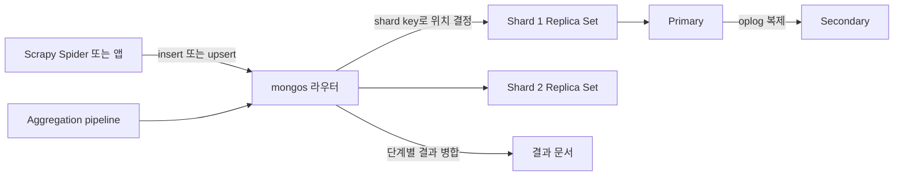

# MongoDB

## 한 줄 정의 {#definition}

MongoDB는 데이터를 JSON과 비슷한 문서(BSON document) 단위로 저장하는 문서형 NoSQL 데이터베이스다. 컬렉션 안의 문서마다 필드 구성이 달라도 된다.

**언제 쓰나**

- 크롤링 결과처럼 소스마다 필드가 조금씩 다르고, 스키마가 자주 바뀌는 데이터를 일단 받아 둘 때
- 한 번에 같이 읽는 데이터(글과 댓글 목록, 상품과 옵션)를 문서 하나에 묶어 조인 없이 읽고 싶을 때
- 쓰기량이 많아 샤딩으로 수평 확장해야 할 때

여러 엔티티를 자주 조인하고, 여러 행을 한 번에 바꾸는 트랜잭션이 핵심이면 관계형 DB가 더 맞다(아래 비교 참고).

## 핵심 개념 {#concepts}

| 용어 | 설명 |
|------|------|
| Document | BSON(바이너리 JSON) 객체 하나. RDB의 행에 해당하지만 중첩 객체와 배열을 가질 수 있다. 최대 16MB. |
| Collection | 문서의 묶음. RDB의 테이블에 해당하지만 스키마를 강제하지 않는다(필요하면 JSON Schema 검증을 걸 수 있다). |
| `_id` | 모든 문서의 기본 키. 지정하지 않으면 ObjectId(생성 시각 + 머신·프로세스 값 + 카운터)가 자동으로 들어간다. 자동 인덱스가 있다. |
| Embedding vs Referencing | 관련 데이터를 문서 안에 넣거나(embedding), 다른 컬렉션의 `_id`만 저장하거나(referencing). 함께 읽는 데이터는 embedding이 기본. |
| Index | 단일 필드, 복합, 배열(multikey), 텍스트, TTL, unique 인덱스 등. 없으면 컬렉션 전체를 스캔(COLLSCAN)한다. |
| Aggregation pipeline | `$match` → `$group` → `$sort`처럼 단계(stage)를 이어 붙여 변환·집계하는 쿼리 방식. SQL의 `WHERE`, `GROUP BY`, `JOIN($lookup)`을 대신한다. |
| Upsert | `update_one(filter, {"$set": ...}, upsert=True)`. 조건에 맞는 문서가 없으면 새로 만든다. 재수집 시 중복을 막는 기본 도구. |
| Replica Set | primary 1개와 secondary 여러 개. primary 장애 시 자동 선출(failover). |
| Sharding | shard key 기준으로 데이터를 여러 서버에 나눠 저장해 수평 확장한다. |
| Write concern / Read preference | 쓰기를 몇 개 노드가 받아야 성공으로 볼지, 읽기를 어느 노드에서 할지. |

## 동작 원리 {#how-it-works}



1. 단일 서버나 Replica Set만 쓸 때는 앱이 primary에 직접 쓴다. 샤딩을 쓰면 `mongos` 라우터가 shard key로 문서가 갈 shard를 정한다.
2. primary의 변경은 oplog(작업 로그)에 기록되고 secondary가 이를 따라 적용한다.
3. 쿼리는 인덱스가 있으면 IXSCAN, 없으면 COLLSCAN으로 실행된다. `explain("executionStats")`로 확인한다.
4. Aggregation pipeline은 앞 단계 결과가 다음 단계 입력이 된다. `$match`와 `$sort`를 앞에 둬야 인덱스를 쓴다.

```python
from pymongo import MongoClient, ASCENDING

books = MongoClient()["crawl"]["books"]
books.create_index([("title", ASCENDING), ("category", ASCENDING)], unique=True)

# 재수집해도 중복이 생기지 않도록 upsert
books.update_one(
    {"title": "Soumission", "category": "Travel"},
    {"$set": {"price": 50.10, "rating": 1, "in_stock": "Y"}},
    upsert=True,
)

# 카테고리별 평균 가격, 비싼 순
pipeline = [
    {"$match": {"in_stock": "Y"}},
    {"$group": {"_id": "$category", "avg_price": {"$avg": "$price"}, "n": {"$sum": 1}}},
    {"$sort": {"avg_price": -1}},
]
list(books.aggregate(pipeline))
```

## 내가 썼던 방식 {#my-usage}

- Scrapy 기반 데이터 수집 Pipeline: Scrapy 스파이더로 도서 사이트에서 50개 카테고리, 약 1,000건의 도서 정보(제목, 가격, 별점, 재고상태, 카테고리)를 수집해 Scrapy pipeline에서 MongoDB에 적재했다. 가격은 통화 기호를 뺀 float, 별점은 텍스트를 숫자로 바꿔 저장했고, 적재 결과를 MongoDB 컬렉션과 Excel 파일로 중복·누락·타입 검증했다.
- 외부 소스 수집 워크플로우 (서브 프로젝트): 뉴스·의약품 등 외부 소스 수집 워크플로우에서 소스별 수집 DB를 설계·정제했다(프로젝트 스택: PostgreSQL, MongoDB).
- 데이터 수집 · 감성 분석 대시보드 운영: 일 단위 적재·감성 분석 파이프라인의 스택에 MongoDB가 포함되어 있었다(운영·점검 역할).

## 장단점과 함정 {#pros-cons}

**장점**

- 스키마가 유연해 수집 초기처럼 필드가 계속 바뀌는 단계에 빠르게 대응한다.
- 함께 읽는 데이터를 한 문서에 두면 조인 없이 한 번에 읽힌다.
- 샤딩과 Replica Set이 내장되어 수평 확장과 고가용성 구성이 쉽다.

**단점**

- 컬렉션 간 조인(`$lookup`)은 RDB 조인보다 느리고 표현력이 낮다.
- 스키마를 강제하지 않으므로 같은 필드가 문서마다 다른 타입으로 쌓이기 쉽다. 데이터 품질 관리를 코드가 떠안는다.
- 여러 문서 트랜잭션은 지원되지만 비용이 크고, 그게 자주 필요하면 모델링을 다시 봐야 한다.

!!! tip "함정"
    - unique 인덱스 없이 `insert`만 반복하면 재수집 때마다 중복 문서가 쌓인다. 자연 키로 unique 인덱스를 걸고 upsert한다.
    - 배열을 계속 키우는 embedding(예: 댓글을 무한히 추가)은 16MB 문서 한도와 갱신 비용 문제를 만든다. 커지는 목록은 별도 컬렉션으로 뺀다.
    - shard key는 나중에 바꾸기 어렵다. 단조 증가 값(시간, ObjectId)을 shard key로 쓰면 쓰기가 한 shard에 몰린다.
    - 가격 같은 숫자를 문자열로 저장하면 정렬·집계가 틀린다. 적재 단계에서 타입을 정규화한다.

## 비교 {#comparison}

| 항목 | MongoDB (문서형) | RDB (PostgreSQL 등) |
|------|------------------|---------------------|
| 데이터 단위 | 중첩 가능한 문서 | 정규화된 행과 컬럼 |
| 스키마 | 유연 (선택적 검증) | 엄격 (테이블 정의 필수) |
| 관계 표현 | embedding 또는 `_id` 참조 | 외래 키와 JOIN |
| 조인 | `$lookup`, 제한적 | 강력하고 최적화됨 |
| 트랜잭션 | 단일 문서는 원자적, 다중 문서는 가능하지만 비쌈 | 기본 기능 |
| 확장 | 샤딩으로 수평 확장 내장 | 기본은 수직 확장, 읽기 복제 |
| 잘 맞는 경우 | 수집 원천 보관, 소스별 형태가 다른 데이터, 읽기 패턴이 문서 단위로 정해진 서비스 | 정합성이 중요한 서비스 데이터, 복잡한 조인·집계, DW |

수집 파이프라인에서는 원본을 MongoDB에 형태 그대로 받아 두고, 정제·정규화한 결과를 RDB에 적재하는 조합도 흔하다. PostgreSQL의 jsonb도 비슷한 유연성을 일부 제공한다([PostgreSQL 노트](postgresql.md#concepts)).

## 예상 질문 {#interview}

[예상질문 보기](../../interview/storage.md#mongodb)

## 더 보기 {#links}

- [MongoDB Manual: Data Modeling](https://www.mongodb.com/docs/manual/data-modeling/)
- [MongoDB Manual: Indexes](https://www.mongodb.com/docs/manual/indexes/)
- [MongoDB Manual: Aggregation Pipeline](https://www.mongodb.com/docs/manual/core/aggregation-pipeline/)
- [Scrapy: Item Pipeline (MongoDB 예시 포함)](https://docs.scrapy.org/en/latest/topics/item-pipeline.html)
