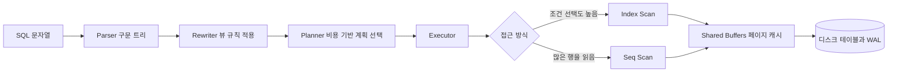

# PostgreSQL

## 한 줄 정의 {#definition}

PostgreSQL은 트랜잭션(ACID), 풍부한 인덱스 종류, JSON 타입, 재귀 쿼리, 확장(extension)을 지원하는 오픈소스 관계형 데이터베이스다.

**언제 쓰나**

- 서비스 DB처럼 정합성이 중요한 데이터를 저장하고 조인·트랜잭션이 필요할 때
- 작은~중간 규모 데이터 웨어하우스(Raw / Staging / Marts)를 SQL로 만들 때
- 정형 컬럼과 반정형 JSON(jsonb)을 한 테이블에서 함께 다룰 때
- 트리·계층 구조(조직도, 카테고리, 법령 조문 계층)를 재귀 쿼리로 조회할 때

## 핵심 개념 {#concepts}

| 용어 | 설명 |
|------|------|
| Schema | DB 안의 네임스페이스. `raw`, `staging`, `marts`처럼 계층별로 나눌 때 쓴다. |
| Transaction / ACID | 여러 쿼리를 하나로 묶어 전부 성공 또는 전부 취소. 적재 중간에 실패해도 반쯤 들어간 상태가 남지 않는다. |
| MVCC | 갱신 시 행을 덮어쓰지 않고 새 버전을 만든다. 읽기와 쓰기가 서로를 막지 않는 대신, 죽은 행을 정리하는 `VACUUM`이 필요하다. |
| Index | 조회를 빠르게 하는 별도 자료구조. 쓰기 때마다 갱신되므로 많을수록 쓰기가 느려진다. |
| EXPLAIN / EXPLAIN ANALYZE | 쿼리 실행 계획을 보여준다. `ANALYZE`를 붙이면 실제로 실행해 각 단계의 시간과 행 수를 보여준다. |
| CTE (`WITH`) | 쿼리 안에서 이름 붙인 임시 결과. `WITH RECURSIVE`로 재귀 조회가 된다. |
| jsonb | JSON을 파싱된 바이너리로 저장하는 타입. 키 조회 연산자(`->`, `->>`, `@>`)와 GIN 인덱스를 쓸 수 있다. |
| Upsert | `INSERT ... ON CONFLICT (키) DO UPDATE / DO NOTHING`. 있으면 갱신, 없으면 삽입. 멱등 적재의 기본 도구다. |
| Window function | `ROW_NUMBER()`, `LAG()` 등. 행을 줄이지 않고 그룹 안의 순서·이전 값을 계산한다. |

## 동작 원리 {#how-it-works}



1. **Planner**는 테이블 통계(`ANALYZE`로 수집)를 보고 Seq Scan, Index Scan, Bitmap Scan, 조인 방식(Nested Loop, Hash Join, Merge Join) 중 비용이 가장 낮은 계획을 고른다.
2. 조건이 전체 행의 아주 일부만 고르면 인덱스를 쓰고, 많은 행을 읽어야 하면 인덱스가 있어도 Seq Scan을 고른다. 이건 정상이다.
3. 변경은 먼저 WAL(Write-Ahead Log)에 기록된 뒤 데이터 파일에 반영된다. 장애 복구와 복제가 WAL 기반이다.

**EXPLAIN 읽는 법**

```sql
EXPLAIN ANALYZE
SELECT * FROM laws WHERE country = 'US' AND parent_id = 1024;
-- Index Scan using idx_laws_parent on laws (cost=0.42..8.44 rows=3) (actual time=0.03..0.05 rows=3 loops=1)
```

- `cost`는 추정 비용, `actual time`은 실제 시간(ms), `rows`는 추정 행 수와 실제 행 수다.
- 추정 rows와 실제 rows가 크게 다르면 통계가 오래된 것이다. `ANALYZE 테이블`을 돌린다.
- 큰 테이블에서 `Seq Scan`과 `Filter`로 대부분 행을 버리고 있으면 인덱스 후보다.

**재귀 CTE로 계층 조회**

```sql
-- 조문 1024 아래의 모든 하위 조문을 깊이와 함께 조회
WITH RECURSIVE tree AS (
    SELECT id, parent_id, title, 1 AS depth
    FROM laws WHERE id = 1024                 -- 시작점 (anchor)
    UNION ALL
    SELECT c.id, c.parent_id, c.title, t.depth + 1
    FROM laws c JOIN tree t ON c.parent_id = t.id   -- 한 단계씩 아래로
)
SELECT * FROM tree ORDER BY depth;
```

재귀 단계마다 `parent_id = ?` 조회가 반복되므로 `parent_id` 인덱스가 없으면 단계마다 전체 테이블을 훑는다. 재귀 쿼리와 인덱스는 같이 설계한다.

**jsonb와 upsert**

```sql
CREATE INDEX idx_raw_payload ON raw.user_events USING GIN (payload);
SELECT payload->>'user_id' FROM raw.user_events WHERE payload @> '{"event_type": "purchase"}';

INSERT INTO marts.dim_product (product_id, category, price)
VALUES ('p0045', 'book', 29000)
ON CONFLICT (product_id) DO UPDATE SET category = EXCLUDED.category, price = EXCLUDED.price;
```

## 내가 썼던 방식 {#my-usage}

- 해외 법령 적재 · DB 관리: 국가별 법령문 약 20,000건과 번역본을 서비스 DB에 적재·반영했고, 국가별 법령 계층 구조를 서비스 스키마에 맞췄다. 인덱스 설정과 재귀 쿼리로 법령 계층 조회 속도를 개선했다.
- 데이터 수집 API · ETL 파이프라인: 스크래핑 수집 → Airflow 일 증분 적재 → REST API 조회 흐름을 만들고 초기 데이터 약 50,000건을 수집·적재했다. 프로젝트 스택에 PostgreSQL이 포함되어 있다(테이블 설계 세부 기록은 없다).
- 외부 소스 수집 워크플로우 (서브 프로젝트): 소스별 수집 DB를 설계·정제했다(프로젝트 스택: PostgreSQL, MongoDB).
- User Behavior Data Warehouse: Postgres를 웨어하우스로 두고 Redshift 호환 SQL로 설계했다. Raw 스키마에 JSONL 로그를 jsonb로 적재 → Staging(타입 변환, null·정합성 체크) → Marts. dim_user는 SCD Type 2(`valid_from`, `valid_to`, `is_current`), dim_product는 upsert, fact는 event_id 기준 중복 방지로 멱등 적재했다. 품질 검사 SQL로 필수 컬럼 null, staging 대비 fact 적재 비율 90% 이상, 중복 event_id를 확인했다.
- DW 기반 이벤트 로그 ELT Pipeline: JSONL을 PostgreSQL Staging 테이블(`stg_users_raw`, `stg_events_raw`)로 로드한 뒤 SCD Type 2 `dim_user`와, 이벤트 발생 시점 기준으로 당시 회원 상태 키를 조인한 `fact_events`로 변환했다.
- Smart Factory Data Agent: PostgreSQL에 스키마와 샘플(모의) 데이터를 적재하고 SQLAlchemy로 접근했다. 자연어 질문을 안전한 SELECT 전용 SQL로 변환해 KPI를 조회했다.

SCD Type 2와 Dim/Fact 설계는 모델링 노트 참고.

## 장단점과 함정 {#pros-cons}

**장점**

- 표준 SQL 지원이 넓고, 인덱스 종류(B-tree, GIN, GiST, BRIN, Hash)가 다양하다.
- jsonb로 반정형 데이터를 받고, extension(pgvector, PostGIS 등)으로 기능을 넓힌다.
- 트랜잭션 안에서 테이블 생성·변경도 롤백된다.

**단점**

- 기본은 행 기반 저장이라 수십억 행 분석 집계는 컬럼형 DW(Redshift, BigQuery)보다 느리다.
- 쓰기 확장은 기본적으로 한 노드다. 수평 확장은 파티셔닝, 읽기 복제, 별도 도구(Citus)가 필요하다.
- MVCC 특성상 갱신·삭제가 많으면 테이블이 부풀고 VACUUM 관리가 필요하다.

!!! tip "함정"
    - 인덱스 컬럼에 함수를 씌우면(`WHERE lower(name) = ...`) 일반 인덱스를 못 쓴다. 표현식 인덱스를 만들거나 조건을 바꾼다.
    - 복합 인덱스 `(a, b)`는 `a` 조건이 있어야 효과가 있다. `b`만으로 찾으면 쓰이지 않는다.
    - `ON CONFLICT`는 대상 컬럼에 UNIQUE 제약이나 인덱스가 있어야 동작한다.
    - 재귀 CTE에 순환 데이터가 있으면 끝나지 않는다. 깊이 제한이나 방문 경로 체크를 둔다.
    - 대량 적재는 행 단위 INSERT보다 `COPY`가 훨씬 빠르다. 적재 중에는 인덱스를 나중에 만드는 것도 방법이다.

## 비교 {#comparison}

**인덱스 종류**

| 인덱스 | 구조 | 잘 맞는 조건 | 예시 |
|--------|------|--------------|------|
| B-tree | 정렬된 균형 트리 (기본값) | `=`, `<`, `>`, `BETWEEN`, `ORDER BY`, 접두어 `LIKE 'abc%'` | 기본 키, 외래 키, 날짜 범위 |
| GIN | 값 안의 원소(키, 단어)마다 행 목록을 가진 역색인 | jsonb `@>`, 배열 포함, 전문 검색 `tsvector` | jsonb 필드 검색, 태그 배열 |
| GiST | 범위·영역을 묶는 균형 트리, 겹침 판단 | 기하·범위 타입 겹침(`&&`), 최근접 탐색 | PostGIS 좌표, 기간 겹침 |
| BRIN | 블록 범위마다 최소·최대값만 저장 | 물리적으로 순서대로 쌓인 매우 큰 테이블의 범위 조건 | 시간순 적재 로그의 `event_time` |
| Hash | 해시 테이블 | `=`만 | 긴 문자열 동등 비교 |

BRIN은 인덱스 크기가 매우 작지만, 데이터가 컬럼 순서대로 저장돼 있을 때만 효과가 있다.

## 예상 질문 {#interview}

[예상질문 보기](../../interview/storage.md#postgresql)

## 더 보기 {#links}

- [PostgreSQL: Index Types](https://www.postgresql.org/docs/current/indexes-types.html)
- [PostgreSQL: Using EXPLAIN](https://www.postgresql.org/docs/current/using-explain.html)
- [PostgreSQL: WITH Queries (CTE)](https://www.postgresql.org/docs/current/queries-with.html)
- [PostgreSQL: JSON Types](https://www.postgresql.org/docs/current/datatype-json.html)
- [PostgreSQL: INSERT ON CONFLICT](https://www.postgresql.org/docs/current/sql-insert.html)
