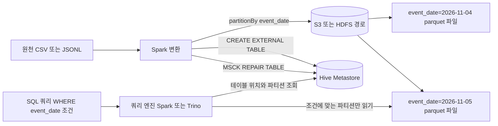

# S3 · Hive · Parquet

## 한 줄 정의 {#definition}

세 가지를 묶으면 데이터 레이크의 기본 구조가 된다.

- **S3**: 파일을 key로 저장하는 오브젝트 스토리지. 용량 제한 없이 싸고 내구성이 높다.
- **Parquet**: 컬럼 단위로 압축 저장하는 파일 포맷. 분석 쿼리에서 필요한 컬럼만 읽는다.
- **Hive (Metastore)**: "이 경로의 Parquet 파일들은 이런 컬럼을 가진 테이블이고, 이렇게 파티션되어 있다"는 메타데이터를 관리해 파일 묶음을 SQL 테이블처럼 쓰게 해 준다.

**언제 쓰나**

- 원천 데이터(Raw)와 가공 결과를 DB보다 싸게 오래 보관하고, Spark·Athena·Trino 같은 여러 엔진이 같은 데이터를 읽어야 할 때
- 날짜별로 계속 쌓이는 이벤트 로그를 파티션 단위로 저장하고 기간 조건으로 조회할 때

## 핵심 개념 {#concepts}

| 용어 | 설명 |
|------|------|
| Bucket / Object / Key | S3의 최상위 저장 공간 / 저장된 파일 하나 / 그 파일의 전체 이름. `s3://bucket/raw/events/dt=2026-11-05/part-0.parquet`에서 `raw/events/...`가 key다. |
| Prefix | key의 앞부분. S3에는 진짜 폴더가 없고, `/`로 구분된 prefix를 폴더처럼 보여줄 뿐이다. |
| Hive 스타일 파티션 | 경로에 `컬럼=값` 형태(`event_date=2026-11-05/`)를 넣는 규칙. 엔진이 경로만 보고 파티션 값을 안다. |
| Partition pruning | 쿼리 조건(`WHERE event_date = '2026-11-05'`)에 맞는 파티션 경로만 읽고 나머지는 건너뛰는 것. |
| Columnar format | 행 단위가 아니라 컬럼 단위로 값을 모아 저장. 같은 타입끼리 모여 압축이 잘 되고, 필요한 컬럼만 읽는다. |
| Row group / Column chunk | Parquet 파일 내부 단위. row group(행 묶음)마다 컬럼별 chunk가 있고, chunk마다 min·max 통계가 있다. |
| Predicate pushdown | 필터 조건을 파일 읽기 단계로 내려, min·max 통계로 조건에 안 맞는 row group을 아예 읽지 않는 것. |
| Hive Metastore | 테이블 이름, 컬럼, 파일 위치, 파티션 목록을 저장하는 카탈로그. Spark, Trino, Hive가 공유한다. AWS에서는 Glue Data Catalog가 같은 역할. |
| External table | 데이터 파일 위치(`LOCATION`)를 지정해 등록한 테이블. DROP 해도 메타데이터만 지워지고 파일은 남는다. |
| `MSCK REPAIR TABLE` | 경로에 새로 생긴 파티션 디렉터리를 스캔해 메타스토어에 등록하는 명령. `ALTER TABLE ... ADD PARTITION`으로 하나씩 등록할 수도 있다. |

## 동작 원리 {#how-it-works}



1. Spark가 원천을 읽어 변환한 뒤 `partitionBy("event_date")`로 날짜별 디렉터리에 Parquet를 쓴다.
2. external table을 한 번 등록해 두고, 새 파티션이 생길 때마다 메타스토어에 파티션을 추가한다.
3. 쿼리 엔진은 메타스토어에서 테이블 위치와 파티션 목록을 받아, WHERE 조건에 맞는 파티션 경로만 고른다(partition pruning).
4. 고른 Parquet 파일 안에서도 필요한 컬럼만 읽고(column pruning), row group 통계로 조건에 안 맞는 묶음을 건너뛴다(predicate pushdown).

```sql
CREATE EXTERNAL TABLE IF NOT EXISTS user_activity (
    event_time_kst TIMESTAMP,
    user_id        BIGINT,
    session_id     STRING
)
PARTITIONED BY (event_date STRING)
STORED AS PARQUET
LOCATION 's3a://bucket/warehouse/user_activity';

MSCK REPAIR TABLE user_activity;   -- 새 파티션 디렉터리 등록
```

**레이아웃 설계 요령**

- 파티션 키는 조회 조건에 자주 쓰이고 값 종류가 적당한 컬럼(날짜)을 쓴다. `user_id`처럼 값이 수백만 개인 컬럼은 파티션 키로 부적합하다.
- 파일 하나는 수백 MB 안팎이 좋다. 수 KB짜리 파일이 수만 개 생기면(small files problem) 목록 조회와 열기 비용이 처리 시간을 넘는다.
- 계층을 prefix로 나눈다: `raw/`, `staging/`, `marts/`. Raw는 원본 그대로 보관해 재처리 근거로 쓴다.

## 내가 썼던 방식 {#my-usage}

- Backpacker (개인, Spark 배치): 이커머스 이벤트 CSV를 Spark로 변환해 `event_date` 기준 파티션, Snappy 압축 Parquet로 저장했다. 저장 경로(`/app/data/warehouse/user_activity`)를 LOCATION으로 하는 Hive external table(`PARTITIONED BY (event_date)`, `STORED AS PARQUET`)을 만들고, 적재 후 `MSCK REPAIR TABLE`로 파티션을 등록한 뒤 이 테이블에서 WAU를 SQL로 계산했다. external table을 고른 이유는 Spark 배치가 Parquet를 직접 만들고 Hive는 메타데이터로 등록만 하며, 다른 도구(Presto, Athena 등)에서도 접근할 수 있게 하려는 것이었다. 날짜 파티션마다 `_SUCCESS` 마커를 확인해 완료된 날짜는 건너뛰고, Dynamic Partition Overwrite로 해당 파티션만 덮어썼다. (저장 위치는 S3가 아니라 로컬·컨테이너 볼륨 경로였다.)
- 데이터 수집 API · ETL 파이프라인: 프로젝트 스택에 S3가 포함되어 있다. 구체적인 버킷 구조나 포맷 기록은 없다.
- User Behavior Data Warehouse: Python 로그 생성기가 만든 Raw JSONL을 Raw 스키마에 jsonb로 적재했다.
- DW 기반 이벤트 로그 ELT Pipeline: 원본 유실을 막기 위해 이벤트를 DB로 바로 보내지 않고 `data/raw/` 아래에 타임스탬프가 붙은 JSONL 파일로 먼저 덤프한 뒤 Staging에 로드했다.

## 장단점과 함정 {#pros-cons}

**장점**

- 저장(S3)과 계산(Spark, Trino)이 분리되어 각자 따로 늘리고 줄일 수 있다.
- Parquet는 CSV 대비 크기가 작고, 분석 쿼리에서 읽는 양이 크게 줄어든다.
- 메타스토어 하나로 여러 엔진이 같은 테이블을 본다.

**단점**

- 파일 단위라 행 하나를 수정·삭제하기 어렵다. 파티션 단위로 다시 쓰는 것이 기본이다. 행 단위 갱신이 필요하면 Delta Lake, Iceberg, Hudi 같은 테이블 포맷을 얹는다.
- 파일이 생겨도 메타스토어에 등록하지 않으면 쿼리에서 안 보인다.
- 트랜잭션이 없어 쓰는 도중 읽으면 반쯤 쓰인 결과를 볼 수 있다.

!!! tip "함정"
    - 새 파티션을 쓰고 `MSCK REPAIR TABLE`이나 `ADD PARTITION`을 안 하면 데이터가 없는 것처럼 보인다.
    - 파티션을 너무 잘게(시간 + 사용자 등) 나누면 작은 파일이 폭증한다. 쓰기 전에 `repartition`이나 `coalesce`로 파일 수를 조절한다.
    - Spark의 `mode("overwrite")`는 기본적으로 테이블 경로 전체를 지운다. 날짜 파티션만 다시 쓰려면 dynamic partition overwrite를 켠다.
    - 파티션 컬럼에 함수를 씌워 조건을 걸면(`WHERE substr(event_date, 1, 7) = ...`) pruning이 안 될 수 있다.
    - 시간대를 섞으면 파티션 날짜가 하루씩 밀린다. UTC로 받은 시각을 어느 시간대 날짜로 파티션할지 먼저 정한다.

## 비교 {#comparison}

| 항목 | Parquet | CSV | JSONL |
|------|---------|-----|-------|
| 저장 방식 | 컬럼 단위, 바이너리 | 행 단위, 텍스트 | 행 단위, 줄마다 JSON 하나 |
| 스키마 | 파일에 타입까지 저장 | 없음 (헤더만, 타입은 추론) | 문서마다 자유, 중첩 가능 |
| 압축률 | 높음 (컬럼별 인코딩 + Snappy 등) | 낮음 | 낮음 (키 이름이 줄마다 반복) |
| 일부 컬럼 읽기 | 필요한 컬럼만 읽음 | 전체 행을 읽어야 함 | 전체 행을 읽어야 함 |
| predicate pushdown | row group 통계로 지원 | 없음 | 없음 |
| 사람이 바로 보기 | 불가 (도구 필요) | 쉬움 | 쉬움 |
| 이어 쓰기(append) | 파일 단위로만 | 줄 추가 쉬움 | 줄 추가 쉬움 |
| 잘 맞는 경우 | 분석용 저장, Staging·Marts | 작은 교환 파일, 엑셀 호환 | 로그·API 응답 원본 보관(Raw) |

흔한 조합은 Raw는 받은 그대로(JSONL, CSV) 보관하고, 정제 이후 계층은 Parquet로 바꿔 쓰는 것이다.

## 예상 질문 {#interview}

[예상질문 보기](../../interview/storage.md#s3-hive-parquet)

## 더 보기 {#links}

- [Amazon S3: Organizing objects using prefixes](https://docs.aws.amazon.com/AmazonS3/latest/userguide/using-prefixes.html)
- [Apache Parquet Documentation](https://parquet.apache.org/docs/)
- [Spark: Parquet Files](https://spark.apache.org/docs/latest/sql-data-sources-parquet.html)
- [Spark: Hive Tables](https://spark.apache.org/docs/latest/sql-data-sources-hive-tables.html)
